<!-- Generated from the live log page used during the session (logs/testlog/benchtop_log.html on the lab PC; logs/ is not in git). Narrative lab notes: docs/lab_notes_2026-11.md. -->

# Benchtop Test Log — MOT coil servo

2026-11-02 to 2026-11-13 · Tests 0–3 of the bring-up (docs/test_campaign.md), all at low power on the bench · Test 3 uses a small bench power supply (5 V, at most 3 A) instead of the big 100 A supply, settings profile `mot_bench`, and one temporary test coil (12 turns) · firmware rev 4 (commit 103a127) until the evening of 11-12, then rev 5 (commit 275081b)

## Words used in this log

- **Setpoint:** the current we ask for. **Controller:** the part of the firmware that compares the measured current with the setpoint and adjusts the output until they match ("closed loop"). "Open loop" means the output is set by hand and the controller is off.
- **OUT1:** the Red Pitaya output that drives the pass transistors, set in steps ("counts"). **IN1:** the measured coil current, from the current sensor (LEM). **IN2:** the setpoint from the control computer.
- **Pass transistors** (pass bank): six transistors that set how much current flows. **Bridge** (H-bridge): four switches that set which way the current flows through the coil. **Flip:** reversing that direction.
- **Arm:** the "you may run" signal. **Trip:** the automatic switch-off when the current is too high. **Safety board:** cuts the bridge off if the Red Pitaya's heartbeat signal stops, and stays cut off until its reset button is pressed.
- **Red Pitaya pins:** DIO0 = bridge direction, DIO1 = bridge on/off, DIO3 = flip signal, DIO4 = arm signal, DIO6 = heartbeat. **Firmware:** the program in the Red Pitaya's chip that runs the controller.

## Status

| Test | What we checked | Status | Result in one line |
|---|---|---|---|
| 0 Pre-checks (11-02 to 11-11) | Each part works on its own before any current flows | [passed] | A missing wire on the safety board found and added; one firmware problem (output jump when switching modes) fixed |
| 1 Gate stage (11-11) | OUT1 drives the six pass transistors correctly, without oscillating, and switches them off if power is lost | [passed] | Amplifier supply wiring fixed; amplifier gain 7.93; a 50 Ω terminator added on OUT1 |
| 2 Current sensor and zero (11-11) | The current reading is zero when no current flows | [passed] | Three wiring faults on the sensor's amplifier board fixed; the small remaining offset is calibrated out |
| 3 day 1: first current (11-11) | Sign of the reading, grounding, how the transistors behave at small currents | [done] | Sensor turned round; bench supplies must not be connected to earth; reading about 10 % low (calibrated on day 2) |
| 3 day 2 start (11-12) | Load the firmware and bench settings, zero the sensor | [done] | Loading firmware trips the safety board: press its reset after every load |
| 3c Current scale | The board reads amps correctly | [done] | Calibrated against the supply's ammeter: full scale 224 A, 27.3 mA per measurement step |
| 3d Controller settings | Fast and stable current control | [done] | Set at half the strength where it starts to oscillate; bench limit lowered to 2.2 A |
| 3e Over-current trip | The current limit | [passed] | Trips at 2.85 A (set 2.79 A), before the supply's own 3 A limit |
| 3f Switch-off | Where the coil's current goes when the transistors switch off, and how fast it dies away | [done] | It circulates through the bridge's built-in diodes and dies away by itself, as designed |
| 3g Flips and reversals | Reversing the current safely and quickly, the way the control computer will | [passed, open finding] | All 32 reversals worked, 1–1.4 ms each; change the setpoint sign first, then flip |
| 3h Safety-board cut-off | The hardware cut-off while current flows | [passed] | Bridge opens at once, current gone in ≈ 10 µs; supply voltage jumps 2.5–3.2 V for ≈ 10 µs |
| 3i Steadiness of a held current | Is the current steady enough (goal 0.1 %)? | [done, open finding] | Average steady to 0.01 %; a 10–20 kHz ringing (±0.15 A) found, not caused by the controller |
| Extra checks | Settings over the whole bench range, a 10-minute hold, 20 flips | [passed] | No trips; 10-minute hold steady within 0.5 mA; 20 of 20 flips |
| 3j Heating without cooling water | How long it may run without water | [moved] | Moved to the 100 A test (the bench only reaches 15 W) |
| Damper | Does a resistor + capacitor across the coil stop the ringing? | [passed] | Yes: ringing 43–124 mA → 2.5–5 mA |
| Sensor moved inside the coil loop (11-12, late) | Is current still flowing after a switch-off that the sensor could not see? | [done, open finding] | 2 A → 0 in ≈ 170 µs; an unexplained 5 A surge, caught by the over-current trip; switch-off has a slow ≈ 1 ms tail |
| Rev 5: zero snap (11-12, evening) | Remove the slow switch-off tail | [passed] | New firmware: 2 A falls to 2 % in 0.14 ms instead of 1.55 ms |
| Day 3: checks before the control computer (11-13) | Everything that can be tested without the control computer | [passed, one fix made] | All cases end safely; 50 of 50 repeated sequences; a settings bug in the PC software found and fixed |
| New firmware: snap in flips and stops (11-13) | Remove the pause near 0.4 A when the flip comes first | [passed] | Every reversal ordering and every stop reaches zero in ≈ 140 µs (before: up to 380 µs); firmware 583e877 |
| Zero-current noise reference (11-13) | Which tones are real current | [done] | Most tones are measurement; 200–400 kHz lines grow with load current but are pickup, not current |
| Fastest full reversal (11-13) | How fast can the current go from +2 A to −2 A? | [passed] | 0.81 ms to within ±2 % (0.95 ms with the current settings); after zero, the controller's rise is the limit |
| Day 4: bench characterization (11-13) | Everything about the bench setup that can be measured: stability, long holds, zero drift, 1000 shots, the transistors, the trip; plus simulations for 100 A | [done, open findings] | All good on the bench; the old 5.18 V gate ceiling might not have reached 100 A, so the amplifier supply was raised to 12 V; switch-offs put short spikes on the current reading |

## Test 0 · Each part on its own (11-02 to 11-11) [passed]

**Why.** Before any current flows, every part is checked by itself: the transistors are matched, the Red Pitaya runs the firmware and talks to the lab PC, the safety board cuts the bridge off when it should and stays cut off, the controller works on a plain cable, and the bridge switches correctly when driven by hand.

### 0a · Transistor thresholds (11-02)

**How.** For each transistor we measured with a meter the gate voltage at which it starts to conduct (its threshold), 10 of each type.

**Result:** pass transistors 3.35–3.56 V; the six installed are within 0.06 V of each other, so they share the current to within about 12 % at 100 A. Bridge transistors 3.51–3.59 V; the four installed are within 0.01 V.

### 0b · Safety board on the Red Pitaya, old firmware (11-03)

**How.** Safety board wired to the Red Pitaya's connector E1, power stage switched off, the August firmware. The check program run from the lab PC, then the light test: green = heartbeat OK, amber = bridge allowed on, red = cut off.

**Finding:** after a restart the Red Pitaya had neither the firmware nor its communication program running, so the check failed. Both were loaded by hand; the PC tools now notice this and print the command that fixes it.

**Result:** heartbeat running, lights correct, servo idle, nothing switched on. With no current it read +0.18 A (the Red Pitaya's own input offset).

**Timer:** the timer that decides "the heartbeat has stopped" ran out after only 1.1 ms, about one heartbeat period, which is too short. With a 220 kΩ resistor and 100 nF capacitor it now cuts off ≈ 7.6 ms after the last heartbeat.

**Noted:** the old firmware started as soon as the arm signal was on. The new firmware needs arm to switch on *after* the servo is enabled, so the order is: enable, then arm.

### 0c · First load of the new firmware (11-11)

**How.** Red Pitaya only, arm off, nothing on the inputs. Loaded the firmware, then ran the check program.

**Result:** loaded in 69 ms; safe state confirmed (idle, output 0, bridge off, not armed); all 32 settings written and read back correctly; reads +0.19 A with no current (the input offset).

### 0d · Safety-board test with the new firmware (11-11)

**How.** Power stage off. Arm jumper on E1 pin 11; the heartbeat wire (DIO6) pulled out and plugged back by hand; lights and the status display read at every step.

| Step | What we did | Expected | Seen |
|---|---|---|---|
| 1 | Arm jumper in *before* enabling the servo | stays idle, amber off (arm must switch on after enabling) | ✓ |
| 2 | Unplug and re-plug arm | running, amber on | ✓ |
| 3 | Pull the heartbeat wire (DIO6) | green off, amber off, **red on** | red stayed off ✗ → fixed, then ✓ |
| 4 | Plug the heartbeat back in | green on, red stays on, amber stays off | ✓ after the fix |
| 5 | Stop the servo, then press reset | red off, amber stays off | ✓ |
| 6 | Enable and arm; then stop | running, then idle | ✓ |

**Fault found: the cut-off did not stay cut off.** Pulling the heartbeat switched the bridge off, but plugging it back switched the bridge on again by itself. A meter showed the timer chip's output (CD74HC123 pin 4) was fine, but the wire to the latch chip (74HC74 pin 3) was missing altogether, probably loose since 11-03. Wire added; test passed.

**Weak point (open):** the cut-off is triggered by the *moment* the heartbeat stops, not by its absence. If reset is pressed while the heartbeat is still missing, the cut-off clears and does not trigger again when the heartbeat returns. Until this is changed: **press reset only with the green light on, and only after stopping the servo** (taking arm away does not stop a running servo).

### 0e · Controller test on a cable (11-11)

**Why.** Check the controller, the scaling and the over-current trip on a plain cable before connecting real hardware.

**How.** OUT1 connected straight back to IN1 with a cable, so the "coil" is just a wire; safety board connected; no power stage. Fixed output values first, then held setpoints, then a setpoint above the trip level.

**Results:** output-to-input ratio 2.026 (August: 2.03); the controller holds the setpoint to within 1–2 steps at "20 A" and "50 A"; a "110 A" setpoint trips the board, the bridge signal drops, and acknowledging + stopping returns it to idle.

**Finding — a jump when switching modes:** while the output was set by hand (open loop), the controller kept adding up its error in the background, so switching back to automatic control made the output jump and tripped the board. On the real coil that would be a jump toward 100 A. Fixed the same day in the PC tools and in firmware rev 4 (the controller is held at zero while the output is set by hand).

### 0f · Bridge and current sensor driven by hand (colleague, reported 11-11)

**How.** Bridge alone, safety board not connected; the bridge's switch drivers on their own isolated supplies, switched by hand; 5 V bench supply. First a resistor as the load, then the coil with the current sensor.

**Results:** no short-circuit through the bridge; one loose gate connection found and fixed (Q4); with the resistor the output is +5 V, −5 V or 0 V as expected; 1.12 A through the coil in each direction, reversal correct.

**Finding:** the sensor seemed to read −5.8 A with no current. Test 2 showed this was wiring on the sensor's amplifier board, not the sensor. It also led to the zero-offset correction added in firmware rev 4.

## Test 1 · Gate stage (11-11) [passed]

**Why.** OUT1 goes through an amplifier (OPA994, gain ≈ 8) to the gates of the six pass transistors; the gate voltage sets how much current flows. Before any high current we check that the amplifier works as designed, does not oscillate, and switches the transistors off if it loses power.

**How.** Amplifier board on its own 5.18 V bench supply; OUT1 also to scope CH1; probes on the gates of pass transistors #4, #1 and #10; no power on the high-current side. OUT1 stepped from 0 to 4474 steps by hand.

*Without a terminator OUT1 swings 2.34× more than specified, and the gates reach the amplifier's maximum (its supply voltage) at about 2550 steps. With the 50 Ω terminator the whole range stays below it.*

*When the amplifier's supply is switched off, all gates fall together, below 0.5 V within ≈ 8.5 ms: the transistors switch off safely.*

**Wiring fault found first:** the gates stayed at 0 V because the amplifier's supply was not connected to the transistors' common reference point (the source bar). Fixed; the amplifier's supply is not connected to earth.

**Results:** amplifier gain 7.93 (design 7.98); highest possible gate voltage 5.18 V (the amplifier's supply); no oscillation (only 4–6 mV of pickup from the Red Pitaya's clock); safe when power is lost.

**Test 1b, 50 Ω terminator on OUT1:** 142.6 µV per step (1.168 V at full scale, 17 % above the nominal 1 V), −41.3 mV at zero. These values are now in the settings file (`out1_fs_volts` 1.168, `out1_offset_volts` −0.0413, `gain_opamp` 7.93, `V_opamp_max` 5.18). The terminator stays fitted.

## Test 2 · Current sensor and zero (11-11) [passed]

**Why.** The current is measured by a sensor around the coil lead (LEM). Its small signal goes through a 10 Ω resistor and an amplifier (AD8421) into IN1. Before this reading is trusted for the over-current trip, and for deciding when the current is close enough to zero to flip, it must read zero when no current flows.

**How.** Sensor powered, no current anywhere, the amplifier output also on the scope; IN2 closed with a 50 Ω terminator. Then the zero program measured and stored the offsets.

| Fault found | What it did | Fix |
|---|---|---|
| The amplifier's reference pin (pin 6) not connected to ground | IN1 stuck at full scale | Connected straight to ground |
| Solder bridge between pins 2 and 3 | Output stuck or oscillating | Removed |
| A 47 kΩ resistor where 49.9 Ω was meant | Would read 4.5–9 % low and slow the signal down | Replaced |

**Result:** the "−5.8 A offset" seen earlier was these wiring faults, not the sensor. Repaired, the amplifier reads −0.2 mV (≈ −0.04 A). Calibration: IN1 +8.6 steps (≈ +0.21 A, mostly the Red Pitaya's own input), IN2 +6.3 steps. Afterwards the board reads −0.06 A with no current.

**Noted:** the amplifier's two inputs are swapped compared with the drawing, which only flips the sign (fixed in Test 3 by turning the sensor round). Drawing to correct: reference pin straight to ground; capacitors from the supply pins to ground.

## Test 3, day 1 · First current (11-11) [done]

**Why.** First current through the coil, from a bench supply that cannot give more than 3 A. We check the sign of the reading, the grounding, the current scale, and how the pass transistors behave at these small currents.

**How.** Bench supply at 5.0 V with a 3 A limit instead of the big supply. OUT1 stepped by hand across the range where the transistors start to conduct; held values compared with the supply's ammeter and the scope.

*The transistors start to conduct at about 3540 steps (gate ≈ 3.65 V), and the current grows roughly with the square. The amps in this plot were measured before the grounding fix and read about 2× low; where it starts and its shape are right.*

**Wrong sign:** the first scan read a growing negative current and stopped itself. Fixed by turning the sensor round.

**The bench supplies must not be connected to earth.** With their earth links in, part of the coil current flowed back through earth and the scope cables: IN1 read about half the real value with the wrong sign on the scope, and the bridge dropped out. With all supplies floating (the only earth connection through the scope) the board, the scope and the supply's ammeter agree.

**IN1 reads about 10 % low,** because the firmware uses the raw measurement without the Red Pitaya's factory calibration. Provisional correction 1.10, refined to 1.12 on day 2.

**The transistors are weak at small currents:** about 8 mA per OUT1 step at 1–2 A, against 136 mA per step expected at 100 A. They also conduct more as they warm up (3990 steps tripped at 2.8 A once warm, which also showed the trip working). The bench lower limit (3450 steps) and upper limit (4100 steps) were set from this.

## Setup for Test 3, day 2 (11-12)

### Power and wiring

- Bench supply 5 V, 3 A limit, **not connected to earth** (the only earth is through the scope).
- One temporary test coil: 12 turns of 4 × 2 mm hollow copper, a 70 × 210 mm racetrack, lifted 13–15 cm off the optical table from 3f on.
- OUT1 → 50 Ω terminator → amplifier (gain 7.93) → six pass transistors.
- The arm and flip signals sent from the PC software instead of wires (arm jumper out).

### Scope (Rigol DHO914 "test", plain BNC cables)

- CH1: IN1 (5 mV per amp).
- CH2: the drain bar (where the pass transistors join the bridge) in 3f; DIO1 (bridge on/off) in 3g.
- CH3: bridge node A (one end of the coil).
- CH4: DIO1, then a pass-transistor gate (3f), then DIO0 (bridge direction, 3g).

## Test 3, day 2 · Start-up [done]

**How.** Loaded the firmware and the bench settings, checked them (LED 7 lit), and measured the zero offsets with no current.

Offsets: IN1 +0.256 A, IN2 +0.157 A, the same as day 1 within one measurement step.

**Finding:** the first test gave no current and no amber light. Loading the firmware pauses the heartbeat for a moment, so the safety board cuts off. **Press the safety board's reset after every firmware load** (servo stopped, green light on).

## 3c · Current scale [done]

**Why.** The board must read amps correctly. Day 1 showed IN1 reading about 10 % low.

**How.** Held 2 A for 60 s and compared the board's reading with the bench supply's ammeter (taken as the reference) and with the scope on IN1.

| Board | Supply's ammeter | Scope on IN1 | OUT1 setting |
|---|---|---|---|
| 1.988 A | 2.02–2.03 A | 2.086 A (about 3 % high) | 3942 steps, steady |

**Result:** the scale setting (`in1_fs_volts`, the IN1 voltage at the top of the range) changed from 1.10 to **1.12 V** (nominal 1.0). So full scale is 224 A and one measurement step is 27.3 mA. This agrees with day 1's first ammeter estimate (1.118).

## 3d · Controller settings [done]

**Why.** The controller compares the measured current with the setpoint and adjusts OUT1. Two settings decide how strongly it reacts: kp (to the present difference) and ki (to the difference added up over time). Too weak and it is slow; too strong and it oscillates. The values from the cable test don't suit the real transistors, which give only 8 mA per step at these currents.

**How.** Repeated steps from 0 to 1 A, recorded by the board (one sample per µs for 16.8 ms). We started at a quarter of the calculated settings and doubled both while the step stayed clean.

| kp (steps per A) | ki (steps per A per ms) | Time to 90 % | Time to 98 % | Noise while holding | Verdict |
|---|---|---|---|---|---|
| 15.6 | 471 | 1.41 ms | 1.85 ms | 40 mA | clean, slow |
| **31.2** | **942** | 0.73 ms | 1.04 ms | 40 mA | **chosen** |
| 62.4 | 1884 | 0.38 ms | 0.53 ms | 86 mA | oscillates at 21 kHz |
| 31.2 (step to 2 A) | 942 | 0.45 ms | 0.65 ms | 54 mA | clean, 1 % overshoot |

*Each doubling makes the rise faster; the strongest setting oscillates while holding.*

*Which frequencies are in the held current. At ×4 a sharp tone at 21 kHz appears: the controller is at the edge of oscillating. The band near 290 kHz is measurement noise.*

*The transistors get stronger as the current rises, so the safety margin is smallest at the top of the range. Still clean at 2 A.*

**Result:** the settings are at half the strength where it oscillates (a safety factor of 2). They are for the bench only: at 100 A the transistors give about 17× more current per step, so the real coils need their own tuning.

**Open point (found in 3h):** a single jump from 0 to 2.5 A went past the 2.79 A trip level. Two possible causes:

1. The transistors are stronger at 2.5 A, so the same settings push harder; 2.5 A is only 0.29 A below the trip.
2. The coil was lifted off the table then, and it was ringing by itself at about 12 kHz with ±0.12 A (see 3i). That alone uses up much of the 0.29 A margin.

**Closed:** repeated with the coil on the table, the 2.5 A step did not trip: 2.8 % overshoot, 98 % reached in 0.59 ms. The ringing was there too, and 28 single samples went above 2.79 A (a trip needs 4 in a row). So the settings are fine, and the near-trips come from the ringing on top of a small margin. **The bench limit was lowered from 2.5 to 2.2 A.**

*At 2 A the current approaches its target from below; at 2.5 A it keeps rising toward the trip level, and the trip ends the run at about 0.6 ms.*

## 3e · Over-current trip [passed]

**Why.** In this first version, the firmware's over-current trip is the current limit. If IN1 reads above the trip level for 4 samples in a row, the outputs go to zero, the coil's current dies away, the bridge opens, and the board stays tripped until someone acknowledges it.

**How.** Asked for 2.9 A (the bench limit was raised to 2.9 A for this test only). The trip was set to 2.79 A, 0.21 A below the supply's 3 A limit, so the trip should act first. Then acknowledged, stopped, and the limit put back.

*The current rises toward 2.9 A, trips at about 2.85 A and dies away in about 225 µs. The spikes at the trip are electrical pickup, not real current.*

**Result:** tripped, bridge open, and the supply never reached its own limit (its current-limit light stayed off). Acknowledged and back to idle without switching anything off.

## 3f · Switch-off: where the current goes [done]

**Why.** When the transistors switch off with the bridge still closed, the coil keeps its current flowing round inside the bridge, through the transistors' built-in diodes, and the current dies away by itself. The drain bar should then sit at about the supply voltage plus one diode drop (≈ 0.6 V). The alternative is that the current goes into the surge protector (a TVS diode), which would show about 13 V. In 3e the current took 225 µs to reach zero, about 7× slower than expected (30 µs).

**How.** Held about 1.5 A with OUT1 fixed (3900 steps), then set OUT1 to 0 at once. Scope CH4 on a transistor gate, to see whether the transistors themselves switch off slowly.

*The gate falls in about 4 µs, so the transistors switch off fast. The drain bar jumps to about 5.9 V (briefly ringing up to 7.4 V) and stays there exactly as long as current flows. The current falls in a straight line.*

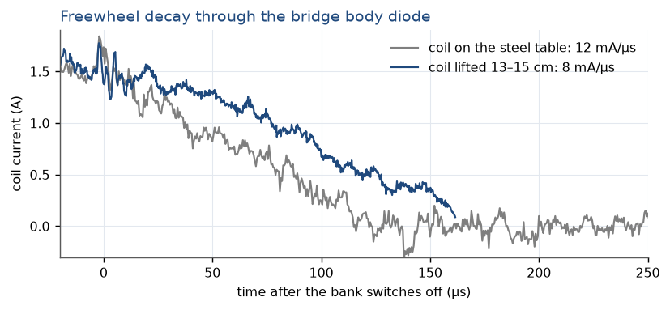

*Lifting the coil off the steel table made the current die away more slowly, not faster: currents induced in the table had been taking away part of the energy.*

**Result:** the current dies away through the bridge's built-in diodes, as designed; the surge protector is never reached; the transistors are not why it is slow.

**Why it is slow:** the test coil has 12 turns, so its inductance is about 45 µH (calculated from its shape), not the 9 µH assumed. The current falls at (voltage across the coil) ÷ (inductance): 8.1 mA/µs × 45 µH ≈ 0.37 V, a normal diode voltage at 1 A. The MOT coils' 16 µH is not affected.

**Side finding:** warm transistors at the bench lower limit let through only a little current: 45–60 mA at 3450 steps, 66–76 mA at 3500, 98–117 mA at 3550.

**Not measured:** the voltage directly across the coil (the other coil end was not probed then), so 45 µH is calculated, not measured.

## 3g · Flips and reversals (11-12, 11-13) [passed, open finding]

**Why.** In the experiment the control computer reverses the coil current by sending a flip signal (DIO3) and changing its setpoint from +I to −I. The board then has to bring the current to zero, switch the bridge off, change the bridge's direction, and switch it back on. While the direction changes, all four bridge switches must be off for a moment; otherwise the supply would be short-circuited. This test checks that the whole reversal works as one sequence.

**How.** The current was made to reverse from +2 A to −2 A and back. The control computer isn't connected yet, so the arm signal ("you may run") and the flip signal were sent from software instead. Arm had to stay on the whole time, because the board ignores flip signals when arm is off.

- **On 11-12, with the scope:** the short gap during which all four bridge switches are off, measured at the Red Pitaya pins (CH2 = DIO1, bridge on/off; CH4 = DIO0, bridge direction).
- **On 11-13, with the board's own recording** (one sample per µs for 16.8 ms): complete reversals. A reversal needs two things, the flip signal and the new setpoint, so we tried them in three orders: **A** both at the same moment; **B** setpoint changed first, flip 0.5 ms later; **C** flip first, setpoint changed 0.2 ms later. Also "setpoint first, then flip" at several delays, and some awkward cases (flipping with no current, flipping while the current is still rising, two flip signals close together).

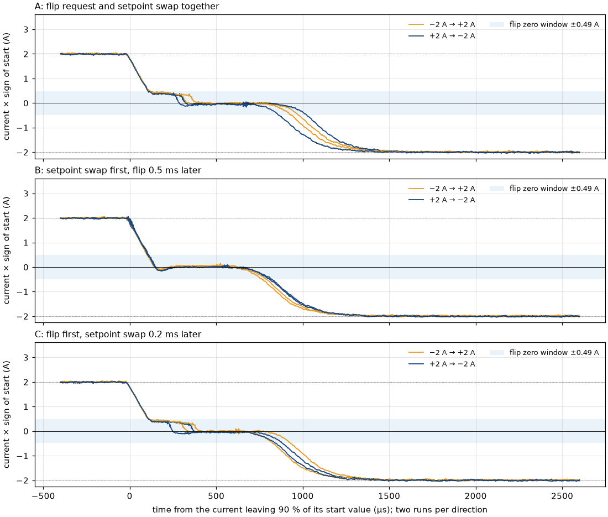

*The current multiplied by its starting sign, so every run starts at +2 and ends at −2. All 12 reversals complete. In A and C the current pauses at about 0.4 A for 150–250 µs until the bridge opens; in B it goes straight to zero.*

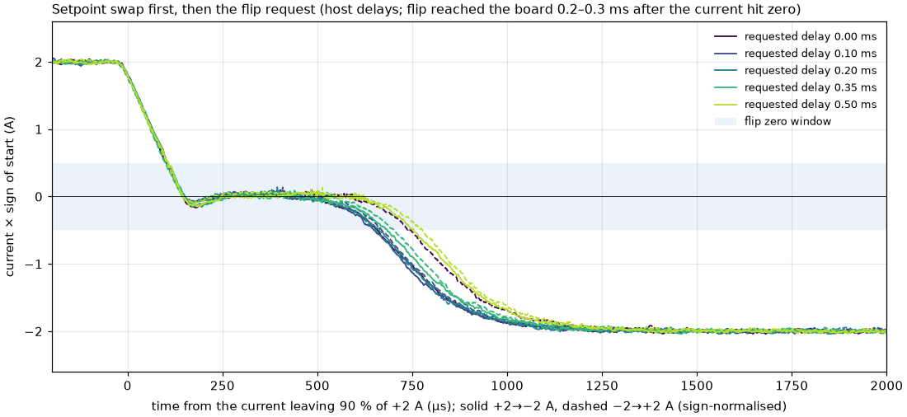

*The order the control computer should use: change the setpoint sign, then send the flip. 20 of 20 good at every delay; the current goes straight to zero, and the new current rises as soon as the flip reaches the board.*

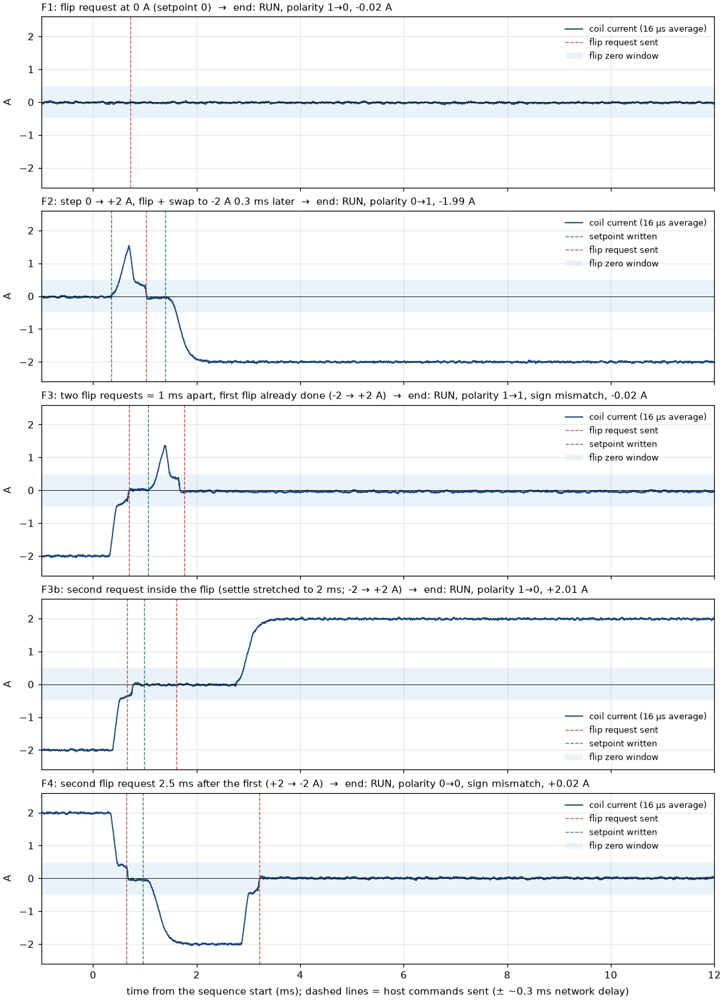

*Unusual cases. F1: a flip with no current just changes direction. F2: a flip while the current is still rising works. F3/F4: a second flip signal after the first flip has finished flips back again; the setpoint sign is then wrong for the direction, so the board holds zero current (safe). F3b: a second flip signal during a flip is ignored, not saved for later.*

*DIO1 (bridge on/off) goes off 1.02–1.04 µs before DIO0 (direction) changes, and comes back on 0.98–1.02 µs after: the safety gap, as set.*

| Order (±2 A) | Fall from 90 % to zero | From leaving 2 A to steady at the new value (within ±2 %) |
|---|---|---|
| A: flip and setpoint together | 338 µs | 1.37 ms |
| B: setpoint first, flip 0.5 ms later | **146 µs** | **1.22 ms** |
| C: flip first, setpoint 0.2 ms later | 343 µs | 1.29 ms |

**Safety gap (11-12):** the bridge is switched off 1.02–1.04 µs before the direction changes and back on 0.98–1.02 µs after, as set. Still to check: the same gap at the bridge switches themselves (needs a special floating probe).

**Reversals (11-13):** all 12 in the three orders and all 20 "setpoint first" worked: every one ended at the new current with the bridge in the right direction, no faults, overshoot only 25–38 mA (noise level). The new current reaches 90 % 0.8–0.95 ms after the old one starts to fall.

**Why "setpoint first" is fastest:** a setpoint of the opposite sign makes the controller's error twice as big (−4 A instead of −2 A), so it switches the transistors off about twice as fast.

**Rules for the control computer:** change the setpoint sign first, then send **one** flip signal per reversal. A second signal during a flip is ignored; a second signal after it flips back again.

**Open finding:** the rev 5 "zero snap" (switch the transistors fully off when the setpoint is zero; see Rev 5 below) does not act during a flip, because the board brings the setpoint to zero by itself there. The flip still finishes quickly, because the bridge opens once the current is within ±0.49 A, but orders A and C show a short pause at about 0.4 A for 150–250 µs. **Decide before 100 A:** make the snap act during flips and stops too, or rely on the "setpoint first" rule.

**Side findings:** if the safety board is still cut off after a firmware load, the board goes through a flip with no current flowing (another reason to reset after every load). The dashboard's software arm button gives only a short arm pulse, so flips after it are ignored; it needs a "hold arm" option for bench tests.

## 3h · Safety-board cut-off while current flows [passed]

**Why.** The safety board is the only automatic hardware cut-off. When it opens the bridge while current flows, the coil's stored energy (≈ 90 µJ at 2 A here) has to go somewhere: back into the power supply. With the big 100 A supply the same event returns about 0.08 J, and whether that over-voltages the supply is an open question.

**How.** Held 2 A (2.5 A tripped first, see 3d), the scope set to trigger when the drain bar falls, then pulled the heartbeat wire DIO6 (E1 pin 15). The test program stopped the servo as soon as it saw the current collapse. Recovery: servo stopped, heartbeat wire back in, wait for green, press reset.

*With all four bridge switches off, the coil pushes its current back into the supply through three of the built-in diodes (the drain bar goes to about −0.5 V). Afterwards one end of the coil (node A) rings at about 170 kHz. The supply-voltage trace (CH4, showing only changes) is cut off at +0.87 V by the scope's range.*

**Result:** the bridge opened the moment the wire was pulled; 2 A → 0 in about 10–13 µs, as expected for about 6.7 V across 45 µH.

**As predicted:** with the bridge open the controller saw zero current and turned OUT1 up to its maximum (4100 steps) until the program stopped it. That is why the servo must be stopped before pressing the reset.

**Supply voltage, first recording:** off the scope's range at +0.87 V, so repeated with a coarser range over 200 µs:

*Repeat at 2 A. The supply voltage jumps by +2.5 V (up to +3.2 V in single samples) for about 10 µs while the coil pushes current back into the supply, then stays about 0.85 V higher.*

**The jump of +2.5 to +3.2 V for about 10 µs** comes from the returning current flowing through the inductance of the supply's cables. This previews the open question for the big supply; the real numbers need the 100 A setup.

**The 0.85 V that stays higher** is mostly not stored energy. About half of it is the cables' resistance: at 2 A the voltage at the bridge is 0.41 V lower than at the supply (≈ 0.2 Ω of cables and contacts, measured in 3i), and that comes back when the current stops. The other half is not explained yet (possibly the supply's own response to losing its load).

## 3i · How steady is a held current? [done, open finding]

**Why.** The goal is a current steady to 0.1 %. One OUT1 step changes the current by 8–140 mA, so the firmware has an option ("dither") that flicks the output up and down by one step very fast, so that the average falls between steps. This test compares holding 2 A with dither on and off.

**How.** Held 2 A; took four recordings of 16.8 ms (one sample per µs) and 4 s of slower readings, with dither on, then off. Also read the supply voltage at 2 A and at zero.

| Run (coil lifted) | Noise in single samples | Noise in 0.1 ms averages | Frequencies present |
|---|---|---|---|
| Dither on, chosen settings | 165 mA | 15 mA | a strong tone at 11 kHz |
| Dither off, chosen settings | 164 mA | 15 mA | the same tone |
| Dither on, half-strength settings | 162 mA | 11 mA | the same tone, same size |

The noise was 4× higher than in the morning (40–54 mA), so its cause was tracked down:

| OUT1 fixed at 3935 steps (≈ 1.93 A) | Current at 10–12 kHz | Drain bar at 12 kHz | Gate at 12 kHz |
|---|---|---|---|
| Coil lifted | ±116 mA | ±467 mV | ±0.1 mV |
| Coil on the table | ±31 mA | ±67 mV | ±0.1 mV |
| Coil lifted, varistor removed | ±165 mA | ±494 mV | — |

**Finding:** the ringing does not come from the controller (it is the same at half strength and with the controller off) and not from the amplifier (the gate does not move at 12 kHz).

**Ruled out — a capacitor across the coil:** there is none on the bridge. The only part across the coil was a varistor (a surge protector, Digi-Key 495-6502-ND), and removing it changed nothing.

**Ruled out — the drain voltage reaching back to the gates:** CH4 on a transistor gate stays steady to ±0.1 mV during the ringing.

**Nothing goes around the transistors:** the wobble of the supply voltage matches the cables' resistance and inductance (0.17 Ω, 3.6 µH) times the oscillating current. So the supply, the transistors and the coil all carry the same oscillating current while the gate stays fixed: the transistors change their current by themselves, probably because of their drain voltage or their temperature.

| OUT1 fixed, coil lifted | Current | Ringing frequency | Current swing | Drain swing (peak to peak) |
|---|---|---|---|---|
| 3800 steps | 0.71 A | 20 kHz | ±0.08 A | 1.64 V |
| 3870 steps | 1.23 A | 15 kHz | ±0.11 A | 1.64 V |
| 3935 steps | 1.93 A | 11.5 kHz | ±0.15 A | ≈ 1.6 V |

*Coil lifted: one sharp tone that moves lower as the current rises. On the table at 1.93 A: no tone.*

**Pattern:** the frequency falls as the current rises (frequency × √current ≈ 16–17), and the drain always swings about 1.6 V peak to peak: the ringing grows until the bridge's diode stops it.

**Coil on the table, controller on, 2 A (later):** the tone came back at 13.6 kHz, 110 mA, so the table only just stops it.

**Dither:** no difference (110 / 110 mA; 0.1 ms averages 20.6 / 19.9 mA). That is expected on the bench, where one step is only 8 mA; the real test of dither is at 100 A (≈ 140 mA per step).

**Average current:** the averages of the four recordings agree within ±0.2 mA (0.01 %), well inside the 0.1 % goal.

**Why it matters:** a similar ringing on the MOT coils would put a field ripple of a few percent at 10–20 kHz, far too fast for the controller to correct. It was fixed on the bench with a damper (below); its cause is still not understood.

**Supply voltage:** 5.06 V with no current, 4.65 V at 2 A: the cables and contacts lose 0.41 V (≈ 0.2 Ω), about half of the 0.85 V seen in 3h.

## Extra checks (second session) [done]

**Why.** While the damper was being soldered: check the controller settings over the whole bench range, how steady a long hold is, and how reliable flips are. Coil flat on the table, limit 2.2 A. Run by a second Claude session.

| Step | Time to 10 / 90 / 98 % | Overshoot (0.064 ms averages) | Noise while holding (single samples) |
|---|---|---|---|
| 0 → 0.5 A | 0.18 / 1.08 / 1.36 ms | +37 mA | 69 mA |
| 0 → 1.0 A | 0.08 / 0.72 / 0.95 ms | +25 mA | 64 mA |
| 0 → 1.5 A | 0.12 / 0.55 / 0.70 ms | +30 mA | 74 mA |
| 0 → 2.0 A | 0.10 / 0.46 / 0.62 ms | +28 mA | 85 mA, a faint 13.8 kHz tone |
| 0 → 2.2 A | 0.08 / 0.44 / 0.63 ms | +41 mA | 83 mA, no sample above the trip level |
| 2.2 → 1.0 A | 0.01 / 0.24 / 0.34 ms | 27 mA past the target | 63 mA |
| 1.0 → 0 A | 0.01 / 0.68 / 1.22 ms | 32 mA past the target | ends at 18 mA (transistor leakage) |
| 2.0 → 0 A | 0.02 / 0.47 / 1.49 ms | 40 mA past the target | ends at 14 mA |

*Steps up get faster at higher current (the transistors get stronger); the 0.5 A step is the slowest. Steps down fall fast at first, then approach the target as the controller winds down.*

*Each point scatters by 6.1 mA, which is just its measurement uncertainty, so no drift is visible; after the first minute the averages agree within 0.5 mA. Over the same 10 minutes the controller lowered OUT1 by 21 steps: the transistors warm up and conduct more, and the controller compensated (about 0.2 A of drift removed).*

**Steps:** overshoot is at the noise level everywhere (25–41 mA); no trips. The settings work from 0.5 to 2.2 A.

**10-minute hold at 2.0 A:** average 1.9958 A; drift +0.19 mA per minute. Averages over parts of the run: 1.9925 A (first minute, warming up), then 1.9959, 1.9964, 1.9962 A, so steady within about 0.5 mA (0.025 %) after the first minute. Each single point is only good to ±5.8 mA, so checking 0.1 % point by point needs longer averages.

**20 flips at ±1 A:** all 20 good, no faults; current afterwards ±1.003–1.025 A; about 1.1 ms from the flip signal to running again in the new direction.

## Damper test [passed]

**Why.** If the 10–20 kHz ringing (3i) is an oscillation of the transistors together with the coil that is only weakly damped, a resistor across the coil at those frequencies should soak up its energy every cycle. A capacitor in series stops the resistor from carrying the steady current.

**How.** 1 Ω + 2.2 Ω resistors (1/4 W) in series with a 10 µF capacitor, across the coil terminals next to the varistor. The 3.2 Ω roughly matches the coil's own impedance at 12 kHz (≈ 3.4 Ω), which gives the strongest damping. Coil lifted (where it rang reliably). The same fixed-output recordings at three currents, then a 2 A hold.

| OUT1 fixed, coil lifted | Strongest tone 5–30 kHz, no damper | With damper | Drain ripple, without → with |
|---|---|---|---|
| 3800 steps (≈ 0.7 A) | 43 mA at 20 kHz | 2.5 mA (noise) | 328 → 107 mV |
| 3870 steps (≈ 1.2 A) | 76 mA at 15 kHz | 2.8 mA (noise) | 326 → 71 mV |
| 3935 steps (≈ 1.9 A) | 124 mA at 11.5 kHz | 4.9 mA (noise) | 366 → 63 mV |

*The sharp tone disappears at every current. Left over: the measurement noise near 290 kHz, and a small new tone at about 72 kHz (10–14 mA), probably the capacitor with its wiring.*

**Result:** the damper removes the ringing completely. 2 A hold with the coil lifted: 75 mA in single samples (measurement noise), **6.5 mA in 0.1 ms averages** (15–21 mA before).

**For the MOT:** plan a damper across the coil pair, sized for 16 µH, with a resistor that can take the pulses at 100 A. Check on the real coils.

## Current sensor moved inside the coil–damper loop: switch-off measurements (11-12, late) [done, open finding]

**Why.** The sensor sat on the lead before the point where the damper and varistor connect, so it measured coil current and damper current together. Current going round only coil → damper → coil (for example after the bridge opens) never passed through the sensor, so a switch-off could look finished while the coil still carried current.

**How.** The sensor was moved so that along the lead the order is: bridge → damper and varistor → sensor → coil. Scope: CH1 = IN1 (now the true coil current), CH2 = drain bar, CH3 = node A and CH4 = node B (the two coil ends, so CH3 − CH4 is the coil voltage); all scope grounds on the source bar. Coil lifted, damper and varistor fitted.

### Sign and controller check

With no current: −0.06 A. OUT1 at 3800 steps → +0.65 A (sign unchanged). Step to 1 A: 90 % in 0.61 ms, 98 % in 0.81 ms, 2.4 % overshoot (before: 0.54 / 0.73 ms, 2.0 % at 1.5 A). Measuring inside the coil–damper loop does not upset the controller.

### Switch-off with the bridge closed (OUT1 set to 0)

*OUT1 goes to 0 at about −80 µs. The drain bar rises to supply + one diode drop (the current circulates in the bridge); the coil voltage stays at about 0.5 V and the current falls in a straight line. The transistors switching off make the drain bar ring up to 12.1 V for a few µs, just below the surge protector's 13.3 V.*

*The scope (raw and 10 µs averages) and the board's own recording (each sample the average of 128 measurements) agree. After reaching zero the current swings to about −0.2 A for about 100 µs: the coil rings once into the damper's capacitor.*

*Before (sensor outside, no damper, morning) and after (sensor inside, damper). The fall rate is similar; only the "after" runs show the small negative swing, which a sensor outside the loop cannot see. With the controller on, both show the same slow tail. Before and after also differ in damper and coil position.*

**Result:** 2 A → 0 in about 170 µs (90 → 10 % in 130 µs), coil voltage about 0.5 V, i.e. 12–13 mA/µs, as expected for 45 µH; then a −0.2 A swing, gone by about 200 µs. Two runs agree.

**Why the raw scope trace looks so noisy:** the sensor gives only 5 mV per amp, and about 3 mV of electrical pickup (mostly the Red Pitaya's clock) sits on IN1 even with the scope's 20 MHz filter on. With no current the raw trace scatters by 575 mA, by 232 mA in 2 µs averages, 91 mA in 10 µs, 36 mA in 50 µs: random noise, not current (a 1 A change in 1 µs would need about 45 V across the coil). The real steadiness comes from the board's own averaged measurement: 6.5 mA in 0.1 ms averages at a 2 A hold, and the average steady to 0.5 mA over 10 minutes.

### Bridge opened while current flows

**How.** Instead of pulling the heartbeat wire, we let the firmware open the bridge. During a 2 A hold the trip level was lowered to 1 A and the trip set to open the bridge at once, so the over-current trip switched off the output and the bridge in the same instant. This is the same electrical event as the safety-board cut-off, but the firmware knows about it, so the controller does not wind up. Settings put back afterwards.

*The coil voltage jumps to about 6 V = 2 A × 3.2 Ω (the damper's resistor takes the coil current) and decays; the current reaches zero in about 25 µs, swings to about −0.3 A and is gone after 150–200 µs. A short 12.7 V spike (0.4 µs) on node A at the moment of switching comes from the wiring's inductance.*

**Result:** with the damper fitted, the coil's energy goes into the damper, not back into the supply (6 V stays below supply + two diodes). The "current gone in 10 µs" of 3h was measured without the damper and with the sensor outside; it no longer describes this setup.

**For the MOT (100 A, 16 µH):** the damper cannot carry 100 A at a few volts, so the bridge's diodes will limit the coil voltage to about supply + 1.5 V and most of the energy (≈ 0.08 J) goes into the supply; the damper's share sets how robust its resistor must be. Size the MOT damper so the current does not swing back through zero after a switch-off (critical damping, R ≈ 2√(L/C)).

### Heartbeat test attempt: unexplained 5 A surge

**What happened.** The program held 2 A and waited for the heartbeat wire to be pulled. Instead of the expected drop, the firmware's over-current trip fired. The scope caught the current at about 4.7–5 A with the bridge closed and the supply voltage sagging from 4.3 to 1.9 V; the trip then switched the transistors off and the current died away normally. The reset button was pressed before the lights could be read.

*The current is already about 4.7 A at the start, the 3 A bench supply is at its limit (its capacitors supply the rest), the firmware trips at about +25 µs, then the current falls normally.*

**Safety-board check afterwards** (supply output off, servo running at 0 A with OUT1 at its maximum): heartbeat wire pulled for about 2 s → red on, amber off; plugged back in → green on, red stays on, amber stays off. ✓ The cut-off holds through a full heartbeat loss. (A very short flick of the wire was not tested.)

**Cause not found.** Possibilities: (1) reset pressed while the servo was still running with OUT1 at its maximum (the hazard behind "stop the servo before reset"); (2) a heartbeat loss too short to show in a 2 s test; (3) a disturbance on the current reading while handling the wiring. The firmware trip caught it, so the backup worked.

**Underlying weak point:** the firmware cannot see the safety board. When the safety board opens the bridge, the controller turns OUT1 to its maximum, and any reset or glitch re-closes the bridge at full drive (at 100 A, a hard surge). Proposed (not done): connect the safety board's output to the spare input DIO5 so the firmware stops itself, and/or have the firmware stop if OUT1 sits at maximum while the current stays far below the setpoint for more than about 1 ms.

### Current pulse with the controller on

**Why.** The first full pulse of the kind the experiment will use, with the controller in charge (the tests above set the output by hand or opened the bridge). Three questions: how fast and how cleanly the current rises to the setpoint, whether it holds the right value, and how fast it switches off when the setpoint goes back to 0 (bridge closed, the normal switch-off).

**How.** Setpoint 0 → 2 A → 0, with 8 ms at 2 A, recorded by the board and the scope.

*Top: the whole pulse. Bottom: both edges overlaid at their halfway points (16 µs averages).*

**Rise:** 10 → 90 % in 360 µs, 98 % about 0.56 ms after the start, 2 % overshoot. This is set by the controller settings; the 5 V supply could do it in about 20 µs at 2 A. **Flat top:** 1.989 A. **Fall:** 2 A → 0.35 A in about 130 µs (as fast as the coil allows), then a slow tail: 10 % at 0.43 ms, 2 % at 1.3 ms.

**The tail comes from the controller:** once the setpoint is 0 and the current is below about 0.35 A, the remaining error is small, so the controller turns the transistors down only slowly through the range where they start to conduct. Setting OUT1 straight to 0 has no tail. Fixed the same evening in firmware rev 5 (next section).

### What this predicts for 100 A on the MOT coils (16 µH)

| Event | How it is estimated | Estimate |
|---|---|---|
| Switch-off with the bridge closed (current circulates in the bridge) | From the diode voltage (0.6–1.0 V) and the resistance of the loop (8–12 mΩ) | About 1.3 ms (1.0–1.7 ms). Bench check: 45 µH × 2 A ÷ 0.55 V ≈ 165 µs, measured 170 µs |
| Bridge opened while current flows | Coil voltage limited to about supply + diodes ≈ 7–8 V | About 0.2 ms, energy into the supply |
| Future fast switch-off (extra diode + 30 V surge protector) | About 30 V across the coil | About 50 µs |
| Rise 0 → 100 A | Supply voltage minus the losses in cables and transistors: about 0.3 A/µs at 0 A, 0.17 A/µs at 100 A | About 0.4 ms at best; at least 0.5 ms with the firmware's 200 A/ms ramp limit; depends on how hard the transistors can be turned on at 100 A (Test 4) |

This is the coil current only; the field at the atoms also has to wait for currents induced in the vacuum chamber (unknown).

## Rev 5: the zero snap (11-12, evening) [passed]

**Why.** The current pulse showed a slow tail at switch-off: the controller turned the transistors down slowly, so the last 0.35 A took about 1.3 ms. Setting OUT1 straight to 0 has no tail.

**What changed (firmware rev 5).** When the controller is running and the setpoint is zero (within a small margin, `snap_zero_amps` = 0.1 A), the firmware sets OUT1 to exactly 0 and resets the controller: the transistors switch off at once and the coil's current dies away at its natural rate, with the bridge still closed. Only a zero setpoint does this, so small currents can still be held. It can be switched off (`snap_zero_enable` = 0), which gives back the old behaviour. A status flag ("snapped") shows when it is active.

**How it was tested.** First in simulation: the real firmware code simulated together with a model of the coil and transistors, with five new tests. Then built on the lab laptop, loaded onto the MOT board with the bench settings, and the 2 A pulse repeated with the snap off and on (board recording; the scope was not available).

*Simulation of the firmware. Bench model (2 A): the current reaches 0.1 % in 108 µs with the snap, 1.74 ms without. MOT model (80 A): the same either way; there the controller already switches the transistors off quickly, and the snap guarantees it.*

*On the hardware. With the snap on, the current falls at the coil's natural rate all the way to zero; the −0.17 A dip is the damper's capacitor ringing back once, as expected. The rise is unchanged.*

*The same 2 A pulse with the old firmware (rev 4, afternoon) and the new one (rev 5) with the snap off and on. Rise and flat top are identical; with the snap off, rev 5 matches rev 4 exactly. Bottom right: old minus new, i.e. the current the old firmware was still pushing through the coil after the setpoint went to zero (about 0.35 A at first, still 0.1 A at 1.5 ms). Time from the halfway point of the fall to 2 %: 1220 µs (rev 4), 1241 µs (rev 5, snap off), 77 µs (rev 5, snap on).*

| 2 A pulse (hardware) | Rise to 98 % | Fall to 10 % | Fall to 2 % | Dip below zero |
|---|---|---|---|---|
| Snap off | 0.55 ms | 0.48 ms | **1.55 ms** | −0.03 A |
| Snap on (4 runs) | 0.55–0.60 ms | 0.13 ms | **0.14 ms** | −0.16 to −0.20 A |

**Other checks:** setpoint 0 and 2 steps (55 mA) → snapped on every reading; 10 steps (0.27 A) → not snapped, the controller holds 0.275 A; setpoint coming from IN2 at 0 V → snapped on 3000 of 3000 readings, no flickering on and off; snap switched off → OUT1 goes back to the controller's lower limit.

**Re-test after the Red Pitaya was switched off and on:** same results (2 % in 0.14 ms with the snap, 1.31 ms without). **IN2 noise at 0 V:** single samples scatter by 4.1 steps, but the averages the snap uses scatter by only 0.43 steps and never went above 2.45 steps in 2560 tries (the snap threshold is 4): a margin of about 1.5 steps with IN2 terminated.

**To watch:** measure IN2's noise with the control computer connected, and set the snap threshold from that. This firmware build only just met its timing requirement (by 3 ps); check that again on the next firmware change.

## Test 3, day 3 · Checks before the control computer (11-13) [passed, one fix made]

**Why.** The control computer's software is being written from scratch, so everything that can be tested without it is tested now. Then, if something goes wrong later, we know the problem is on the computer's side. Flips and reversals are in 3g; these are the other sequences and failure cases.

**How.** Firmware rev 5, bench settings. The setpoint was set from the PC, and the arm and flip signals were sent from software instead of the computer's wires (arm kept on). The board's own 16.8 ms recording. Any setting changed for a test was put back afterwards (checked). Run by the second Claude session; data in `logs/t3g_*` … `logs/t3m_*`.

### D1 · Stopping and tripping around a flip

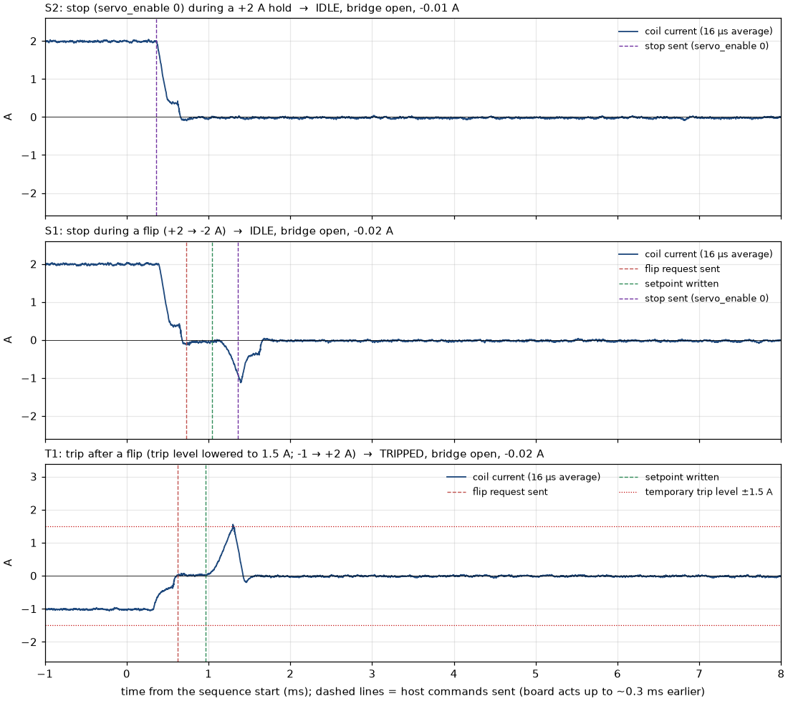

*S2: stopping during a 2 A hold ramps the current down and ends idle. S1: stopping during a flip lets the flip finish, then ramps to 0 and ends idle. T1: with the trip level lowered to 1.5 A for this test, a trip right after a flip works in the new direction and ends tripped with the bridge open; acknowledging returns to idle.*

**Result:** every combination ends safely, idle or tripped with the bridge open; the trip works in both current directions. Trip level put back (2.79 A).

### D2 · The arm signal while running

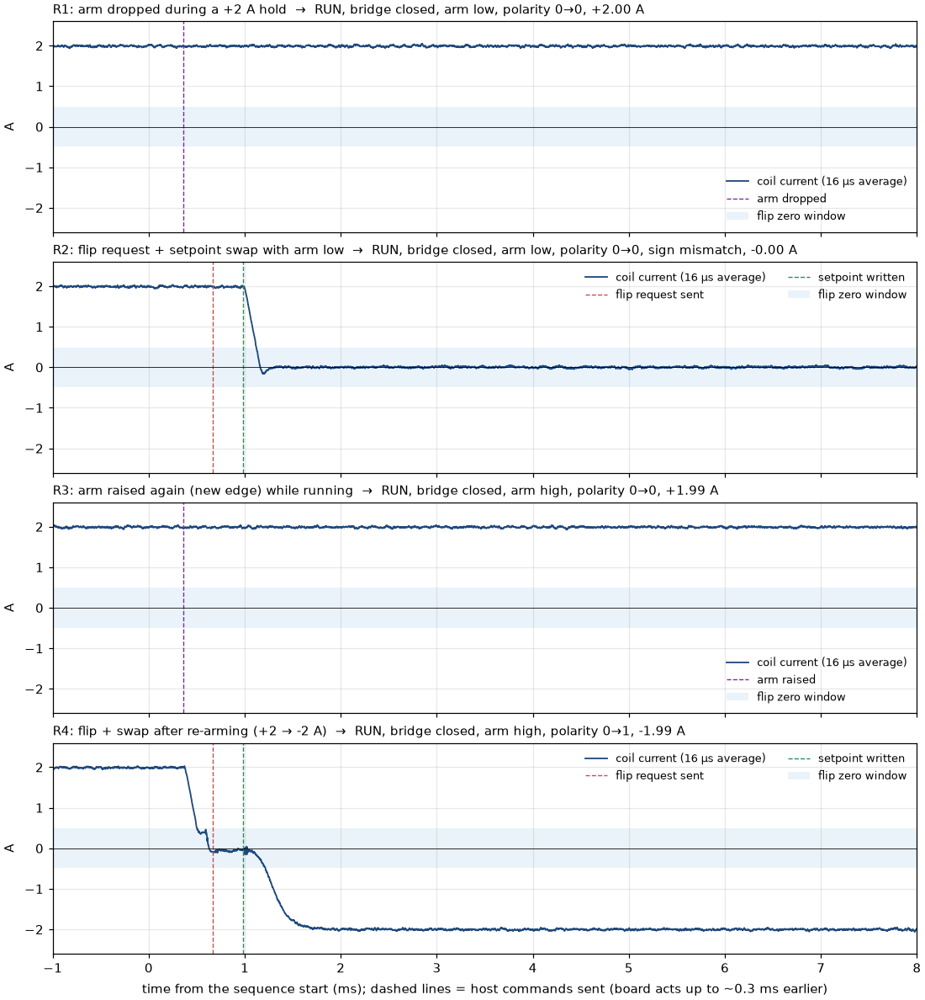

*Taking arm away at 2 A changes nothing (by design, the current is kept). A flip with arm off is ignored (the sign change alone then leaves the board holding zero current). Switching arm back on while running has no effect. A flip after arm is back works normally.*

**Rule for the control computer:** keep arm on for as long as flips may be needed. Taking arm away does not stop the servo.

### D3 · Limits on how fast the setpoint may change

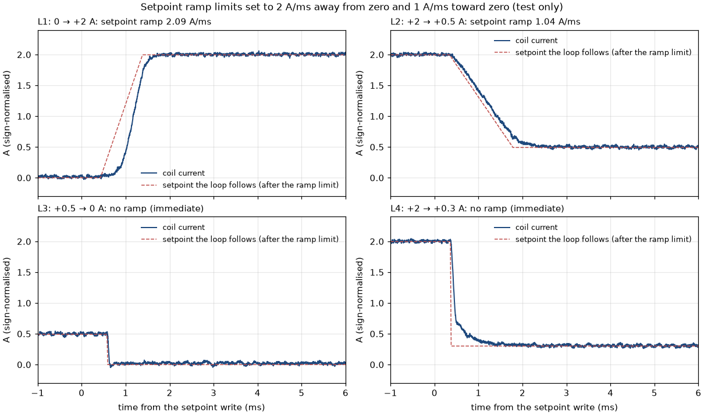

*The firmware limits how fast the setpoint may change. For this test the limits were slowed to 2 A/ms going up and 1 A/ms going down (normally 200 and 50 A/ms). Measured: 2.09 and 1.04 A/ms. A zero setpoint, and a small one inside ±0.49 A (0.3 A), are taken at once.*

**Result:** the limits work exactly as set; normal values put back. **Found here:** the PC software drew the wrong setpoint curve when the current flows the other way (fixed, commit 7e4b7e84).

### D4 · The same sequence 50 times

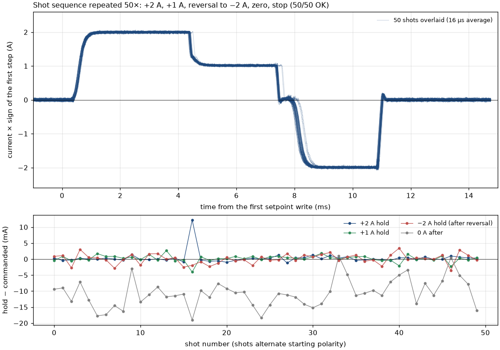

*Each run: +2 A for 4 ms, +1 A for 3 ms, setpoint sign change + flip to −2 A for 3 ms, zero, stop; the runs alternate the starting direction. Bottom: each held value compared with what was asked for.*

**Result:** 50 of 50 good. Held values within 0.3 mA of the request on average, varying by 1–2 mA from run to run (0.05–0.09 % of 2 A). After the snap the current reads about −10 mA, because the stored zero offset is a whole number of measurement steps (27 mA each). **Found here:** the board's recordings read 6.8 mA low because of how the board packs the data (corrected in the PC software, commit 39bbf373).

### D5 · Two programs changing settings at once — safety issue, fixed

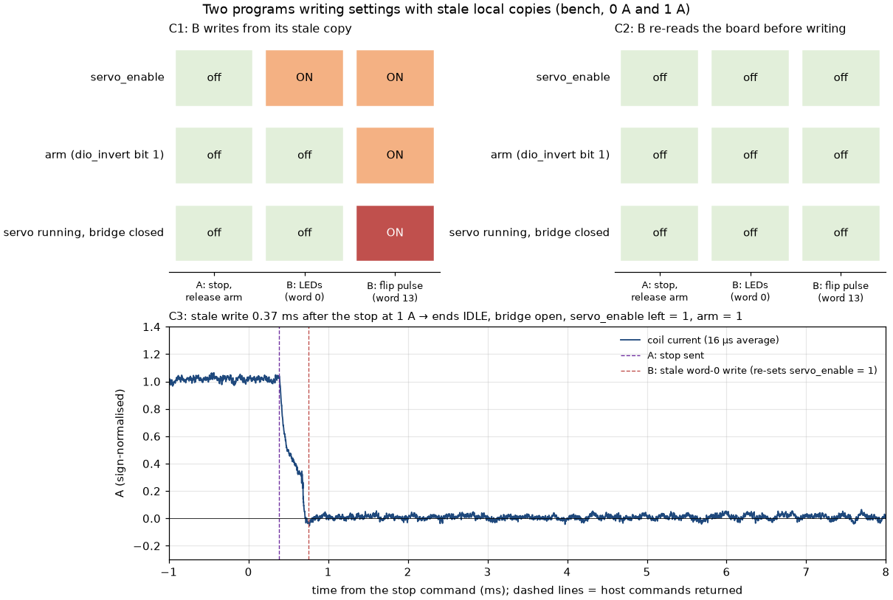

*C1: program B connected while the servo was running; program A then stopped the servo. When B later changed two unrelated settings, it used its out-of-date copy of the settings, which switched "servo enable" and "arm" back on, and the stopped servo started again with the bridge closed (tested at 0 A). C2: when B reads the board's settings first, nothing restarts. C3: an out-of-date change 0.37 ms after a stop at 1 A does not cancel the stop, but leaves "enable" and "arm" on, so a single arm signal would restart it.*

**Fix (commit 39bbf373):** every settings change now reads the current settings from the board first, so one program can no longer undo another's stop; a test reproduces C1. The dashboard was already safe. The control computer never changes settings (it only drives IN2, DIO3 and DIO4); the risk was the dashboard and scripts together.

### D6 · Connection to the PC lost during a hold

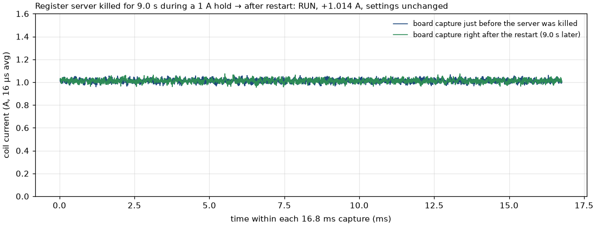

*The program on the Red Pitaya that the PC talks to was stopped for 9 s during a 1 A hold.*

**Result:** the current stayed at 1.01 A with all settings unchanged; the board's clock kept counting; the dashboard reconnected by itself. The current control never depends on the PC or the network.

**Still to test, needs a signal generator:** the analog setpoint input IN2 (its scale has never been measured; steps, ramps, noise against the snap threshold, an earthed source, an unplugged IN2 cable) and the real flip and arm wires DIO3 and DIO4 (voltage levels, shortest pulse, glitches, delay). The scope was busy with another program on day 3, so day 3 has board recordings only.

## New firmware: zero snap also in flips and stops (11-13) [passed]

**Why.** The reversal test (3g) showed that when the flip request came before the setpoint sign change, the current paused near 0.4 A for 150–250 µs before the bridge could switch. Reason: the zero snap only reacted when the control computer asked for zero; during a flip or a stop the board brings the setpoint to zero itself, and then the controller turned the pass transistors down slowly, as before the snap existed.

**What changed.** The zero snap now also switches the pass transistors fully off whenever the board itself brings the setpoint to zero for a flip or a stop (bridge closed, no trip). Same on/off setting as before; nothing changes for the control computer. Checked first in simulation (a new test runs flips and stops with the snap off and on), then built on the lab laptop. The first build missed its timing check by 0.05 ns in an unrelated, already marginal part (the dither); that part was rearranged so its slow steps run side by side, with exactly the same result on every clock tick, and the second build passed with a comfortable margin (+0.25 ns). Loaded on the board: firmware 583e877.

**How.** The same reversal test as in 3g (+2 A ↔ −2 A, the three orderings, both directions, two runs each), run with the snap off and on, and compared with yesterday's run on the old firmware. Then a stop during a 2 A hold, three times each with the snap off and on. The board's own current recording; the scope was not available.

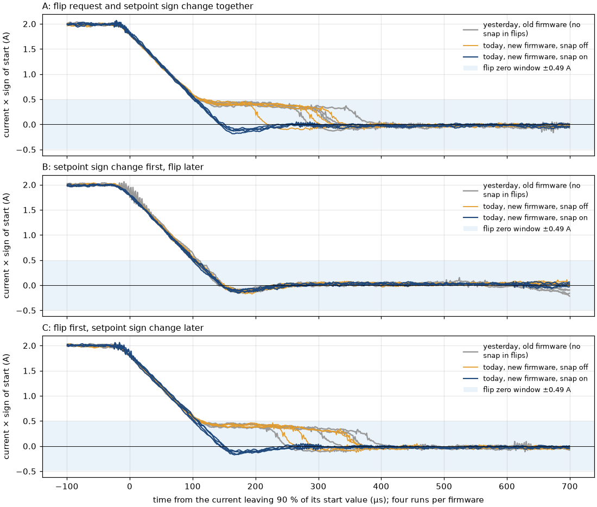

*Grey: yesterday, old firmware. Orange: today, new firmware with the snap off (same as before). Blue: snap on: in every ordering the current goes straight through zero at the coil's own speed; the pause near 0.4 A in orderings A and C is gone. (The small dip below zero is the damper capacitor giving back its charge.)*

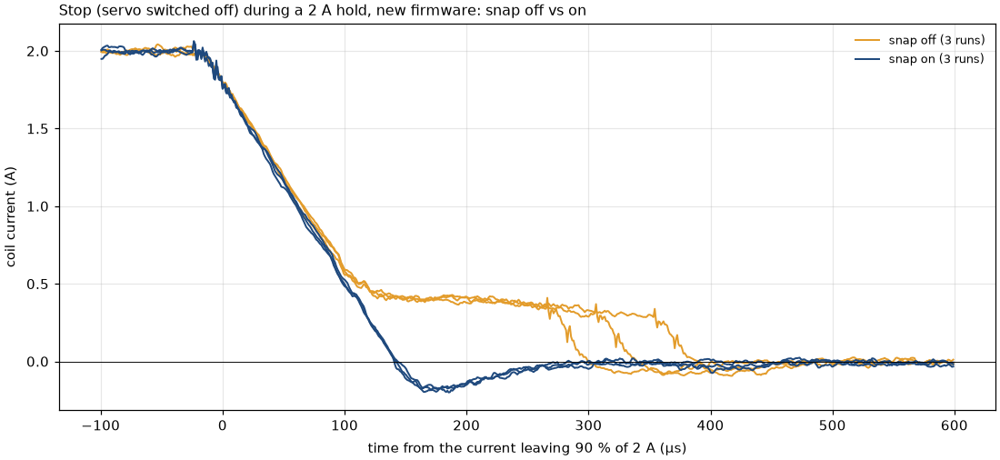

*Stopping the servo during a 2 A hold. Snap on: 90 % → 2 % in 139–140 µs every time. Snap off: 296–381 µs.*

| 2 A → 0, time from 90 % to within 2 % of zero | Old firmware (yesterday) | New firmware, snap off | New firmware, snap on |
|---|---|---|---|
| Reversal A: flip and sign change together | 329 µs | 290 µs | **142 µs** |
| Reversal B: sign change first | 144 µs | 144 µs | **144 µs** |
| Reversal C: flip first | 335 µs | 317 µs | **143 µs** |
| Stop during a hold | — | 296–381 µs | **139–140 µs** |

**Result:** 24 of 24 reversals and 6 of 6 stops OK (new polarity, no trip, no sign mismatch; stops end with the bridge open). With the snap on, every switch-off now reaches zero in about 140 µs, the coil's own speed, whichever order the flip and the sign change come in.

**Note on the total reversal time:** today's full reversals took longer than yesterday's (about 2.1 ms instead of 1.4 ms for A and C) with the snap off as well. That is the PC, not the firmware: since the safety fix of the morning, each settings write from the PC first reads the board, so the PC's flip and sign-change commands now arrive about twice as far apart (0.76 ms instead of 0.38 ms), and the new current can only rise once both have arrived. The control computer uses the flip line and IN2, which act within microseconds, so this does not apply to it.

## Zero-current noise reference (11-13) [done]

**Why.** To tell which tones in the board's current reading are real current and which come from the measurement itself.

**How.** Three conditions, ten 16.8 ms recordings each, frequency content averaged: (1) servo off, bridge open, no current at all; (2) servo running at setpoint 0 (zero snap on, bridge closed); (3) a 2 A hold. A fourth check: the 2 A hold again with the dither switched off.

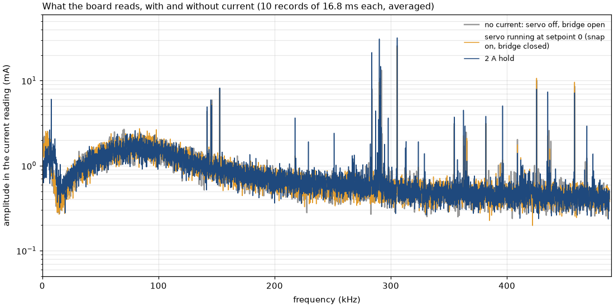

*Grey and orange (no current) lie on top of each other and under most of the blue (2 A): the broad hump around 30–150 kHz and most sharp lines are there with no current at all, so they come from the measurement. With 2 A flowing, extra sharp lines appear between about 200 and 400 kHz (strongest near 290 kHz).*

| Band (current in that band) | No current | Setpoint 0, snap on | 2 A hold | 2 A hold, dither off |
|---|---|---|---|---|
| 7.7 kHz bump | 8.1 mA | 8.4 mA | 9.6 mA | 10.2 mA |
| 10–20 kHz | 4.3 mA | 4.3 mA | 7.2 mA | 7.5 mA |
| 30–150 kHz hump | 45.1 mA | 45.1 mA | 43.6 mA | — |
| 260–320 kHz lines | 32.3 mA | 32.8 mA | 52.3 mA | 52.2 mA |

**Measurement, not current:** the 30–150 kHz hump and the 72 kHz region are the same with no current at all. The extra 200–400 kHz lines that appear with 2 A cannot be real coil current either: a real 30 mA at 290 kHz would need about 2.5 V across the 45 µH coil, and the scope showed the coil voltage steady to about ±0.05 V during holds (at most ≈ 0.6 mA at 290 kHz). They grow with the load current and are the same with the dither off, so they are pickup from something that carries the load current; the bench supply's own switching is the most likely source. The real supply (SE-600-5) will behave differently, so check again in Test 4.

**Possibly real, and small:** with current flowing, the 7.7 kHz bump (close to the coil + damper resonance, ≈ 7.5 kHz) and the 10–20 kHz band each grow by about 5 mA (≈ 0.25 % of 2 A).

The 290 kHz lines are well above anything the controller reacts to (it works below about 10 kHz), so they do not disturb the current; they only make single readings look noisier.

## Fastest full current reversal on the bench (11-13) [passed]

**Why.** How fast can the setup reverse the current from +2 A to −2 A (and back), with the new firmware (zero snap also in flips)?

**How.** Sign change first, flip right after, both directions, three runs each, the board's own recording. Two ways of sending them from the PC: (1) **together** in one network message, so they reach the board microseconds apart, like the control computer's IN2 and flip line will; (2) **separately**, ≈ 0.35 ms apart (one network round trip each). Each with the current settings and with two settings trimmed for speed: the zero check shortened from 64 to 8 samples, and the 100 µs settle wait after a flip (a placeholder for chamber eddy currents; there is no chamber on the bench) removed. Settings restored afterwards.

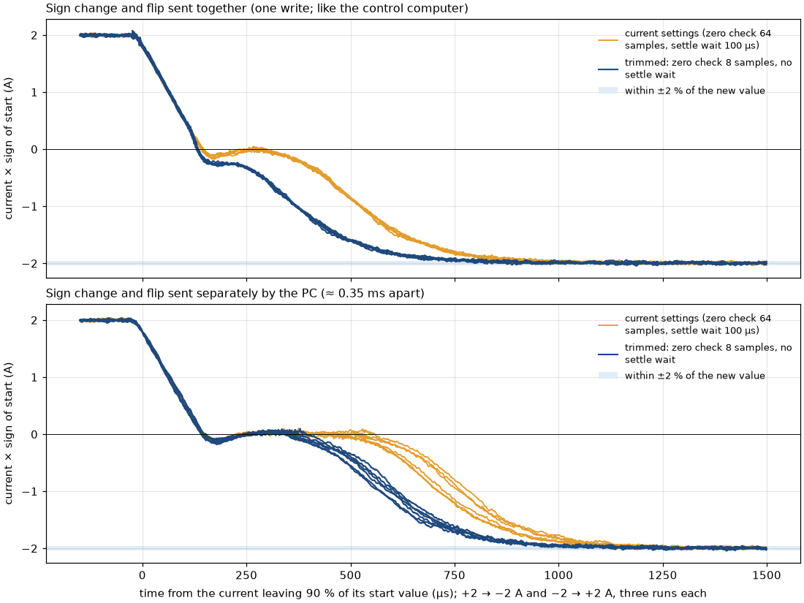

*Top: sign change and flip together. The current drops to zero at the coil's own speed (≈ 140 µs), the bridge switches, and the controller brings the current up to the new value. Trimmed settings (blue) save the settle wait. Bottom: the PC sends them 0.35 ms apart and the current waits at zero for the flip.*

| Sent | Settings | At zero | 90 % of new value | Within ±2 % of new value |
|---|---|---|---|---|
| Together | current | 141 µs | 740 µs | **0.95 ms** |
| Together | trimmed | 130 µs | 585 µs | **0.81 ms** |
| Separately | current | 143 µs | 959 µs | 1.18 ms |
| Separately | trimmed | 142 µs | 805 µs | 1.05 ms |

**Result:** 24 of 24 reversals OK. Fastest: **+2 A → −2 A, settled within ±2 %, in 0.81 ms** (0.95 ms with the current settings). Times from the moment the current starts to fall.

**What limits it now:** getting to zero takes ≈ 140 µs (the coil's own speed); the check and switch-over ≈ 10 µs (trimmed) or ≈ 170 µs (current settings, including the settle wait); then about 0.5–0.7 ms for the controller to bring the current up to the new value. That last part is set by the controller settings, not the hardware (the supply could do it in about 20 µs at 2 A). On the real coils the settle wait must be set from the measured chamber eddy currents, and the controller will be retuned for 100 A.

## Test 3, day 4 · Bench characterization (11-13) [done, open findings]

**Why.** Before connecting the control computer and moving to 100 A, measure everything about the bench setup once, properly: how much safety margin the controller has, how steady a long hold is, how much the zero reading wanders, whether a full shot sequence works every time, how the pass transistors behave cold and warm, and how the over-current trip behaves. Alongside, use the bench data in computer models to predict what will happen at 100 A on the MOT coils.

**How (all tests).** Firmware 583e877, bench settings (`mot_bench`), the test coil with its damper, the 3 A bench supply. Everything was run from the PC and recorded with the board's own 16.8 ms current recording; the scope could not be used (another program holds its connection). Every setting changed for a test was put back afterwards. Run by the second Claude session; data in `logs/t3q*`, scripts in `logs/t3q_scripts` and `logs/t3q_offline`.

### Q1 · How much safety margin does the controller have?

**How.** Controller off. At 0.5, 1 and 2 A, OUT1 was stepped up and down by 10 counts, 12 times each, and the current's response averaged. A simple model (a short delay plus a damped resonance) fitted to that response describes the power stage; combined with the controller settings it gives the margins.

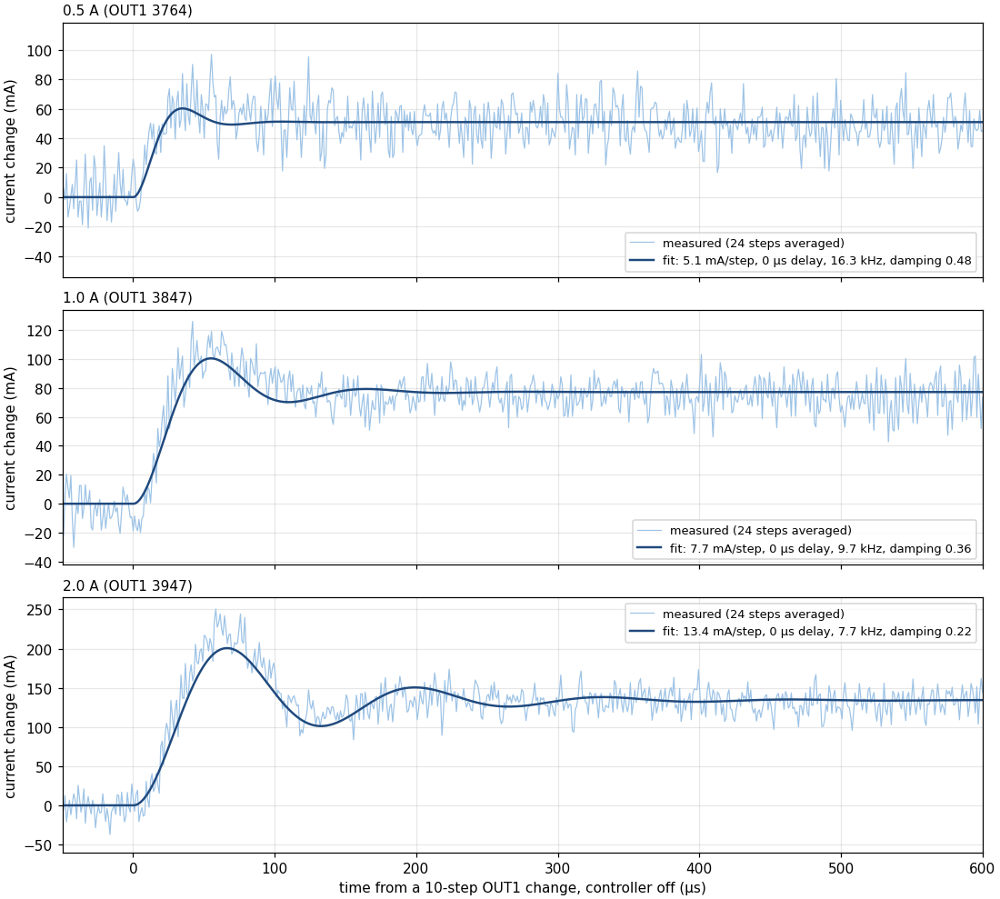

*The current's response to a small OUT1 step at three currents (light: measured, dark: fit). The power stage itself rings: 16 kHz at 0.5 A, 10 kHz at 1 A, 7.7 kHz at 2 A, and less damped at higher current.*

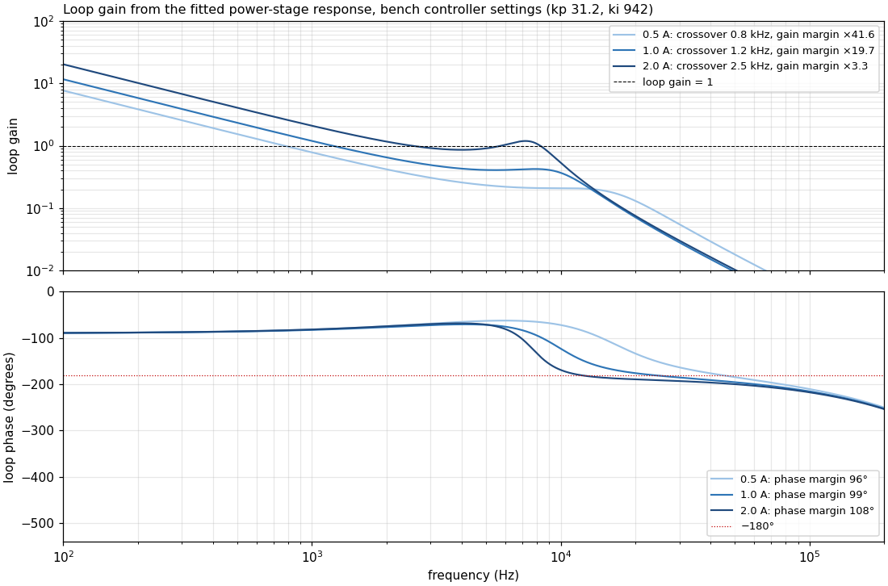

*How strongly the controller corrects at each frequency (top) and how late the correction arrives (bottom). The controller works up to where the top curve crosses 1; it would oscillate if the bottom curve reached −180° while the top curve is still above 1.*

| Current | Extra current per OUT1 step | Power-stage ringing | Controller works up to | Phase margin (≥ 45° is good) | Gain could rise by |
|---|---|---|---|---|---|
| 0.5 A | 5.1 mA | 16 kHz | 0.8 kHz | 96° | × 40 |
| 1 A | 7.7 mA | 10 kHz | 1.2 kHz | 99° | × 20 |
| 2 A | 13.4 mA | 7.7 kHz | 2.5 kHz | 108° | × 3.3 |

**Result:** the controller is very stable. The limit is the power stage's own ringing, which gets stronger and slower as the current rises, so the margin is smallest at the highest current. The controller settings were tuned (3d) before the damper was fitted; the "×2 oscillates at 21 kHz" found then was the undamped ringing, not the controller.

### Q2 · A 2 A hold for 45 minutes

**How.** Controller on, 2 A, 45 minutes. Every 2 s: one recording (its average) and the OUT1 value.

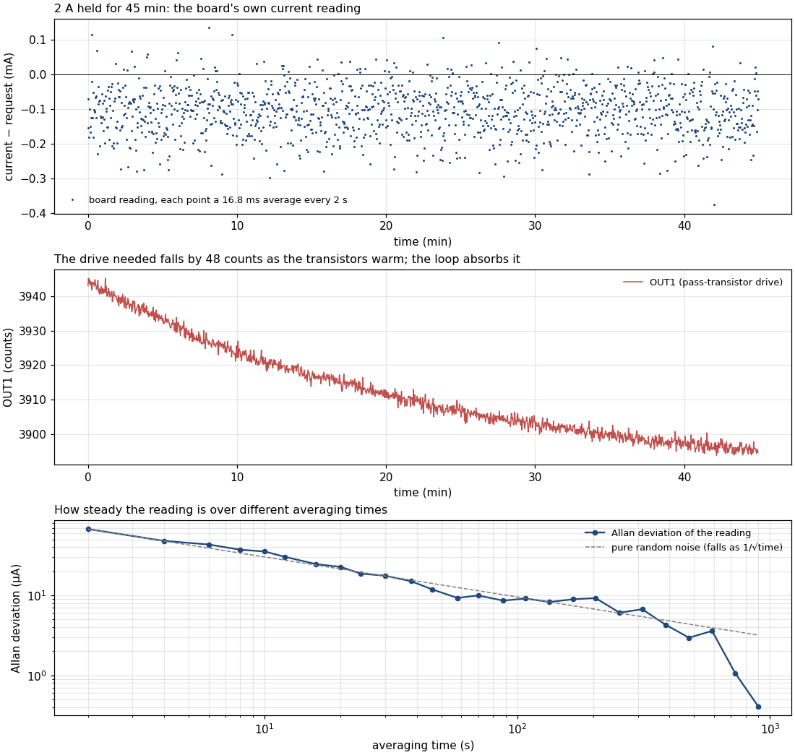

*Top: the board's reading minus the request. Middle: OUT1 falls by 48 counts as the transistors warm; the controller absorbs it. Bottom: how much the reading wanders when averaged over longer and longer times (Allan deviation); it keeps falling like pure random noise.*

**Result:** steady to 0.07 mA rms (0.003 % of 2 A), no drift (−0.002 mA per hour), wander 68 µA at 2 s, 9 µA at 1 minute, under 1 µA at 15 minutes. This is the board's own reading, which the controller forces to the request: it shows the controller is steady, not that the current sensor is (Q3 and the ammeter cover that).

### Q3 · The zero reading with no current, 50 minutes

**How.** Servo off, no current. Every 20 s the uncorrected readings of IN1 (current sensor) and IN2 (setpoint input), each the average of 8 short recordings. Stopped at 50 of the planned 60 minutes to change the amplifier supply (below).

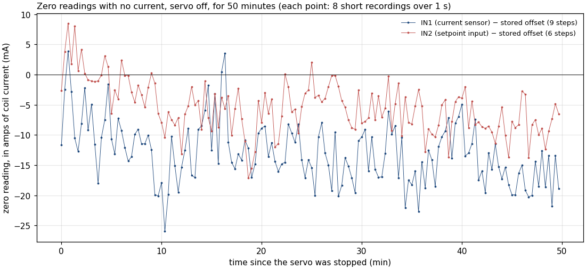

*Both zero readings minus the stored offsets, in mA of coil current.*

**Result:** both zeros steady: ±5 mA (IN1) and ±4 mA (IN2) from point to point, drifting only −0.3 measurement steps per hour (≈ 8 mA/h). IN1's zero now sits at 8.5 steps but the stored offset is 9 (measured just after power-up; whole steps only), so the board reads about −13 mA with no current. This is the "−8 to −10 mA after the snap" seen in the shot tests. Re-zero once the board has warmed up.

### Q4 · The shot sequence 1000 times

**How.** The day-3 sequence, repeated 1000 times from a stopped servo: +2 A, +1 A, sign change + flip to −2 A, zero, stop; the starting direction alternates. Every hold is checked against the request; every 50th run is kept in full.

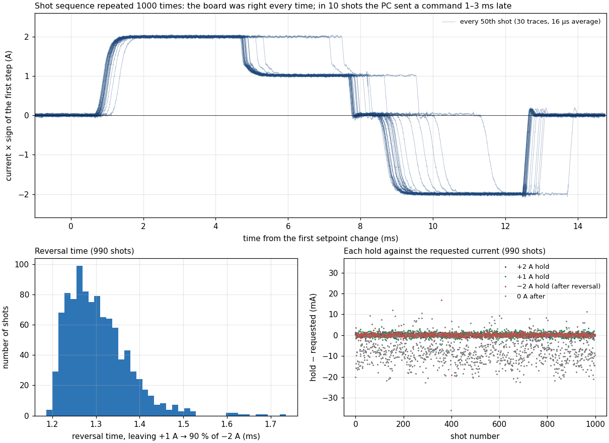

*Top: every 50th run overlaid. Bottom left: the reversal time of every run. Bottom right: every held value compared with the request.*

**Result:** the board did the right thing all 1000 times. In 10 runs the PC (Windows) sent a command 1–3 ms late, so the hold being checked was cut short; those runs are left out of the numbers. Holds within 0.1–0.3 mA of the request on average, varying 0.6–1.1 mA from run to run. Reversal (+1 A → 90 % of −2 A): 1.29 ms typical, 1.21–1.53 ms for 98 % of runs.

### Amplifier supply raised from 5.18 V to 12 V

**Why.** The amplifier that drives the pass-transistor gates ran on 5.18 V, so the gates could never go higher. The transistor datasheet (typical 73 A/V, at least 55 A/V at 60 A) puts 100 A at about 5.0–5.3 V on the gates (turn-on ≈ 3.6 V, plus 0.5 V lost in each 0.03 Ω resistor at 17 A, plus 0.9–1.2 V to carry 17 A): at or above the old limit. The amplifier (OPA994) runs on 2.7–32 V and the gates are rated ±20 V.

**Done (11-13):** amplifier supply now 12.01 V; settings file, model and dashboard updated (commit e77d7916). Quick check with the controller off: zero at OUT1 = 0, and about 10 % more current than in the morning at the same OUT1 (≈ 15 counts, ≈ 15 mV at the gates), absorbed by the controller. The OUT1 limit and the over-current trip are now the only limits on the drive, so for the MOT the OUT1 limit must be set from measured data in Test 4.

### Q5 · The pass transistors, cold and warm

**How.** Controller off, with the new 12 V amplifier supply. OUT1 stepped by 5 counts from 3400 up to about 2.1 A and back down, cold; then OUT1 held at 3895 for 20 minutes; then the same scan warm.

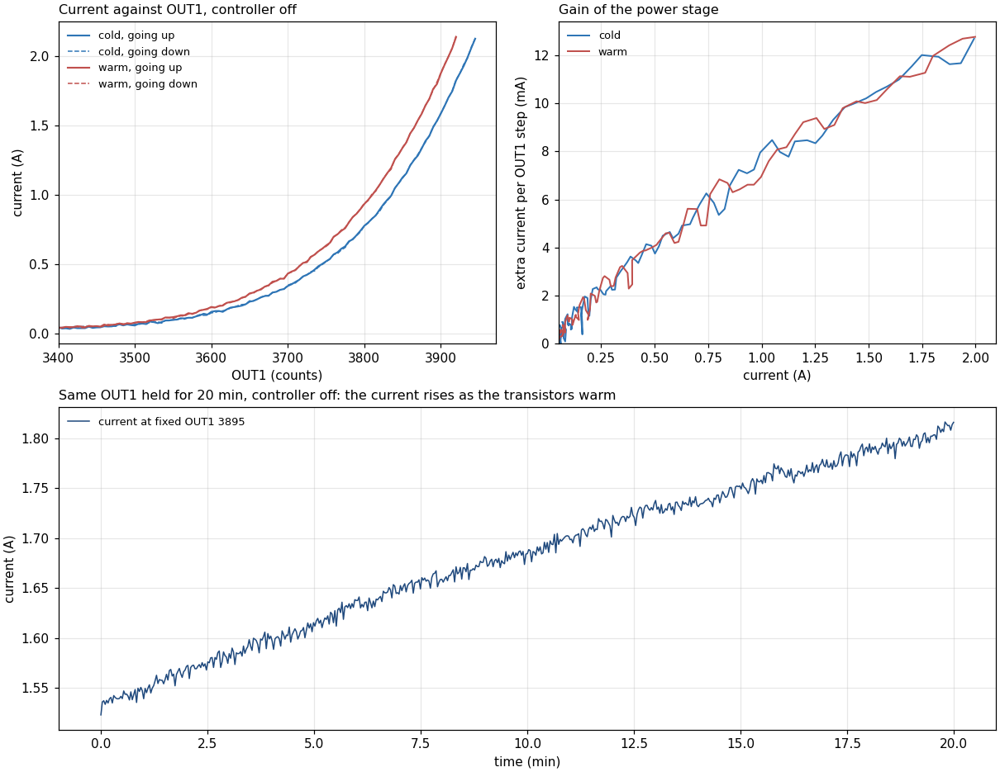

*Top left: current against OUT1, up and down, cold and warm. Top right: extra current per OUT1 step. Bottom: at a fixed OUT1 the current climbs as the transistors warm.*

**Result:** no difference between going up and coming down. The gain rises with current (3.6 mA per step at 0.5 A, 8.6 at 1 A, 13 at 2 A), the same cold and warm. Warm transistors need 25–35 counts less for the same current; at a fixed OUT1 the current rose 1.53 → 1.81 A (+18 %) in 20 minutes on the uncooled plate, still rising. With the controller on this is simply absorbed (Q2).

### Q6 · The over-current trip

**How.** (1) Noise margin: a 1 A hold with the trip level set 300 … 80 mA above it, 20 s each, with the trip needing 4 samples in a row above the level (the setting in use) or just 1. (2) Timing: trip level lowered to 1.5 A, setpoint stepped 1 A → 2 A, 5 times. (3) A follow-up comparing a trip, the same step without a trip, and a normal 2 A → 0 switch-off.

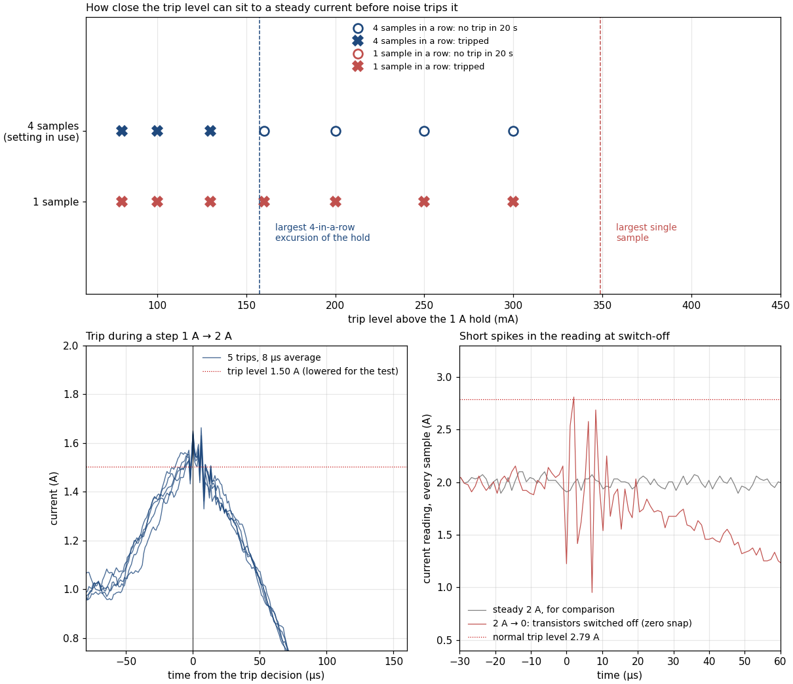

*Top: which trip levels were set off by noise alone. Bottom left: the current around the trip decision. Bottom right: the current reading, every sample, when the transistors switch off (red) compared with a steady 2 A (grey).*

**Result:** with "4 in a row" the trip level can sit 160 mA above a steady current without false trips (at 130 mA and below, noise sets it off). With "1 sample" even 300 mA trips, because single noise samples reach 350 mA. The trip acts within about 10 µs: the current stops rising 5–10 µs after the trip decision and overshoots the level by only 0.05–0.1 A.

**New finding:** whenever the pass transistors switch off abruptly (a trip or the zero snap), the current reading shows a 10 µs burst of spikes of up to ±0.9 A; at a 2 A switch-off one reached 2.81 A, above the 2.79 A trip level. They are pickup from the sudden voltage jump on the transistors, not coil current, and never last more than 2 samples, so the 4-sample trip ignores them. Keep `trip_ticks` at 4 or more, and check the spikes at 100 A.

### Q7 · Computer model of the transistors, and what it says for 100 A

**How.** A smooth turn-on law for the six transistors was fitted to the bench scans (bench current ≤ 0.45 A per transistor), then used to predict the gain at higher current and controller settings for the MOT.

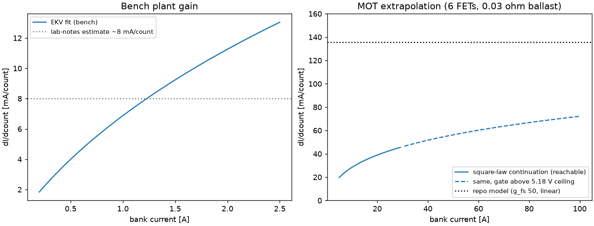

*Left: extra current per OUT1 step on the bench (fit). Right: the same law extended to 100 A (solid: reachable with the old 5.18 V supply; dashed: needed more), against the straight-line model in the settings files (dotted).*

**Result:** the fit matches the bench to 14 mA; the straight-line model in the settings files is far off near turn-on (it predicts 18 A where 0.06 A flows). Extended to 100 A it gives starting controller settings for Test 4: kp ≈ 3, ki ≈ 90 per ms if the bench law holds; kp ≈ 1.6, ki ≈ 48 if the straight-line model is right. The present MOT settings (3.7 / 111) are in between. The bench cannot decide which is right (a 40-fold extrapolation), so tune in Test 4 at the highest current that will be used.

### Q8 · Computer simulations: MOT damper and the 5 A surge

**How.** A circuit simulation of the MOT coils (16 µH) at 100 A with no damper, 10 µF + 2.5 Ω and 22 µF + 1.6 Ω, for a normal switch-off (bridge closed) and for the bridge opening at 100 A; checked against the bench (2 A → 0 in 179 µs, measured 170 µs). And a simulation of the unexplained 5 A surge (11-12) against its scope traces.

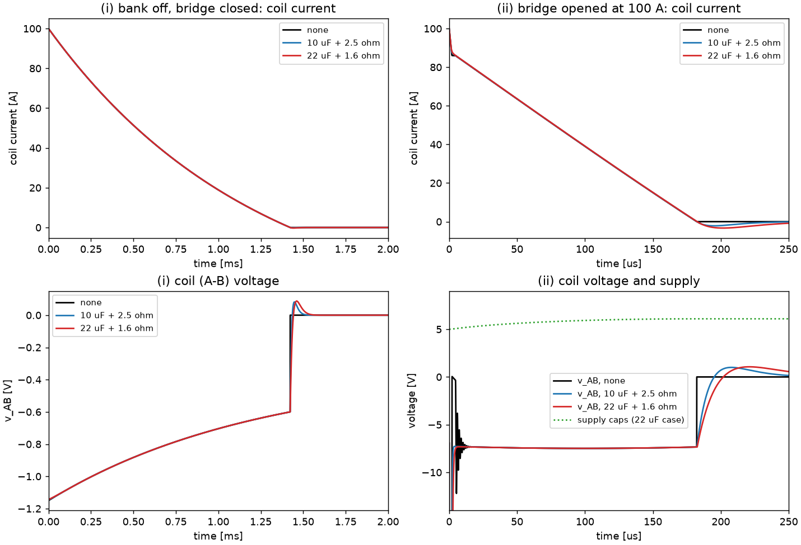

*Left: normal switch-off, bridge closed. Right: bridge opened at 100 A. The damper changes only what happens after the current reaches zero.*

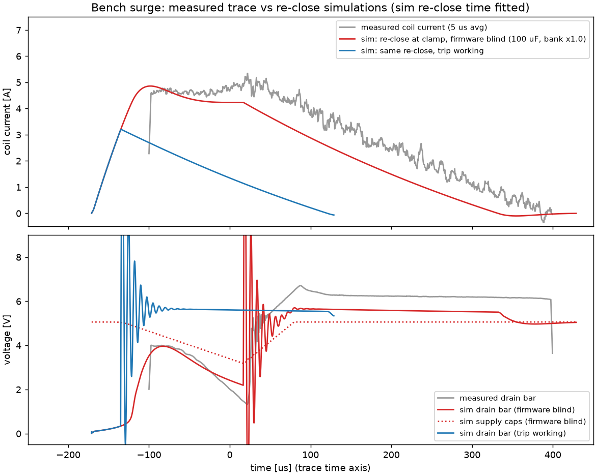

*Grey: the measured surge. Red: the bridge closing with OUT1 at its limit while the firmware could not see the current. Blue: the same with the trip working; it stops at 3.2 A, unlike the measurement.*

**Damper:** a normal switch-off takes ≈ 1.4 ms with or without a damper, then swings 0.2–0.3 A below zero for ≈ 50 µs. If the bridge ever opens at 100 A, most of the damper's energy arrives in the first microsecond (about 100 V, 50–70 A, 8–12 mJ in total): the damper resistor must survive that pulse, or a capacitor on the supply rail at the bridge is needed (in the model, 100 µF removes the spike).

**5 A surge:** the traces fit "bridge closed with OUT1 at its limit", but with the trip working the current would have stopped at about 3.2 A. To match, the firmware must have been unable to see the current for 150–190 µs. The single cause that explains both is a lost IN1 signal at the board (e.g. a loose connection between the scope tee and the input). The start of the event was not recorded, so this is the leading explanation, not proof.

## Open items

Grouped by when they are needed. Items that have been dealt with are in the "Resolved" table at the end, with where the details are.

### Next on the bench: the control computer

- **Connect the control computer:** setpoint on IN2, flip request on DIO3, arm on DIO4, with the same bench coil and supply.
- **Measure IN2:** its scale (amps per volt from the computer) and its noise; then set the zero-snap threshold (`snap_zero_amps`, now a provisional 0.1 A) from that noise.
- *Optional:* raise the bench controller settings. Day 4 (Q1) showed a safety margin of ×8–20 at 1 A and ×2–3.3 at 2 A with the damper fitted, so the 0.5–0.7 ms rise after a reversal could be shortened.

### To build or check before Test 4 (100 A)

- **Damper for the MOT coil pair:** 16 µH, sized near critical damping (proposed 22 µF film + ≈ 1.6 Ω). The current sensor goes between the two coils, the damper across the whole pair. The resistor must survive a 100 A switch-off pulse: if the bridge ever opens at 100 A it takes ≈ 100 V / 50–70 A for ≈ 1 µs (8–12 mJ), unless a capacitor of ≈ 100 µF sits on the supply rail at the bridge (which also keeps the bridge transistors out of avalanche). Check the small 72 kHz tone the bench damper added.
- **5 A surge (11-12):** the leading explanation is a lost IN1 signal at the board (Q8). Check the IN1 cable and tee for a loose contact.
- **Temperature and cooling-water interlock** (planned 11-13): flow and over-temperature switches that cut the bridge through the safety board in hardware, with a status line to the Red Pitaya (DIO5) so the firmware stops cleanly; temperatures on the slow inputs (AIN0, AIN2, AIN3) for logging.

### Safety board and firmware

- **The firmware cannot see the safety board:** connect the safety board's latch to DIO5 and stop the servo on it, and/or stop when OUT1 is at its maximum but no current flows. Same wire as the interlock status above. **Until then: always stop the servo before pressing reset.**
- **Safety-board reset during a heartbeat loss:** the latch trips only when the heartbeat monitor's output changes (an edge), so a reset pressed while the heartbeat is missing clears it with no new trip when the heartbeat returns. Review a level-sensitive trip. Until then: press reset only with the green light on.
- **Faster switch-off with the bridge open** (waits for parts: surge protector 5KP30A and blocking diode DSS2X101-015A): would let the coil current fall much faster than through the bridge diodes.

### During Test 4 (100 A, MOT coils, SE-600-5)

- **Settings:** set the MOT's OUT1 limit from measured current (the 12 V amplifier supply no longer limits the drive); start the controller at kp ≈ 3, ki ≈ 90 per ms (Q7) and retune at the highest current that will be used; set the settle wait after a flip from the measured chamber eddy currents.
- **Re-zero the current sensor** once the board has warmed up (day 4: zero at 8.5 counts, stored 9).
- **Scope:** the drain bar at switch-off (surge protector level at 100 A); the spikes when the bridge opens; the switch-off spikes on the current reading (keep the trip at 4 samples in a row or more); the 200–400 kHz pickup lines with the real supply; ringing at low currents on the real coils.
- **Heating without cooling water (3j)** at 100 A, to set the duty limit for the first test round.

### To understand, not blocking

- **Bench ringing at 10–20 kHz (3i):** cured by the damper, but its cause is still not understood.
- Check the bridge transistors' gate voltages during a flip (needs a floating probe).
- Measure the test coil's inductance directly (probe both coil ends, or an LCR meter).

### Resolved

| Item | How it was resolved | When / where |
|---|---|---|
| Bench ringing at 10–20 kHz | An RC damper across the coil (3.2 Ω + 10 µF) removes it; the cause is still listed above | 11-12, "Damper test" |
| Was the current sensor reading the true coil current? | Moved inside the coil–damper loop; the loop is unaffected | 11-12, "Current sensor moved inside the coil–damper loop" |
| Slow tail after the setpoint goes to zero (2 % only after ≈ 1.3 ms) | Zero snap, firmware rev 5: 2 % in 0.14 ms | 11-12, "Rev 5: the zero snap" |
| Pause near 0.4 A when the flip comes before the sign change; slow stops | The zero snap also acts during flips and stops (firmware 583e877): every ordering reaches zero in ≈ 140 µs | 11-13, "New firmware: zero snap also in flips and stops" |
| A second PC connection could restart a stopped servo | The host software now changes only the setting it is asked to change, reading the board first | 11-13, day 3 (commit 39bbf373) |
| Amplifier supply (5.18 V) limited the gate drive | Raised to 12.01 V; settings updated | 11-13, day 4 |
| "Twice the controller settings oscillates at 21 kHz" | That was the undamped power-stage ringing, not the controller; with the damper the margin is much larger | 11-13, day 4 Q1 |
| Which tones in the current reading are real current? | Most are the measurement itself; the 200–400 kHz lines are pickup from the load current, not coil current | 11-13, "Zero-current noise reference" |
| Bench model coil 9 → 45 µH; lab notes for day 2; bench document fix | Done | commit 8edac7cc |
