<!-- Generated from the live log page used during the session (logs/testlog/benchtop_log.html on the lab PC; logs/ is not in git). Narrative lab notes: docs/lab_notes_2026-11.md. -->

# Benchtop Test Log — MOT coil servo

2026-11-02 to 2026-11-12 · Tests 0–3 of the bring-up campaign (docs/test_campaign.md), all at low power on the bench · Test 3 on a 3 A current-limited bench supply at 5 V (profile `mot_bench`) with one temporary test coil (12 turns, ≈ 45 µH) · firmware register map rev 4, commit 103a127

## Status

| Test | Why | Status | Result in one line |
|---|---|---|---|
| 0 Pre-checks (11-02 to 11-11) | FETs matched; Red Pitaya, safety logic board, loop and H-bridge each work on their own | [passed] | Latch clock wire missing → added; monostable 7.6 ms; loopback 2.026; open-loop wind-up fixed in rev 4; bridge switches cleanly by hand |
| 1 Gate stage (11-11) | OUT1 → op-amp → FET gates works, no oscillation, fails safe | [passed] | Op-amp supply wiring fixed; gain 7.93; 50 Ω terminator fitted on OUT1 (1.168 V full scale) |
| 2 Sensor chain and zero (11-11) | LEM → in-amp → IN1 reads zero correctly | [passed] | Three wiring faults on the in-amp board fixed; LEM offset ≈ 0; Red Pitaya offset calibrated |
| 3 day 1: first current (11-11) | Sign, grounding, bank behaviour near threshold | [done] | LEM sign fixed; bench supplies must float; IN1 reads ≈ 10 % low; bank onset ≈ 3540 counts |
| 3 day 2 bring-up (11-12) | Load firmware and bench settings, re-zero | [done] | Clean; deploying trips the safety latch (reset after every deploy) |
| 3c IN1 current scale | Board must read amps correctly | [done] | `in1_fs_volts` = 1.12 V → 224 A full scale |
| 3d PI gain tuning | Fast, stable closed loop | [done] | kp 31.2 counts/A, ki 942 counts/(A·ms); ×2 more oscillates at 21 kHz; 2.5 A step +2.8 %; bench limit lowered to 2.2 A because of the ringing |
| 3e Over-current trip | The current limit of the MVP | [passed] | Fires at ≈ 2.85 A (set 2.79 A), before the 3 A supply limit |
| 3f Turn-off path | Freewheel vs TVS, turn-off time | [done] | Freewheel through the bridge body diode; slope set by the coil's L |
| 3g Flips + dead time | Polarity change at zero current, no shoot-through | [passed] | Flips only inside the zero window; enable low 1 µs each side |
| 3h Heartbeat-latch trip | Hardware safety path at current | [passed] | Bridge opens at 2 A, current gone in ≈ 10 µs; rail spikes +2.5–3.2 V for ≈ 10 µs |
| 3i Hold noise, dither on/off | Steady-hold stability vs 0.1 % spec | [done, open finding] | Average stable to 0.01 %; dither makes no difference on the bench; hold noise dominated by a 10–20 kHz ringing of the pass bank with the coil (±0.15 A), not from the loop |
| Extra: range, long hold, flips | Gains over 0.5–2.2 A, drift, flip reliability | [passed] | No trips; 10 min hold stable within 0.5 mA after warm-up; 20/20 flips |
| 3j Uncooled duty test | Heating limit without water | [moved] | Moved to the 100 A build (≤ 15 W on the bench) |
| Damper test | Does 3.2 Ω + 10 µF across the coil stop the ringing? | [passed] | Yes: ringing 43–124 mA → 2.5–5 mA with the coil lifted; 2 A hold 100 µs noise 6.5 mA rms |
| LEM inside the loop: turn-offs (11-12, late) | Is current still flowing after a turn-off, hidden in the coil–damper loop? | [done, open finding] | Freewheel 2 A → 0 in ≈ 170 µs, then a −0.2 A swing for ≈ 100 µs; bridge opened at 2 A: zero in ≈ 25 µs, gone by ≈ 200 µs, energy into the damper; latch holds; an unexplained 5 A surge caught by the firmware trip; closed-loop turn-off has a ≈ 1 ms PI tail |
| Rev 5: zero-setpoint snap (11-12, evening) | Remove the closed-loop turn-off tail | [passed] | New firmware deployed; 2 A turn-off to 2 % in 0.14 ms instead of 1.55 ms; small setpoints still held; no chatter on IN2 |

## Test 0 · Red Pitaya, logic board and power-stage pre-checks (11-02 to 11-11) [passed]

**Why.** Before any current flows, every piece is checked on its own: the FETs are matched, the Red Pitaya runs the firmware and talks to the lab PC, the safety logic board (heartbeat watchdog → latch → bridge-driver disable) trips and stays tripped, the control loop works on a cable, and the H-bridge switches correctly when driven by hand.

### 0a · MOSFET thresholds (11-02)

**How.** Each FET with gate tied to drain, fed through a series resistor from a bench supply; DMM across gate–source gives the threshold VGS(th) (pass bank IXTN200N10L2 at 3 mA, bridge IXFN420N10T at 8 mA), 10 of each.

**Result:** pass bank 3.35–3.56 V → installed the six at 3.50–3.56 V (0.06 V spread → ≤ 12 % current-sharing spread at 100 A). Bridge 3.51–3.59 V → installed four within 0.01 V.

### 0b · Logic board on the Red Pitaya, first firmware (11-03)

**How.** Logic board wired to E1, power stage off; the August firmware; `check mot` from the lab PC, then the LED acceptance sequence (green = heartbeat OK, amber = bridge enabled, red = latch tripped).

**Finding:** after a reboot the board had neither the bitstream nor the register server running, so `check` failed. Loaded both by hand over ssh; the host tools now detect this and print the `deploy` command.

**Result:** heartbeat advancing, LED walk, state IDLE, nothing armed or enabled; LED sequence passed. Zero reading +0.18 A (the Red Pitaya's own input offset).

**Monostable timing:** with 68 kΩ the watchdog timed out after ≈ 1.1 ms, about one heartbeat period, so a lost heartbeat could recover on an edge. Changed to 220 kΩ / 100 nF: drop ≈ 7.6 ms after the last heartbeat edge, consistent.

**Noted:** the old firmware started on the arm *level*; the MVP firmware needs an arm *edge* after `servo_enable`, so the recipe is now enable first, then arm.

### 0c · First deploy of the MVP firmware (11-11)

**How.** Board only, arm low, nothing on the inputs; `deploy mot` then `check mot`.

**Result:** image loaded in 69 ms; safe state confirmed (IDLE, OUT1 = 0, bridge disabled, not armed); all 32 configuration words written and read back correctly; zero reading +0.19 A (Red Pitaya input offset).

### 0d · Logic-board acceptance test with the MVP firmware (11-11)

**How.** Power stage off. Arm jumper on E1 pin 11, heartbeat wire DIO6 pulled and re-plugged by hand, LEDs and the `watch` display read at each step (bringup.md 3a).

| Step | Action | Expected | Seen |
|---|---|---|---|
| 1 | Arm jumper in *before* `servo_enable` | stays IDLE, amber off (no arm edge) | ✓ |
| 2 | Unplug and re-plug arm | RUN, amber on | ✓ |
| 3 | Pull heartbeat (DIO6) | green off, amber off, **red on** | red stayed off ✗ → fixed, then ✓ |
| 4 | Re-plug heartbeat | green on, red stays on, amber stays off | ✓ after fix |
| 5 | Stop the servo (IDLE), then press reset | red off, amber stays off | ✓ |
| 6 | Enable, arm edge; then stop | RUN, then IDLE | ✓ |

**Fault found: the latch did not latch.** Pulling the heartbeat turned the bridge off, but re-plugging it turned the bridge back on by itself. By meter: the monostable's output (CD74HC123 pin 4) was correct, but the latch's clock input (74HC74 pin 3) had **no wire at all** (floating at 0.4–0.6 V; probably came loose after 11-03). Wire added; test passed.

**Design weakness (open):** the latch trips on the *edge* of heartbeat loss. Pressing reset while the heartbeat is still missing clears it, and when the heartbeat returns there is no new edge, so the bridge enables without another reset. Until a level-sensitive trip is fitted: **press reset only with green on, and only after stopping the servo** (dropping arm alone does not stop a running servo).

### 0e · Loopback test with the MVP firmware (11-11)

**Why.** Check the control loop, scaling and trip on a cable before connecting real hardware.

**How.** OUT1 cabled straight to IN1 (the "plant" is just a wire); logic board connected; no power stage. Open-loop OUT1 values, closed-loop setpoints, then a setpoint above the trip level.

**Results:** loopback factor 2.026 (August: 2.03); closed loop holds the setpoint to ±1–2 counts at "20 A" and "50 A"; a "110 A" setpoint trips the board, bridge enable drops, `trip_ack` + stop returns to IDLE.

**Finding — open-loop wind-up:** in open loop the integrator kept integrating and wound up to ≈ 4400 counts, so switching to closed loop jumped OUT1 and tripped the board (on the real coil, a jump towards ~100 A). Fixed in the host tools the same day and in firmware rev 4 (integrator held cleared in open loop).

### 0f · H-bridge and current sensor driven by hand (colleague, reported 11-11)

**How.** Bridge alone, logic board not connected: UCC5350 gate drivers on isolated supplies, logic inputs set by hand; 5 V bench supply; first a resistive load, then the coil with the LEM sensor.

**Results:** no shoot-through; one loose gate connection found and fixed (Q4); resistive load gives +5 V / −5 V / 0 V for the two diagonals and all-off; 1.12 A through the coil each way, reversal correct.

**Finding:** an apparent LEM offset of −5.8 A (primary equivalent). Test 2 later showed it was wiring on the in-amp board, not the sensor; it also prompted the zero-offset registers in firmware rev 4.

## Test 1 · Gate stage (11-11) [passed]

**Why.** Before any high current: check that the OUT1 command reaches the six pass-FET gates through the OPA994 gain stage as designed, that the stage does not oscillate, and that the gates fall safely when the op-amp loses power.

**How.** OPA994 board on its own 5.184 V bench supply; OUT1 teed to scope CH1; ×10 probes on the gates of pass FETs #4, #1 and #10; high-current side open. Open loop, OUT1 swept 0–4474 counts.

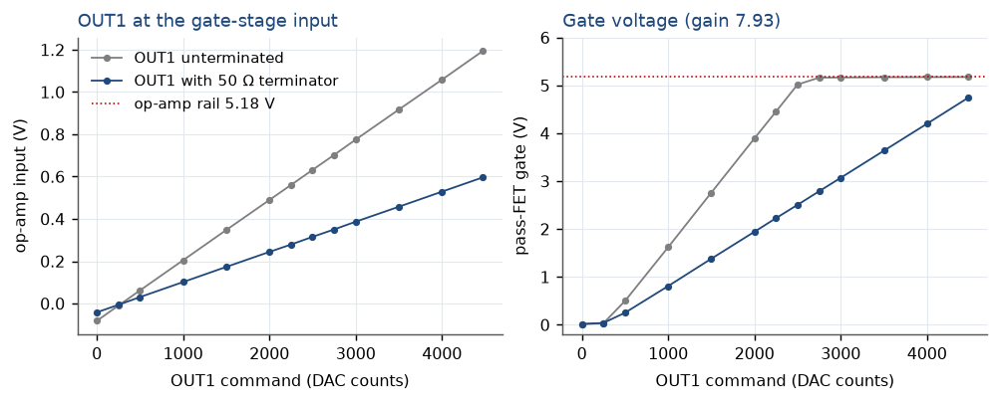

*Without a terminator OUT1 swings 2.34× its nominal range and the gates hit the op-amp rail at ≈ 2550 counts. With the 50 Ω terminator the full command range stays below the rail.*

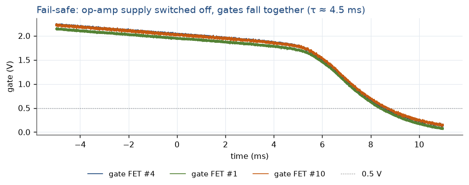

*All gates follow the op-amp's own supply down together, below 0.5 V within ≈ 8.5 ms.*

**Wiring fault found first:** the gates stayed at ≈ 0 V. The op-amp's supply minus was not tied to the pass-bank source bar (its plus sat at ground). Fixed: supply minus → source bar, supply floating from earth.

**Results:** op-amp gain 7.93 (design 7.98); gate ceiling 5.18 V (the op-amp rail); no oscillation (gates 4–6 mV rms at full bandwidth, only the Red Pitaya's 125 MHz clock lines); fail-safe on power loss.

**Test 1b, 50 Ω terminator on OUT1:** 142.6 µV per count (1.168 V full scale, 17 % above nominal), −41.3 mV at code 0. Into channels.toml: `out1_fs_volts` 1.168, `out1_offset_volts` −0.0413, `gain_opamp` 7.93, `V_opamp_max` 5.18. The terminator stays fitted.

## Test 2 · Sensor chain and zero (11-11) [passed]

**Why.** The current reading (LEM → 10 Ω burden → AD8421 in-amp → IN1) must read zero with no current, with a known offset, before it is trusted for trips and the ±0.5 A flip window.

**How.** LEM on its ±15 V supply, no current anywhere, in-amp output teed to the scope; IN2 on a 50 Ω terminator. Then `zero mot --write --apply`.

| Fault found | Symptom | Fix |
|---|---|---|
| In-amp REF (pin 6) floating: reached ground only through capacitors | IN1 pinned at full scale, REF at +4.6 V | Wire REF straight to GND |
| Gain pins 2–3 bridged by solder | Output stuck at a supply limit or oscillating | Bridge removed |
| Output resistor 47 kΩ instead of 49.9 Ω | Would read 4.5–9 % low and filter the signal | Replaced with 49.9 Ω |

**Result:** the "−5.8 A LEM offset" of earlier days was the wiring, not the sensor: with the chain repaired the in-amp reads −0.2 mV (≈ −0.04 A). Zero calibration: IN1 +8.6 counts (≈ +0.21 A, mostly the Red Pitaya's own input offset), IN2 +6.3 counts; after loading, the board reads −0.06 A with no current.

**Noted:** the in-amp inputs are swapped relative to the drawing, which only flips the sign (fixed in Test 3 by turning the LEM round). Drawing correction for the in-amp board: REF wired straight to GND, capacitors from the supply pins to GND.

## Test 3, day 1 · First current (11-11) [done]

**Why.** First current through the coil on a current-limited bench supply: check the sign of the reading, the grounding, the current scale, and how the pass bank behaves at bench currents.

**How.** Bench supply 5.0 V / 3.0 A limit in place of the SE-600-5; open-loop scans of OUT1 across the turn-on region; holds read against the supply ammeter and the scope.

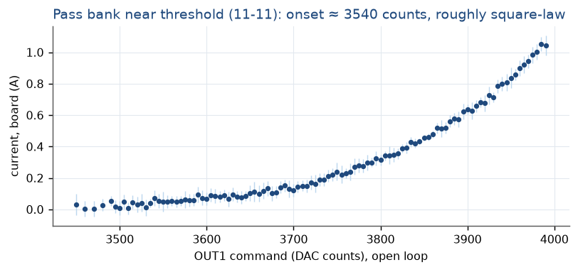

*The bank starts conducting at ≈ 3540 counts (gate ≈ 3.65 V) and rises roughly as a square law. The absolute amps of this scan were taken before the grounding fix and read ≈ 2× low; onset and shape are valid.*

**Sign reversed:** the first scan read a growing negative current and stopped itself. Fixed by turning the LEM round.

**Ground loops: the bench supplies must float.** With the supplies earthed, part of the coil current returned through earth and the scope's BNC shields: IN1 read ≈ 2× low with the wrong sign on the scope, and the bridge dropped out. With all supplies floating (earthed only through the scope) the board, scope and supply ammeter agree.

**IN1 reads ≈ 10 % low:** the firmware uses raw ADC codes. Provisional `in1_fs_volts` 1.10, refined on day 2 to 1.12.

**Pass bank near threshold:** ≈ 0.008 A per OUT1 count at 1–2 A, against 0.136 A per count in the 100 A model; the current rises as the FETs warm (3990 counts tripped at 2.8 A once warm, which also showed the firmware trip working). Bench floor 3450 and clamp 4100 counts set from this.

## Setup for Test 3, day 2 (11-12)

### Power and wiring

- Bench supply 5 V, 3 A limit, **floating** (no earth links; system earthed only through the scope).
- One test coil, 12 turns of 4 × 2 mm hollow Cu, racetrack 70 × 210 mm, lifted 13–15 cm off the optical table (from 3f on).
- OUT1 → 50 Ω terminator → OPA994 gate stage (gain 7.93) → 6-FET pass bank.
- Arm and flip requests from software (pulses of the `dio_invert` setting); arm jumper out.

### Scope (Rigol DHO914 "test", all ×1 BNC)

- CH1: IN1 tee (5 mV per amp: LEM 2000:1 into 10 Ω).
- CH2: drain bar (3f) → DIO1 bridge enable (3g dead time).
- CH3: bridge node A.
- CH4: DIO1 → pass-bank gate (3f) → DIO0 polarity (3g).

## Test 3, day 2 · Bring-up [done]

**How.** `deploy mot_bench` loads the bitstream (the FPGA configuration) and the bench settings, `check mot_bench` verifies them (LED 7 lit), `zero mot_bench --write --apply` measures the input offsets with no current flowing.

Offsets: IN1 +0.256 A, IN2 +0.157 A, within one ADC count of day 1.

**Finding:** the first closed-loop step gave no current and no amber light. Loading the FPGA pauses the heartbeat, so the logic-board latch trips. **Reset the latch after every deploy** (servo stopped, heartbeat green).

## 3c · IN1 current scale [done]

**Why.** The firmware works in raw ADC counts; the Red Pitaya's own input calibration is not applied, so each board reads slightly off. Day 1 found IN1 reading ≈ 10 % low (provisional, ±3 %).

**How.** Closed-loop hold at 2 A for 60 s; compare the board's reading with the bench supply's ammeter (reference) and with the scope on the IN1 tee.

| Board (FPGA) | Bench supply ammeter | Scope, IN1 tee | OUT1 command |
|---|---|---|---|
| 1.988 A | 2.02–2.03 A | 2.086 A (reads ≈ 3 % high) | 3942 counts, steady |

**Result:** `in1_fs_volts` 1.10 → **1.12 V** (IN1 volts at the full-scale ADC code; nominal 1.0). Full scale IFS = 224 A, 27.3 mA per count. Agrees with day 1's first ammeter estimate (1.118). Committed d70a45d6.

## 3d · PI gain tuning [done]

**Why.** The loopback gains do not fit the real plant. Near threshold the pass bank gives only ≈ 0.008 A per OUT1 count (day 1 scan), versus 0.136 A/count in the 100 A model.

**How.** Closed-loop 1 A steps (`step mot_bench --amps 1`, 16.8 ms capture at 1 µs per sample), starting at ¼ of the gains computed from the measured slope and doubling kp and ki together while the step stays clean.

| kp (counts/A) | ki (counts/(A·ms)) | 90 % rise | 98 % settle | Hold noise (rms) | Verdict |
|---|---|---|---|---|---|
| 15.6 | 471 | 1.41 ms | 1.85 ms | 40 mA | clean, slow |
| **31.2** | **942** | 0.73 ms | 1.04 ms | 40 mA | **chosen** |
| 62.4 | 1884 | 0.38 ms | 0.53 ms | 86 mA | oscillates at 21 kHz |
| 31.2 (2 A step) | 942 | 0.45 ms | 0.65 ms | 54 mA | clean, +1 % overshoot |

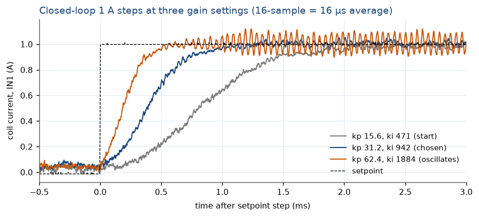

*Rise speeds up with each doubling; the highest setting rings during the hold.*

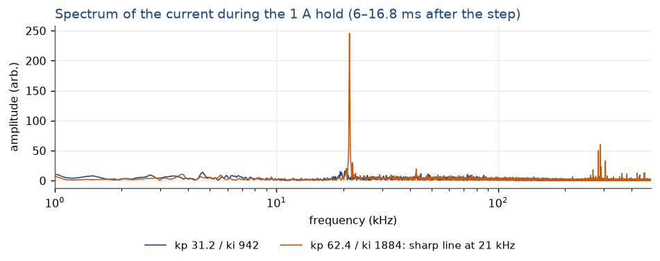

*At ×4 a sharp 21 kHz line appears: the loop is at its stability limit. The ≈ 290 kHz floor is ADC noise.*

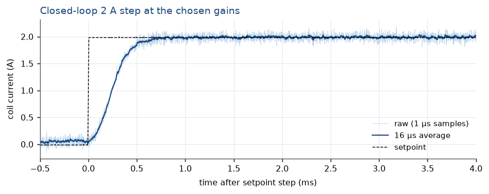

*The bank's gain rises with current, so the margin is smallest at the top of the range: still clean at 2 A. Re-check at 2.5 A.*

**Result:** gains set at half the oscillation limit (gain margin ≈ 2). These are bench values; the 100 A plant has ~17× more gain per count and needs its own tuning.

**Open point (found in 3h):** a single jump from 0 to 2.5 A overshoots past the 2.79 A trip level, and the trip ends the run. The tuning was done at 1 A and checked at 2 A, where it was clean. Two effects can push 2.5 A over the edge, and the second was found only later (3i):

1. The pass bank's gain (amps per OUT1 count) grows with current, so the same PI gains act harder at 2.5 A and damp less; 2.5 A leaves only 0.29 A of margin to the trip.
2. The 2.5 A step was taken with the coil lifted off the table, where the coil rings at ≈ 12 kHz by itself with ≈ ±0.12 A (3i). That ripple alone uses up much of the 0.29 A margin.

**Closed:** repeated with the coil on the table, the 2.5 A step did not trip: overshoot +2.8 %, 98 % in 0.59 ms. The ringing was there too (11.5 kHz, 128 mA rms), and 28 single samples exceeded 2.79 A (a trip needs 4 in a row). So the gains are fine; the near-trips come from the ringing on top of a 0.29 A margin. **Bench `I_rated` lowered 2.5 → 2.2 A** (peaks then ≈ 0.45 A below the trip).

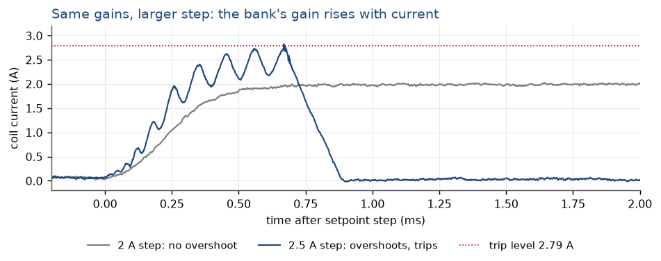

*At 2 A the current approaches the setpoint from below; at 2.5 A it keeps rising toward the trip level, and the trip ends the run at ≈ 0.6 ms.*

## 3e · Over-current trip [passed]

**Why.** In the MVP the firmware trip is the current limit: |IN1| above `trip_level` for 4 samples sets both DACs to zero, lets the coil freewheel, opens the bridge and latches TRIPPED.

**How.** Temporarily `I_rated` = 2.9 A (the step tool refuses targets above it), closed-loop step to 2.9 A. Trip set to 2.79 A, 0.21 A below the supply's 3 A limit so it fires first. Then `trip_ack`, stop, restore 2.5 A.

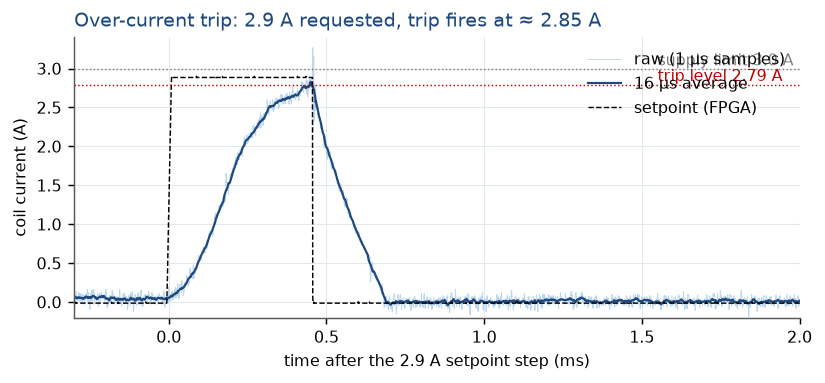

*The current rises toward 2.9 A, trips at ≈ 2.85 A (1 µs samples), and freewheels to zero in ≈ 225 µs. The spikes at the trip are switching pickup, not current.*

**Result:** state TRIPPED, bridge open, supply CC lamp stayed off. Acknowledged and back to IDLE without a power cycle.

## 3f · Turn-off path [done]

**Why.** With the bridge kept closed, the coil current should freewheel through the bridge body diodes (drain bar ≈ rail + one diode drop). The alternative is the bank's TVS (drain ≈ 13 V). The trip's 225 µs decay was ≈ 7× slower than the model's 30 µs.

**How.** Hold ≈ 1.5 A in open loop (OUT1 = 3900 counts), then OUT1 → 0 at once. Scope triggered on the falling current; the gate on CH4 shows whether the bank itself switches off slowly.

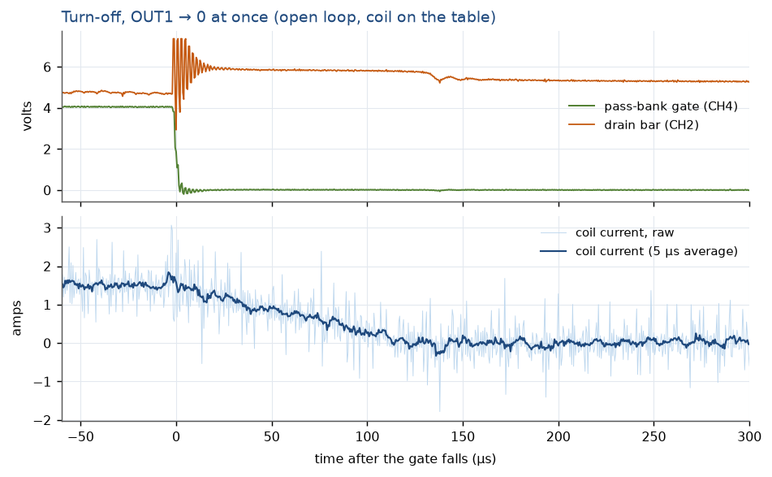

*The gate falls in ≈ 4 µs. The drain bar jumps to ≈ 5.9 V (with brief ringing to 7.4 V) and stays there exactly as long as current flows, then drops. The current ramps down linearly.*

*Lifting the coil off the steel table made the decay slower, not faster: the table's eddy currents had been absorbing part of the energy.*

**Result:** freewheel through the bridge body diode, confirmed; the TVS is never reached. The gate stage is not the cause of the slow turn-off.

**Why it is slow:** the test coil has 12 turns. From its geometry (Neumann integral, scaled N2) L ≈ 45 µH, not the 9 µH in the bench model. Slope = Vcoil/L: 8.1 mA/µs × 45 µH ≈ 0.37 V, a plausible diode drop at ≈ 1 A. Bench model to be updated. The MOT pair's 16 µH (Radia) is unaffected.

**Side finding:** leakage of the warm bank at the RUN floor is small: 45–60 mA at 3450 counts, 66–76 mA at 3500, 98–117 mA at 3550.

**Not measured:** the voltage across the coil (node B is not probed), so 45 µH is calculated, not yet measured.

## 3g · Flips and dead time [passed]

**Why.** A flip must ramp the current into the zero window, drop bridge enable, change polarity, and re-enable. The enable-low window is the only shoot-through protection; the logic board adds no dead time.

**How.** Closed loop at ±2 A; flip request from software. Arm must stay *high* for flips to be accepted, so the arm input was held inverted during the test. After each flip the host re-signs the setpoint.

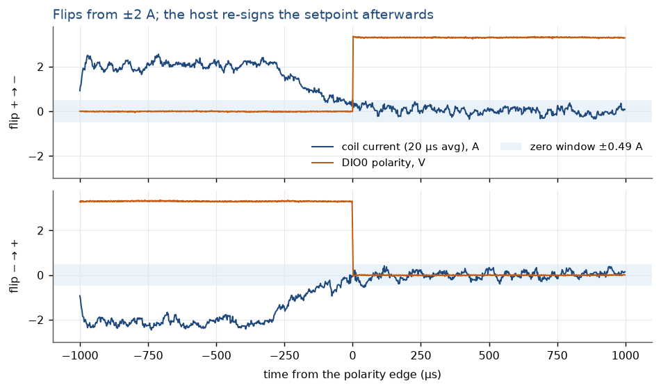

*The current ramps from ±2 A into the ±0.49 A window in ≈ 300 µs, then the polarity changes. Afterwards the board sits at zero until the setpoint sign matches.*

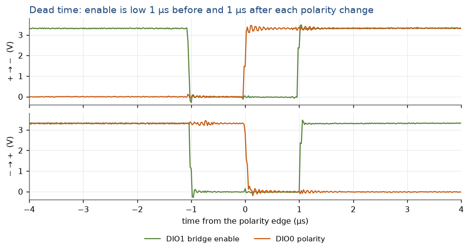

*Enable drops 1.02–1.04 µs before the polarity edge and returns 0.98–1.02 µs after it: the 125 × 8 ns setting.*

**Result:** +2 → −2 → +2 A with no timeout and no trip; current at the polarity edge +0.13 A and −0.29 A.

**Side finding:** the dashboard's software-arm button gives only an edge, so flips after it are ignored. It needs a "hold arm" mode for bench flip tests (passed to the dashboard session).

**Still open:** the bridge FETs' gate voltages during a flip (needs a floating probe), to see the dead time at the FETs rather than at the Red Pitaya pins.

## 3h · Heartbeat-latch trip at current [passed]

**Why.** The logic board's heartbeat latch is the only automatic hardware trip. Opening the bridge at current pushes the coil's energy back into the supply (here ½LI2 ≈ 90 µJ at 2 A); on the SE-600-5 the same event (≈ 0.08 J) is the open over-voltage question.

**How.** Hold 2 A in closed loop (2.5 A tripped the firmware first, see 3d), scope armed on the drain bar falling, pull the DIO6 heartbeat wire (E1 pin 15). The script stops the servo as soon as it sees the current collapse. Recovery: servo stopped (IDLE), re-plug DIO6, wait for green, press the latch reset.

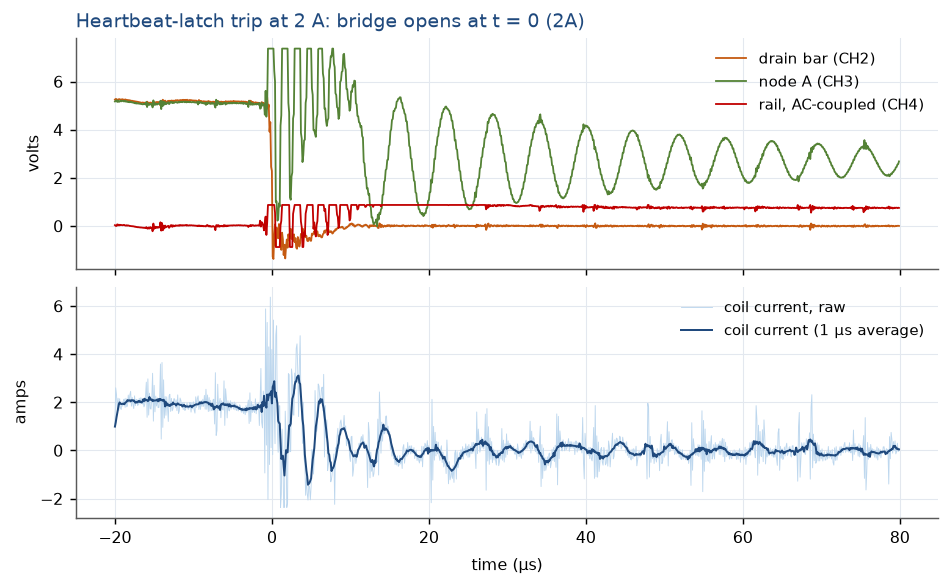

*With all four bridge FETs off, the coil current returns to the supply through three diodes: up from ground through the pass-bank body diodes (drain bar ≈ −0.5 V), through Q4 and Q1's body diodes into the rail. Afterwards node A rings at ≈ 170 kHz. The rail trace (AC-coupled, 0.2 V/div) clips at +0.87 V.*

**Result:** bridge opened the moment DIO6 was pulled; 2 A → 0 in ≈ 10–13 µs, as expected for ≈ 6.7 V across 45 µH.

**As predicted:** with the bridge open the PI saw zero current and drove OUT1 to the clamp (4100 counts) until the script stopped it. This is why the servo must be stopped before pressing the latch reset.

**Rail, first capture:** clipped at +0.87 V (0.2 V/div), so repeated at 0.5 V/div over 200 µs:

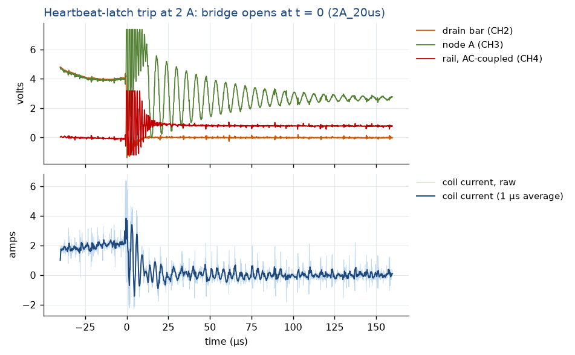

*Repeat at 2 A. The rail spikes by +2.5 V (1 µs average; +3.2 V peak samples) for ≈ 10 µs while the coil current is pushed back into the supply, then sits ≈ 0.85 V higher.*

**Spike, +2.5 to +3.2 V for ≈ 10 µs:** the returned current through the bench supply leads' inductance. This is the bench preview of the SE-600-5 question; the real numbers need the 100 A setup with 4/0 cable.

**Plateau, ≈ +0.85 V, slow:** most likely not stored energy (that would need an output capacitor of only ≈ 20 µF) but the lead resistance. At 2 A the rail bar sits ≈ 0.85 V below the supply's setting (≈ 0.4 Ω of leads and contacts) and returns when the load vanishes. To confirm: DC rail reading at 2 A and at 0 A.

## 3i · Hold noise, dither on/off [done, open finding]

**Why.** The spec is a steady hold within 0.1 %. One OUT1 count moves the bench current by ≈ 0.008–0.14 A, so the firmware dithers OUT1 (switches it ±1 count very fast so the average falls between counts). This test compares the hold with dither on and off.

**How.** Closed-loop 2 A hold; four 16.8 ms current records (1 µs per sample) plus 4 s of slow readings, dither on, then off. DC readings of the rail at the hold and at zero current.

| Run (coil lifted) | Current noise, 1 µs samples | 100 µs averages | Spectrum |
|---|---|---|---|
| Dither on, chosen gains | 165 mA rms | 15 mA rms | strong line at 11 kHz |
| Dither off, chosen gains | 164 mA rms | 15 mA rms | same line |
| Dither on, half gains | 162 mA rms | 11 mA rms | same line, same height |

The noise was 4× this morning's (40–54 mA rms), so the source was tracked down instead:

| Open loop, OUT1 fixed at 3935 (≈ 1.93 A) | Current at 10–12 kHz | Drain bar at 12 kHz | Gate at 12 kHz |
|---|---|---|---|
| Coil lifted | ±116 mA | ±467 mV | ±0.1 mV |
| Coil on the table | ±31 mA | ±67 mV | ±0.1 mV |
| Coil lifted, varistor removed | ±165 mA | ±494 mV | — |

**Finding:** the ringing is not the control loop (it stays with half the gains and in open loop) and not the gate stage (the gate does not move at 12 kHz). With the bank's gate fixed, its current is fixed, so the 12 kHz current must circulate in a loop that bypasses the bank: the coil with a capacitance of ≈ 4 µF across it (45 µH and 12 kHz). In free air the coil loses little energy per cycle (Q ≈ 100) and noise keeps it ringing; on the table the eddy currents absorb the energy.

**Checked and ruled out:** there is no capacitor on the H-bridge; the only part across the coil was a varistor (Digi-Key 495-6502-ND). With it removed and the coil still lifted, the 12 kHz ringing is unchanged (current ±0.17 A, drain ±0.49 V). So it is not a passive resonance with a capacitor: the bank's current must be responding to its own drain voltage, which makes the stage an oscillator together with the coil's inductance.

**Also ruled out:** the drain swing coupling back onto the gates (Miller effect). CH4 was on a pass-FET gate pin, and that gate is steady to ±0.1 mV during the ringing.

**Nothing bypasses the bank:** the ballast resistors could not be probed, but the rail ripple measures the supply current. Rail ±0.059 V vs current ±0.207 A, lagging by 233°, is exactly the supply leads (0.17 Ω, matching the 0.2 Ω measured at DC, plus ≈ 3.6 µH). So supply, bank and coil carry the same oscillating current, while the bank's gate stays fixed: the bank changes its current by itself, through its drain voltage and/or die temperature.

| Open loop, coil lifted | Current | Frequency | Current swing | Drain swing (p-p) |
|---|---|---|---|---|
| OUT1 3800 | 0.71 A | 20 kHz | ±0.08 A | 1.64 V |
| OUT1 3870 | 1.23 A | 15 kHz | ±0.11 A | 1.64 V |
| OUT1 3935 | 1.93 A | 11.5 kHz | ±0.15 A | ≈ 1.6 V |

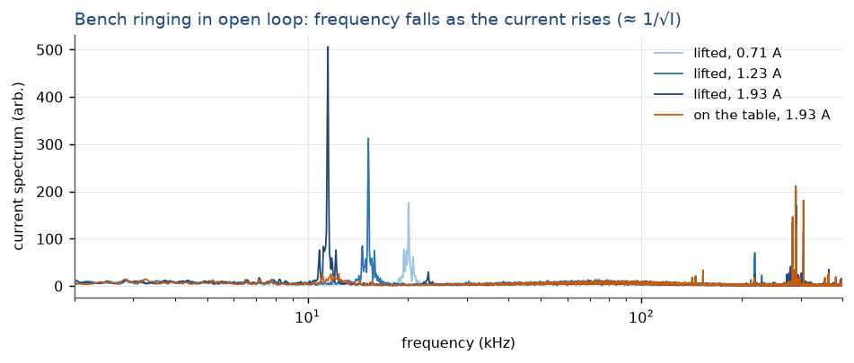

*Lifted: one sharp line that moves down as the current rises. On the table at 1.93 A: no line in open loop.*

**Pattern:** frequency ∝ 1/√I (f·√I ≈ 16–17), and the drain swing is always ≈ 1.6 V p-p: the oscillation grows until the drain reaches rail + one diode drop, where the bridge freewheel diode clamps it.

**Coil on the table, closed loop at 2 A (later):** the line is back at 13.6 kHz, 110 mA rms, so the table only damps it marginally (position, current and temperature decide).

**Dither:** on vs off makes no difference (110 / 110 mA rms; 100 µs averages 20.6 / 19.9 mA). Expected on the bench: near 2 A one OUT1 count is only ≈ 8 mA. The dither test belongs to the 100 A plant (≈ 0.14 A per count).

**Average current:** the means of four 16.8 ms records agree to ±0.2 mA (0.01 %), well inside the 0.1 % spec.

**Why it matters:** a similar ringing on the MOT would put a few-percent field ripple at 10–20 kHz, far above the loop's bandwidth. Needs understanding before the 100 A build (FET data near threshold; try an RC damper across the coil or a drain-bar snubber).

**DC rail:** 5.06 V at zero current, 4.65 V at 2 A: the supply leads and contacts drop 0.41 V (≈ 0.2 Ω), about half of the 0.85 V plateau seen in 3h.

## Extra bench tests (second session) [done]

**Why.** While the damper was being soldered: check the chosen gains over the whole bench range, the long-term stability of a hold, and flip reliability. Coil flat on the table, kp 31.2 / ki 942, limit 2.2 A. Run by a second Claude session that held the board meanwhile.

| Step | 10 / 90 / 98 % | Overshoot (64 µs avg) | Hold noise (1 µs) |
|---|---|---|---|
| 0 → 0.5 A | 0.18 / 1.08 / 1.36 ms | +37 mA | 69 mA rms |
| 0 → 1.0 A | 0.08 / 0.72 / 0.95 ms | +25 mA | 64 mA rms |
| 0 → 1.5 A | 0.12 / 0.55 / 0.70 ms | +30 mA | 74 mA rms |
| 0 → 2.0 A | 0.10 / 0.46 / 0.62 ms | +28 mA | 85 mA rms, faint 13.8 kHz line |
| 0 → 2.2 A | 0.08 / 0.44 / 0.63 ms | +41 mA | 83 mA rms, no sample above the trip |
| 2.2 → 1.0 A | 0.01 / 0.24 / 0.34 ms | 27 mA past | 63 mA rms |
| 1.0 → 0 A | 0.01 / 0.68 / 1.22 ms | 32 mA past | ends at 18 mA (floor leakage) |
| 2.0 → 0 A | 0.02 / 0.47 / 1.49 ms | 40 mA past | ends at 14 mA |

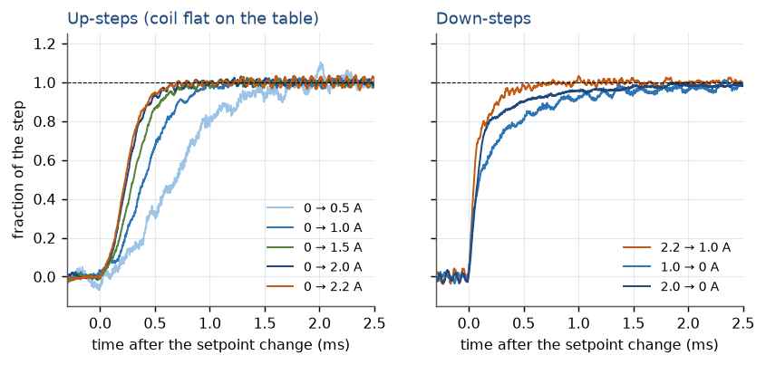

*Up-steps get faster with current (the bank's gain rises with current); the 0.5 A step is the slowest. Down-steps drop fast at first, then approach the target as the integrator unwinds.*

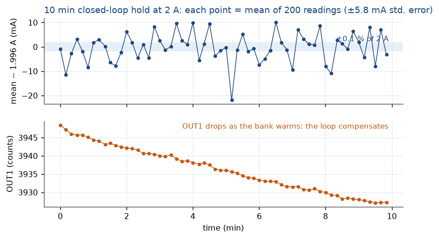

*The point-to-point scatter (6.1 mA) equals the statistical error of each point, so no drift is visible above it; window means after the first minute agree within 0.5 mA. Over the same 10 min OUT1 fell by 21 counts: at fixed gate the warming bank would have drifted by ≈ 0.2 A, and the loop removed it.*

**Steps:** overshoot is at the noise level everywhere (25–41 mA, against 56–77 mA p-p hold noise in 64 µs averages); no trips. The gains hold across 0.5–2.2 A.

**Long hold, 2.0 A for 10 min:** mean 1.9958 A; fitted drift +0.19 mA/min; window means 1.9925 (first minute, warming up), 1.9959, 1.9964, 1.9962 A, i.e. stable within ≈ 0.5 mA (0.025 %) after the first minute. Each point resolves only ±5.8 mA, so a per-point 0.1 % check needs longer averages.

**Flips, 20 at ±1 A:** 20 of 20 good, no TIMEOUT_HOLD, no trip; current after re-signing ±1.003–1.025 A; request → RUN in the new polarity ≈ 1.1 ms (host-timed, includes polling).

## Damper test [passed]

**Why.** If the 10–20 kHz ringing (3i) is a weakly damped oscillation of the bank together with the coil, a resistor across the coil at those frequencies should remove its energy each cycle. A capacitor in series keeps the resistor out of the DC path.

**How.** 1 Ω + 2.2 Ω (1/4 W metal film) in series with 10 µF (non-polarized) across the coil terminals, next to the varistor; sized so the damper's ≈ 3.2 Ω matches the coil's impedance at 12 kHz (≈ 3.4 Ω). Coil lifted onto the box (the condition where it rang reliably). The same open-loop captures at three currents, then a closed-loop 2 A hold.

| Open loop, coil lifted | Strongest line 5–30 kHz, no damper | With damper | Drain ripple, no damper → damper |
|---|---|---|---|
| OUT1 3800 (≈ 0.7 A) | 43 mA at 20 kHz | 2.5 mA (noise) | 328 → 107 mV rms |
| OUT1 3870 (≈ 1.2 A) | 76 mA at 15 kHz | 2.8 mA (noise) | 326 → 71 mV rms |
| OUT1 3935 (≈ 1.9 A) | 124 mA at 11.5 kHz | 4.9 mA (noise) | 366 → 63 mV rms |

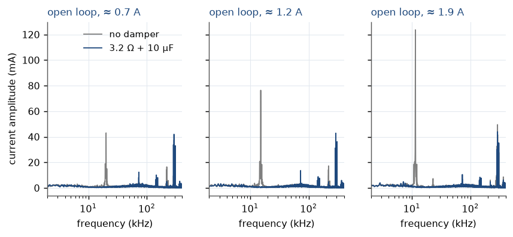

*The sharp ringing line disappears at every current. What remains is the ADC noise near 290 kHz and a small new line at ≈ 72 kHz (≈ 10–14 mA), probably the damper's capacitor with its wiring.*

**Result:** the damper removes the ringing completely in free air. Closed-loop 2 A hold, coil lifted: 75 mA rms in 1 µs samples (ADC noise), **6.5 mA rms in 100 µs averages** (15–21 mA before), record means identical to 0.1 mA.

**For the MOT build:** plan an RC damper across the coil pair, sized for the pair (16 µH): R ≈ ωL at the expected ringing frequency, C large enough to pass it, and the resistor rated for the pulses at 100 A (heartbeat trip, flips). Confirm on the real coils.

## LEM inside the coil–damper loop: turn-off measurements (11-12, late) [done, open finding]

**Why.** With the damper and varistor across the coil terminals and the LEM on the lead between the bridge and that connection point, the LEM read coil + damper + varistor current. Current circulating only round coil → damper → coil (for example after the bridge opens) never passed through it, so a turn-off could look finished while the coil still carried current.

**How.** LEM moved so that the order along the lead is: bridge → damper/varistor connection → LEM → coil. Scope: CH1 IN1 tee (now true coil current), CH2 pass-bank drain bar, CH3 bridge node A, CH4 bridge node B (coil voltage = CH3 − CH4); all probe grounds on the source bar. Coil lifted, damper (3.2 Ω + 10 µF) and varistor fitted.

### Sign and loop check

Zero reading −0.06 A; open loop OUT1 3800 counts → +0.65 A (sign unchanged). Closed-loop 1 A step: 90 % in 0.61 ms, 98 % in 0.81 ms, +2.4 % overshoot (before: 0.54 / 0.73 ms, +2.0 % at 1.5 A). Measuring through the coil–damper resonance does not hurt the loop.

### Turn-off with the bridge closed (OUT1 snapped to 0)

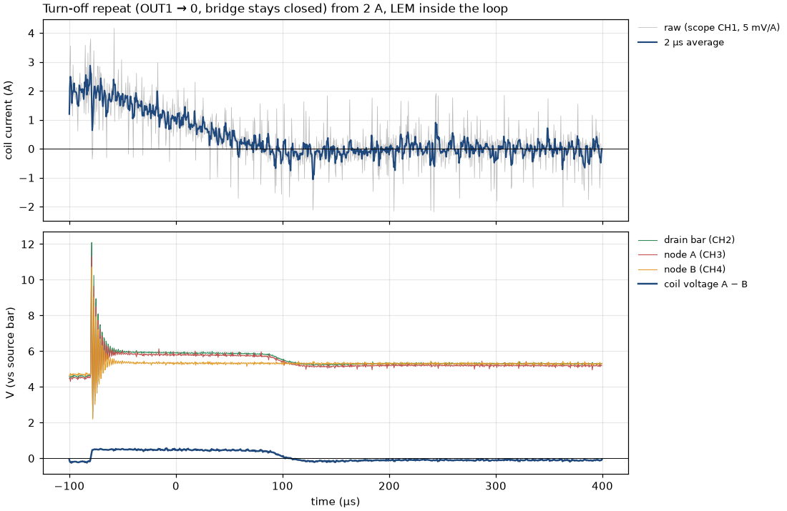

*OUT1 → 0 at about −80 µs. The drain bar goes to rail + one diode drop (freewheel); the coil voltage holds ≈ 0.5 V and the current falls linearly. The bank turn-off rings the drain bar up to 12.1 V for a few µs (≈ 500 kHz), just under the bank TVS (5KP12CA, ≈ 13.3 V).*

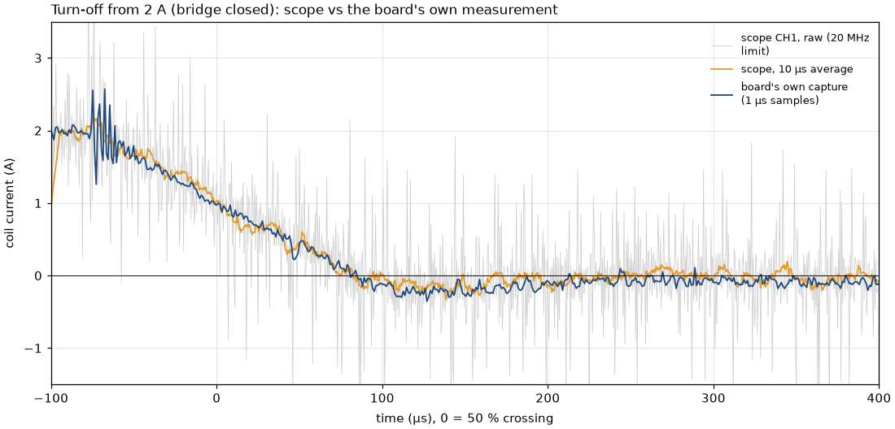

*Scope (raw and 10 µs average) and the board's own capture (1 µs samples, each the mean of 128 ADC samples) agree. After the current first reaches zero it swings to ≈ −0.2 A for ≈ 100 µs: the coil ringing once into the damper capacitor.*

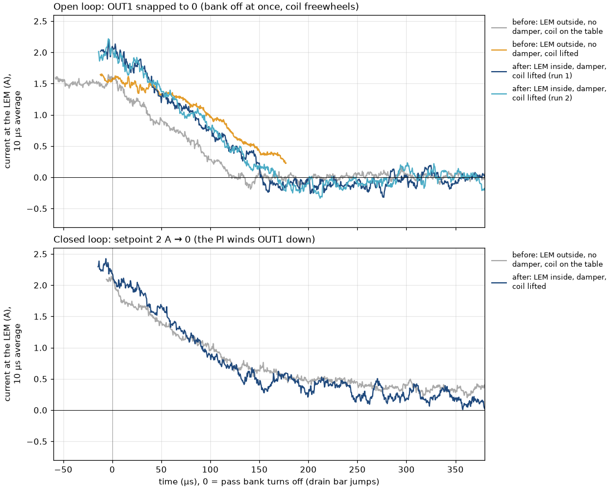

*Before (LEM outside, no damper, morning) and after (LEM inside, damper). The freewheel slope is similar; only the "after" runs show the small negative swing, which an LEM outside the loop cannot see. In closed loop both show the same slow tail. There is no run with the damper fitted and the LEM outside, so before/after also differ in damper and coil position.*

**Result:** 2 A → 0 in ≈ 170 µs (90 → 10 % in ≈ 130 µs), coil voltage ≈ 0.5 V, i.e. ≈ 12–13 mA/µs = V/L for 45 µH, then a ≈ −0.2 A swing that is gone by ≈ 200 µs. Two runs agree.

**Why the raw current trace looks so noisy:** the LEM chain gives only 5 mV per amp, and about 3 mV rms of pickup (mostly the Red Pitaya's clock) sits on the IN1 line even with the scope's 20 MHz limit on. With the current truly zero the raw scope trace shows 575 mA rms, 232 mA in 2 µs averages, 91 mA in 10 µs, 36 mA in 50 µs: white noise, not current (a 1 A change in 1 µs would need ≈ 45 V across the coil). The real steadiness comes from the board's averaged measurement: 6.5 mA rms in 100 µs at a closed-loop 2 A hold, mean stable to 0.5 mA over 10 min.

### Bridge opened at current

**How.** Instead of pulling the heartbeat wire, the firmware opened the bridge: during a closed-loop 2 A hold, `trip_timeout` was set to 0 ("open the bridge at once") and `trip_level` to 1 A, so the over-current trip fired and dropped OUT1 and bridge enable on the same clock. Same electrical event as the heartbeat-latch trip, but the firmware knows about it (no integrator wind-up). Settings restored afterwards (2.79 A, 3 ms).

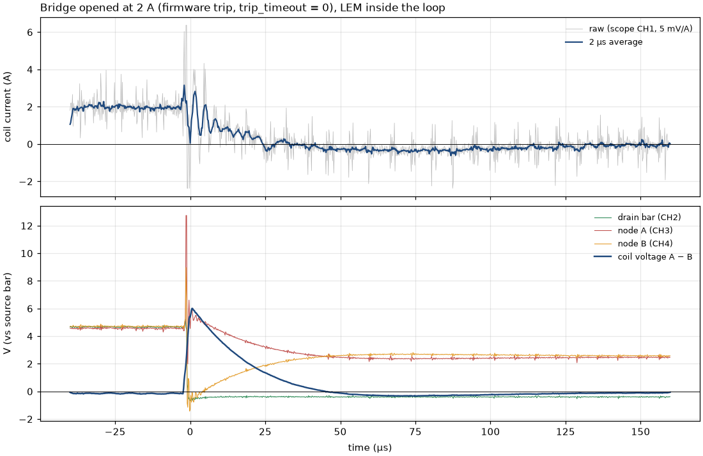

*The coil voltage jumps to ≈ 6 V = 2 A × 3.2 Ω (the damper resistor carries the coil current) and decays; the current reaches zero in ≈ 25 µs, swings to ≈ −0.3 A and is gone by ≈ 150–200 µs. A 12.7 V, 0.4 µs spike on node A at the switching instant (wiring inductance).*

**Result:** with the damper fitted, the coil energy goes into the damper, not back into the supply (6 V stays below rail + two diode drops). The morning's "current gone in ≈ 10 µs" (3h) was measured without the damper and with the LEM outside; it does not describe the coil now.

**For the MOT (100 A, 16 µH):** the damper cannot carry 100 A at a few volts, so the bridge body diodes will clamp the coil voltage at ≈ rail + 1.5 V and most of the energy (≈ 0.08 J) goes into the supply; the damper's share sets its pulse rating. Size the MOT damper near critical damping (R ≈ 2√(L/C)) so the coil current does not ring back through zero after a turn-off.

### Heartbeat-pull attempt: unexplained 5 A surge

**What happened.** The script held 2 A closed loop and waited for DIO6 to be pulled. Instead of the expected current collapse, the firmware over-current trip fired. The scope (triggered on the drain bar falling) caught the current at ≈ 4.7–5 A with the bridge closed and the rail sagging from ≈ 4.3 to 1.9 V; the trip then turned the bank off and the coil freewheeled down. The latch reset was pressed before the LEDs could be read.

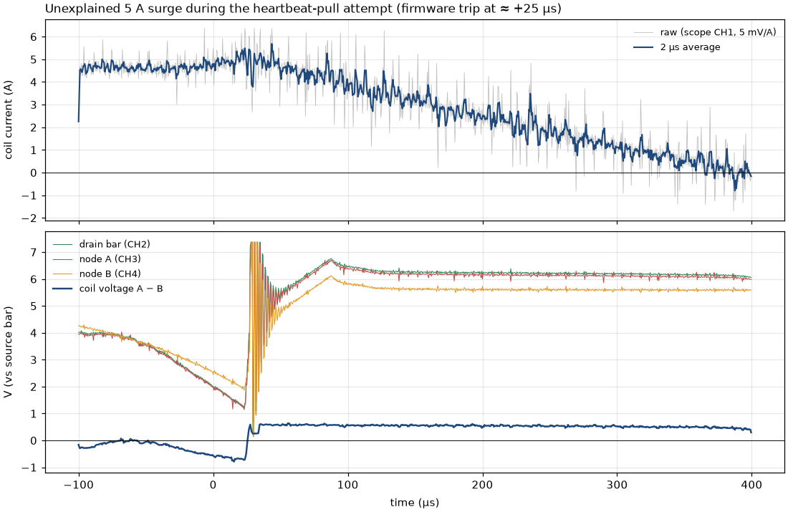

*Current already ≈ 4.7 A at the start of the window, the 3 A bench supply in current limit (its output capacitors supply the rest), firmware trip at ≈ +25 µs, then the normal freewheel slope.*

**Latch check afterwards (supply output off, servo in RUN at setpoint 0, OUT1 wound up to the clamp):** DIO6 pulled for ≈ 2 s → red on, amber off; re-plugged → green on, red stays on, amber stays off. ✓ The latch holds through a full heartbeat loss. (A quick-flick test was not done.)

**Cause not determined.** Candidates: (1) the latch reset pressed while the servo was still in RUN with the integrator wound up (the hazard behind "stop the servo before reset"); (2) a heartbeat loss too short to show in a 2 s pull test; (3) a disturbance on the current reading while handling wiring. The firmware trip caught it (backup layer worked).

**Underlying weakness:** the firmware cannot see the latch. When the latch opens the bridge, the PI winds OUT1 up to the clamp, and any reset or glitch re-closes the bridge at full drive (at 100 A: a hard surge). Proposed fixes (not done): wire the latch output to DIO5 (spare fault input) and have the firmware stop and clear the integrator on it; and/or stall detection in firmware (OUT1 at the clamp while the current is far below the setpoint for > ~1 ms → stop).

### Closed-loop square pulse

**How.** Setpoint 0 → 2 A → 0 with an 8 ms flat top, recorded by the board's own capture (16.8 ms window) and the scope.

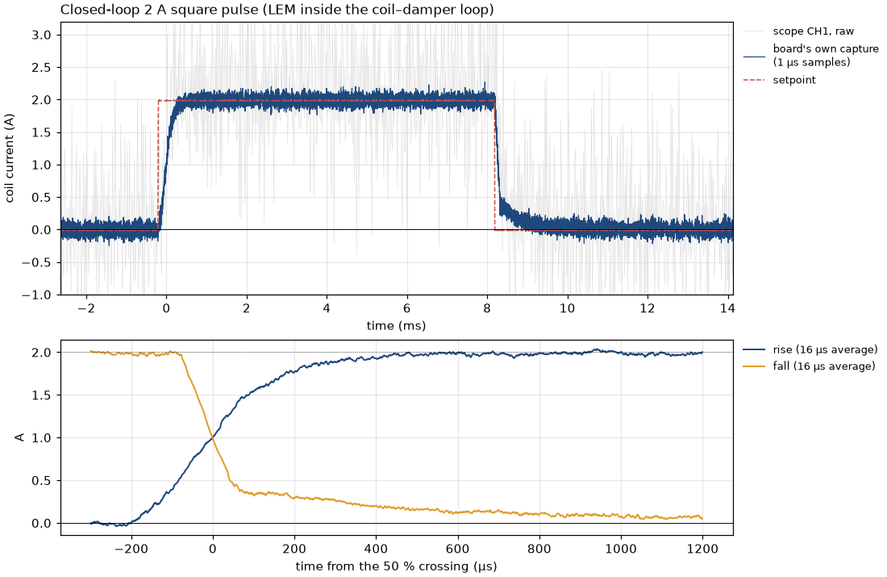

*Top: the whole pulse. Bottom: both edges overlaid on their 50 % crossings (16 µs averages).*

**Rise:** 10 → 90 % in 360 µs, 98 % ≈ 0.56 ms after the start, +2 % overshoot. Set by the PI gains; the 5 V rail could do it in ≈ 20 µs at 2 A. **Flat top:** 1.989 A. **Fall:** 2 A → 0.35 A in ≈ 130 µs (freewheel rate), then a slow tail: 10 % at ≈ 0.43 ms, 2 % at ≈ 1.3 ms.

**The tail is the controller:** after the setpoint goes to 0 the error is small once the current is below ≈ 0.35 A, so the integrator only unwinds at ≈ 280 counts/ms through the bank's turn-on region (3540–3700 counts). The open-loop turn-off (OUT1 straight to 0) has no tail. **Fix (proposed, not done):** a firmware option "snap OUT1 to zero": when the setpoint enters the zero window, OUT1 → 0 at once and the integrator → floor; the coil then freewheels at its natural rate. Works with the present hardware (bridge stays closed, same as the over-current trip); the TVS + blocking diode are only needed for the separate bridge-open fast turn-off.

### What this predicts for 100 A on the MOT pair (16 µH)

| Edge | Model | Estimate |
|---|---|---|
| Turn-off, bridge closed (freewheel) | L dI/dt = −(Vf + I·Rfw), Vf ≈ 0.6–1.0 V, Rfw ≈ 8–12 mΩ → t = (L/R)·ln(1 + I₀R/Vf) | ≈ 1.3 ms (1.0–1.7 ms); bench check: 45 µH × 2 A / 0.55 V ≈ 165 µs vs 170 µs measured |
| Bridge opened at current | coil clamped at ≈ rail + diodes ≈ 7–8 V | ≈ 0.2 ms, energy into the supply |
| Future fast turn-off (blocking diode + 30 V TVS) | ≈ 30 V across the coil | ≈ 50 µs |
| Rise 0 → 100 A | Vcoil = Vrail − I·Rseries − Vbank: ≈ 0.3 A/µs at 0 A, ≈ 0.17 A/µs at 100 A | ≈ 0.4 ms hardware limit; ≥ 0.5 ms with the 200 A/ms firmware ramp; depends on how hard the bank turns on at 100 A with the 5.18 V gate ceiling (Test 4) |

Coil current only; the field at the atoms also waits for chamber eddy currents (unknown).

## Rev 5: zero-setpoint snap, built and tested (11-12, evening) [passed]

**Why.** The closed-loop square pulse showed a slow tail at turn-off: the PI winds OUT1 down through the bank's turn-on region, so the last ~0.35 A took ~1.3 ms. The open-loop turn-off (OUT1 straight to 0) has no tail.

**What changed (register map rev 5).** In RUN, closed loop, when the requested setpoint averaged over one 1 µs loop tick is within `snap_thresh` of zero, the firmware forces OUT1 to exactly 0 and holds the integrator cleared: the bank shuts off at once and the coil freewheels with the bridge closed. Only a zero setpoint triggers it (decided 11-12), so small currents can still be held. One count of hysteresis; status flag `snapped`. Settings in channels.toml: `snap_zero_enable = 1`, `snap_zero_amps = 0.1` (4 counts, provisional). Switching it off restores the rev 4 behaviour.

**How it was tested.** First in simulation: the real Verilog (cocotb + Icarus) closed around the plant model, five new tests. Then built on the lab laptop (Vivado; timing met, WNS +0.003 ns), deployed to the MOT board with the bench profile, and the 2 A closed-loop pulse repeated with the snap off and on (board capture; the scope refused connections this time).

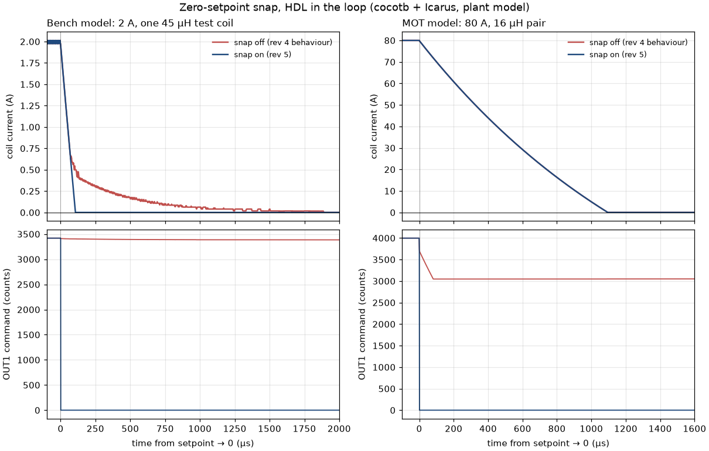

*Simulation, HDL in the loop. Bench model (2 A): 0.1 % in 108 µs with the snap, 1.74 ms without. MOT model (80 A): identical either way; there the PI already gets the bank off, and the snap guarantees it.*

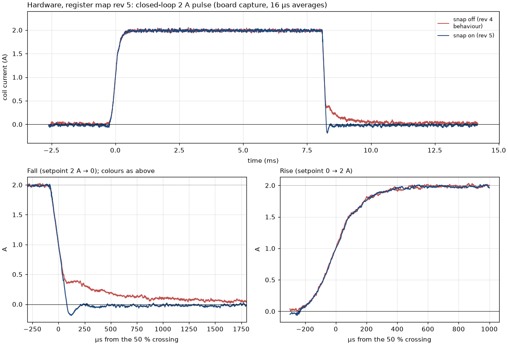

*Hardware. With the snap on the fall runs at the freewheel rate all the way to zero; the −0.17 A dip is the damper capacitor ringing back once (as predicted). The rise is unchanged.*

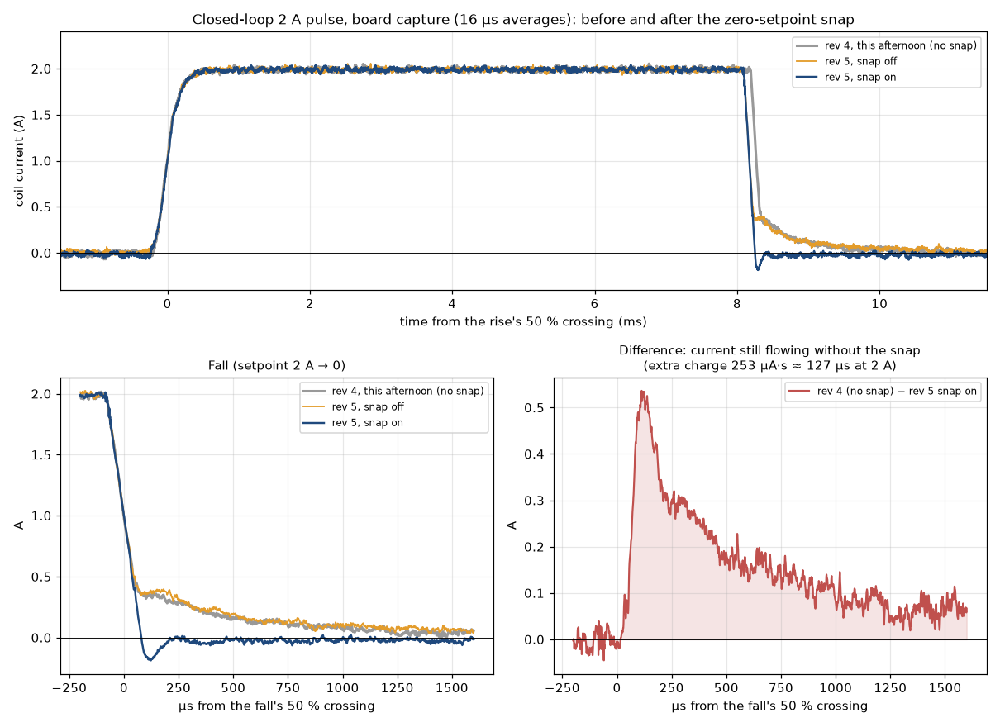

*The same 2 A pulse with this afternoon's rev 4 firmware and tonight's rev 5 (snap off and on). Rise and flat top are identical; rev 4 and rev 5 with the snap off overlap on the fall, so switching the snap off reproduces the old behaviour exactly. Bottom right: rev 4 minus rev 5 with the snap on, the current the old firmware was still pushing through the coil after the setpoint went to zero (~0.35 A just after the fast part, still ~0.1 A at 1.5 ms; the peak near 120 µs includes the new run's damper dip). Times from each fall's 50 % point: fall to 2 % at 1220 µs (rev 4), 1241 µs (rev 5 off), 77 µs (rev 5 on).*

| 2 A pulse (hardware) | Rise to 98 % | Fall to 10 % | Fall to 2 % | Undershoot |
|---|---|---|---|---|
| Snap off | 0.55 ms | 0.48 ms | **1.55 ms** | −0.03 A |
| Snap on (4 runs) | 0.55–0.60 ms | 0.13 ms | **0.14 ms** | −0.16 to −0.20 A |

**Other checks on the hardware:** setpoint 0 and 2 counts (55 mA) → snapped on every read; 10 counts (0.27 A) → not snapped, the loop holds 0.275 A; analog IN2 path at 0 V → snapped on 3000/3000 reads (no chatter); snap switched off → OUT1 back on the PI floor.

**Re-test after a Red Pitaya power cycle (redeploy, re-zero):** same results (fall to 2 % in 0.14 ms with the snap, 1.31 ms without; checks pass). **IN2 noise at 0 V:** 4.1 counts rms per sample, but the 1 µs averages the snap uses have sd 0.43 counts and never exceeded +2.45 counts in 2560 ticks (threshold 4): about 1.5 counts of margin with the input terminated.

**To watch:** single status reads of IN2 swing ±5 counts (per-sample noise). Measure IN2 noise and drift with the control computer connected and set `snap_zero_amps` from that. Timing margin of this build is thin (+3 ps); check it on the next firmware change.

## Open items

- ~~Bench model: coil L 9 → ≈ 45 µH; lab notes for day 2; bench doc recovery fix.~~ Done, commit 8edac7cc.
- Design the RC damper for the MOT pair (16 µH, near critical damping, pulse rating at 100 A); check the 72 kHz line it introduces. LEM between the two coils, damper across the whole pair (LEM inside the loop).
- ~~Firmware: "snap OUT1 to zero".~~ Done: register map rev 5, deployed 11-12. Still to do: set `snap_zero_amps` from the measured IN2 noise.
- **5 A surge / latch visibility:** wire the latch output to DIO5 and stop the servo on it, and/or firmware stall detection. Until then: always stop the servo before pressing reset.
- Test 4: scope the drain bar at turn-off (TVS clamp level at 100 A) and the node spikes when the bridge opens.
- Optional: node B probe or LCR meter to measure the test coil's L.
- **Bench ringing at 10–20 kHz (3i):** cured by the damper; mechanism still not understood.
- 3j uncooled duty test.
- Gate-voltage check of the bridge FETs during a flip (floating probe).
