<!-- Generated from the live log page used during the session (logs/testlog/benchtop_log.html on the lab PC; logs/ is not in git). Narrative lab notes: docs/lab_notes_2026-11.md. -->

# Benchtop Test Log 2 — the old test list, side by side with the new setup

2026-11-17 to 11-19 · Same bench as Benchtop Test Log 1 (bench supply 5 V / ≤ 3 A, profile `mot_bench`, the 12-turn test coil with its damper). New in the circuit: a blocking diode in the supply's + lead and a surge protector (TVS) across the bridge; firmware rev 6 (commit 92d4f15, branch `rev6-test`) that can open the bridge while current flows. Each test below links to the same test in log 1. From 11-18 afternoon: firmware rev 7 (commit 6bf3e93, branch `rev7-ff`) with setpoint feedforward; from 11-18 evening the coil damper is 8.2 Ω + 10 µF (was 3.2 Ω + 10 µF).

## How to read this log

Every test from log 1 that still means something was repeated. Results are given for three setups:

- **Log 1** (11-11 to 11-13, grey): the old setup. Turn-downs keep the bridge closed (the coil's current circulates through the bridge's built-in diodes); firmware rev 5; controller settings kp 31.2, ki 942.
- **11-17** (orange in the plots): the new parts fitted, firmware still rev 5 (bridge still kept closed), same controller settings. Shows that the parts alone change nothing.
- **11-18, the new setup** (blue): firmware rev 6 with all three fast switch-off options on (the bridge opens at once for a zero setpoint, a stop and a flip) and the **re-tuned controller settings** (kp 18.7, ki 374; see why).

**Words:** all words from log 1 apply. **Blocking diode** (DSS2x101-015A): a one-way valve for current in the supply's + lead. **TVS** (5KP30A): a diode that conducts hard above ≈ 33 V, from the rail bar (the bridge's + bar) to the return bar. **Fast switch-off**: opening the bridge while current flows; the coil's current then has to push through the TVS (≈ −35 V; on the bench mostly into the damper) instead of circulating through the bridge's diodes (≈ −1 V), so it dies away much faster. **“To zero”**: from the current leaving 90 % until it first reads below 2 %. **“Settled”**: until it stays within the stated band.

## Summary

**Everything from log 1 works on the new setup.** All flips and reversals (A/B/C orders, setpoint-first, corner cases), stops and trips around flips, the arm line, the setpoint ramp limits, 50 of 50 shot sequences, holds, steps across the bench range: every case ends in the right state, direction and current. The noise on the reading is unchanged.

**Switching off is 4–5× faster to zero:** 2 A → 0 in **33 µs** instead of ≈ 140 µs (setpoint to zero, stop, flip). Counting the damper's −0.3 A swing below zero, the current stays within ±5 % after 135–143 µs instead of 197–222 µs (≈ 1.5×). On the MOT coils at 100 A the gain is expected to be much larger (≈ 1.3 ms → ≈ 40 µs, computer model), because there the TVS, not the damper, sets the speed.

**Rising is about 2× slower — because of the controller settings, not the new parts.** On 11-18 the controller began to oscillate at 7 kHz (the coil-with-damper resonance) above 1.85 A, so its settings were lowered (re-tune). With the 11-17 settings the fast switch-off gave the fastest full reversal so far, 0.89 ms (log 1: 0.95 ms); with the 11-18 settings the same reversal takes 1.29 ms to reach 90 % (log 1: 0.74 ms). The choice of settings is open (see Next).

**Feedforward (rev 7, 11-18/19) gives the speed back without touching the settings:** the board now jumps OUT1 straight to a measured value for the requested current and the controller only corrects the rest. 0 → 2 A is within 5 % after **0.39 ms** (11-18 settings alone: 1.29 ms), the one-command reversal reaches 90 % of −2 A in **0.55 ms** (1.30 ms) and is within 2 % after ≈ 1 ms (≈ 1.8–2.7 ms). Holds, noise and 50 of 50 shot sequences are unchanged. It needs a slower setpoint ramp on the bench (5 A/ms): the transistors overshoot by themselves when OUT1 jumps (details).

**The 220 kHz burst has a trigger:** the bridge closing again from “open at zero” at the start of a step (6 of 10 pulses; 0 of 10 with the bridge kept closed). It is on the reading, not in the coil (details).

**Open findings:** an unexplained drop-then-trip during one 2 A hold (11-18, not reproduced); a 229 kHz burst on the reading when the bridge closes again (source not found yet); the damper's resonance moved after it was reconnected; the switch-off burst on the reading has grown; the rail bar stays charged after a fast switch-off without the damper.

## Side by side, test by test

Log 1's tests in log 1's order. “New setup” = 11-18 (rev 6, bridge opened, new controller settings) unless marked 11-17. Click a test name for log 1's section; “details” goes to this log's section.

| Log 1 test | What it checks | Log 1 result | New setup result | Verdict |
|---|---|---|---|---|
| Before current (hardware) |
| Test 0, 1, 2 · pre-checks, gate stage, sensor zero | Each part works on its own | Passed (wiring faults fixed; gate gain 7.93) | Not repeated: unchanged hardware. New parts checked with a meter (F0) and at power-on (F1); sensor zero re-measured 11-17 (IN1 +7, IN2 +6 steps) after the sensor-supply incident | [checked] |
| 3c · Current scale | The board reads amps correctly | Full scale 224 A (27.3 mA per step), against the supply's ammeter | Not re-measured against the ammeter. The sensor chain was repaired on 11-17; the board's reading follows the setpoint (0.5 A → 0.499 A), but that does not check the scale | [to re-check] |
| Controller and protection |
| 3d · Controller settings | Fast and stable current control | kp 31.2, ki 942: half the strength where it oscillates (at 1–2 A); 0 → 2 A to 98 % in 0.62 ms | **Changed 11-18:** those settings oscillate at 7 kHz above 1.85 A with the damper as it is now. New kp 18.7, ki 374: stable to 2.2 A with margin ×1.4; 0 → 2 A to 98 % in 1.41 ms. details | [slower, stable] |
| 3e · Over-current trip | The current limit | Trips at 2.85 A (set 2.79 A), before the supply's 3 A limit | Works: trip right after a flip (level lowered to 1.5 A) on 11-17 and 11-18; a real trip at the 2.79 A level on 11-18 (incident). Now needs 6 readings in a row (was 4) because of the larger switch-off burst | [works] |
| 3f · Switch-off: where the current goes | The current's path when the transistors switch off | Circulates through the bridge's diodes, dies away in ≈ 170 µs; TVS never reached | With the bridge opened: into the damper on the bench (2 A → 0 in 33 µs, then a −0.3 A swing); without the damper into the TVS, which clamps at 45–50 V for ≈ 1 µs. details | [new path works] |
| Flips and reversals |
| 3g · Reversals in three orders | Full ±2 A reversals as the control computer will send them | 12 of 12; fall to zero 141–143 µs (snap firmware) | 12 of 12 (11-17 and 11-18); fall to zero **37 µs**; total slower (A/C 90 % at 2.4–2.5 ms vs 1.9 ms) because of the new settings and the PC's two-command delay. details | [works, faster to zero] |
| 3g · Setpoint first, then flip (20 runs) | The order the control computer was told to use | 20 of 20 | 20 of 20 (11-17, 11-18). With the new settings the sign change alone brings the current to zero more slowly (≈ 0.4 ms): with the fast flip, **flip first or both together** is now the faster order. details | [works] |
| 3g · Flip corner cases | Flip at 0 A, while rising, two requests close together | All as designed | All as designed (11-17, 11-18). A request during a flip is still ignored (checked with the flip stretched to 4 ms: the fast flip ends ≈ 0.2 ms sooner). details | [works] |
| 3g · Safety gap (dead time) | All four bridge switches off for 1 µs at a polarity change | 1.0 µs each side, on the scope | Not re-measured on the scope. Same firmware setting; checked in the firmware simulation for the new open-bridge flips | [sim only] |
| 3h · Safety-board cut-off at current | The hardware cut-off while current flows | Bridge opens at once; supply jumps +2.5–3.2 V for 10 µs | Not repeated (F6 prepared, cancelled 11-17). Expected: the coil's energy now goes into the TVS / damper instead of the supply | [not repeated] |
| Fastest full reversal | Sign + flip in one command (like the control computer) | 90 % of −2 A at 0.74 ms; within ±2 % at 0.95 ms | 11-17, fast flip with the old settings: **0.64 / 0.89 ms** (the fastest yet). 11-18 with the new settings: 1.29 ms to 90 %. details | [faster with old settings] |
| Holds, steps, noise |
| 3i · Steadiness of a held current | Is a held current steady? | Averages agree within ±0.2 mA; 10–20 kHz ringing fixed by the damper | 90 s at 2 A: average 1.996 A, 7 kHz wobble 3–5 mA, no drift (11-18). 45 s: 1.997 A, 8 mA scatter. details | [works] |
| Extra checks · steps across the range | Steps 0 → 0.5 … 2.2 A and down | 98 % in 1.36 / 0.95 / 0.70 / 0.62 / 0.63 ms; to zero 1.2–1.5 ms (before the snap) | 11-17: unchanged. 11-18: 2.99 / 1.59 / 1.31 / 1.41 / 1.34 ms (slower: settings); to zero **0.03 ms**. details | [slower up, faster down] |
| Damper test | Does the damper stop the ringing? | Yes: 43–124 mA → 2.5–5 mA | Still stops the 10–20 kHz ringing, but its own resonance moved lower after it was reconnected (11-18: 4.6 kHz instead of 5.3 kHz) and set the controller's limit. details | [open finding] |
| Rev 5 zero snap | A zero setpoint switches the transistors off at once | 2 A → 2 % in 0.14 ms (was 1.55 ms) | Still there when `fastoff_zero` is off (11-17: 145 µs). With it on: **33 µs**, 50 of 50 shots | [works, faster] |
| Snap in flips and stops | Stops and flips reach zero at the coil's speed | Stop: 139–140 µs to zero | Stop with the bridge opened: **34 µs**. details | [works, faster] |
| Zero-current noise reference | New tones on the reading? | Single samples 58–67 mA; 0.1 ms averages 6–10 mA | Unchanged; no new tones (11-17, 11-18). 0.1 ms averages at 2 A 10 mA (log 1: 6 mA): weaker controller. details | [unchanged] |
| Day 3: sequences without the control computer |
| D1 · Stop and trip around a flip | Every combination ends safely | All end idle or tripped, bridge open | Same (11-17, 11-18); the stops now open the bridge at once. details | [works] |
| D2 · Arm line while running | Dropping and raising arm while running | Nothing happens; flips with arm low ignored | Same, all four cases (11-18). details | [works] |
| D3 · Setpoint ramp limits | Ramps at the set rate | 2.09 / 1.04 A per ms | 2.09 / 1.04 A per ms (11-17, 11-18); zero still taken at once. details | [identical] |
| D4 · Shot sequence 50 times | A MOT-like sequence, every time | 50 of 50; holds within 0.3 mA, scatter 1–2 mA | 50 of 50 (11-17 both ways, 11-18). 11-18: final switch-off **33 µs** (log 1: 141 µs); holds 6–14 mA off in the short hold windows and 2–3 mA scatter (slower settling: settings). details | [works] |
| D5, D6 · Two programs at once; PC link lost | PC-side safety | Fixed (read-before-write); hold survives a lost link | Not repeated: PC software and network only, not touched by the new parts or rev 6 | [not affected] |
| Day 4: bench characterization |
| Q1 · Controller margin | How far from oscillating | Gain could rise ×3.3 at 2 A | 11-18: the old settings were at the limit above 1.85 A (resonance moved). New settings: margin ×1.4 at 2.2 A, ≈ ×1.9 at 2 A. details | [changed] |
| Q2, Q4 · 45-min hold; 1000 shots | Long-term steadiness and reliability | 0.07 mA rms; 1000 of 1000 | Not repeated at that length (90 s hold, 50 shots) | [short version only] |
| Q3 · Zero drift | The zero reading over time | ±5 mA; re-zero after warm-up | Re-zeroed warm on 11-17 (IN1 +7, IN2 +6); idle reading −4 mA on 11-18 (was −12 mA) | [re-zeroed] |
| Q6 · Trip noise margin, switch-off spikes | False trips from pickup | Spikes ±0.9 A, at most 2 samples; keep 4 in a row | The burst has grown: up to ±4–8 A for 1–3 samples (more with scope cables on the Red Pitaya). Bench trip now 6 in a row. details | [open finding] |
| Q5, Q7, Q8 · Transistors; models | Bank behaviour; predictions for 100 A | Done | Not repeated (unchanged hardware). The damper model was redone by the circuit-model session for the fast switch-off. details | [not affected] |

## Speed: the same events, three setups

**Why.** To see directly what the new setup gains. Every number is from the board's own recording (one sample per µs), measured the same way for all three setups.

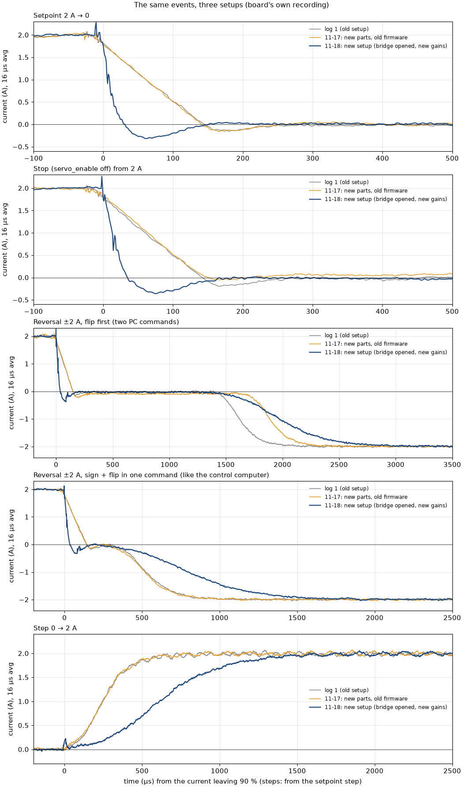

*Grey: log 1. Orange: 11-17 (new parts, bridge still kept closed). Blue: 11-18 new setup (bridge opened, new controller settings). Top two: the current reaches zero ≈ 4× sooner with the bridge opened, then swings ≈ −0.3 A for ≈ 0.1 ms (the coil ringing with the damper's capacitor). Middle and bottom: after zero, the new controller settings bring the current up the other way more slowly.*

| Event (bench, 2 A) | Log 1 | 11-17 new parts, bridge closed | 11-18 new setup | Gain |
|---|---|---|---|---|
| Setpoint 2 A → 0: to zero | 141 µs | 145 µs | **33 µs** (27–38, 50 shots) | 4.3× |
| Setpoint 2 A → 0: settled within ±5 % | 197 µs | 206 µs | **135 µs** | 1.5× (the damper swing) |
| Stop from 2 A: to zero | 139 µs | 144 µs | **34 µs** | 4.1× |
| Stop: settled within ±5 % | 222 µs | 142 µs | **143 µs** | 1.5× (vs log 1) |
| Flip (orders A and C): to zero | 141–143 µs | 143–146 µs | **37 µs** | 3.8× |
| One-command reversal: 90 % of −2 A | 738 µs | 734 µs; with fast flip **642 µs** | 1289 µs | 1.15× with the old settings; 0.57× with the new |
| One-command reversal: within ±2 % of −2 A | 954 µs | 987 µs; with fast flip **890 µs** | ≈ 2.7 ms (slow last approach) | as above |
| Step 0 → 2 A: 98 % | 0.62 ms | 0.60 ms | 1.41 ms | 0.44× (settings) |
| *MOT coils, 100 A → 0 (computer model)* | *≈ 1.3 ms* | — | *≈ 40 µs (into the TVS)* | *≈ 30×* |

**Reading the table.** The new parts and firmware do exactly one thing: they make the current reach zero faster (≈ 140 → ≈ 35 µs on the bench). Everything after zero — the rise to the new current — is set by the controller settings. On 11-17, with the old settings, that made the fastest reversal yet (0.89 ms). On 11-18 the settings had to be lowered, which costs more than the switch-off gains. On the bench the damper's swing below zero eats most of the gain in “settled” time; on the MOT coils at 100 A the TVS, not the damper, sets the switch-off and the gain is expected to be ≈ 30×.

## Controller re-tune (11-18) [done, trade-off open]

**Why.** After the damper was disconnected for F4 and reconnected (11-17 evening), the held current at 2 A wobbled at ≈ 7 kHz by ±0.17 A. Log 1 had the controller at half its oscillation limit; something had moved.

**How.** (D1) holds at 1.6–2.0 A with the 11-17 settings; (D2) the controller switched off with OUT1 fixed at the 2 A value; (D3) both settings × 0.7; (D4) the coil–damper ring after a bridge-opened switch-off, fitted and compared with the afternoon's. Then a sweep at 2.2 A (the bench maximum, where the transistors are steepest): four shapes of the controller (ki/kp = 10, 15, 20, 30 per ms), kp raised until the 7 kHz wobble exceeded 60 mA, backing off at once.

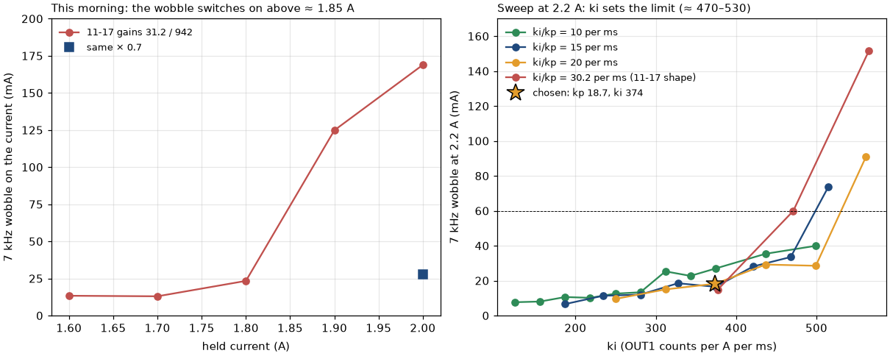

*Left: with the 11-17 settings the wobble switches on between 1.8 and 1.9 A; × 0.7 removes most of it at 2 A. Right: at 2.2 A the limit is set by ki (the part that adds up the error), ≈ 470–530 whatever the shape; kp matters little. Star: the chosen settings.*

**Diagnosis.** With the controller off (D2) the 2 A current is quiet (4 mA): the power stage does not oscillate by itself; the controller does, at the resonance of the coil with the damper's capacitor. That resonance moved after the reconnection: **4.6 kHz, damping 0.81** (afternoon: 5.3 kHz, 0.87), i.e. inductance × capacitance ≈ 1.3× larger. A lower, less damped resonance is easier for the controller to excite, and the transistors respond more steeply at higher current, so the margin ran out at ≈ 1.85 A.

**Chosen:** kp 18.7, ki 374 (`[mot_bench]`, 11-18). Margin ≈ ×1.4 at 2.2 A, ≈ ×1.9 at 2.0 A; a 90 s hold at 2 A wobbles by only 3–5 mA (11-17 settings this morning: 169 mA). Plain “× 0.7” would still have oscillated at 2.2 A.

**Price:** rises are ≈ 2× slower (0 → 1.5 A, 90 %: 1.3 ms instead of 0.55 ms, measured back to back), so reversals and the short holds of the shot sequence are slower to settle. **Better fix:** restore the resonance (was the coil moved while the damper was reconnected? LCR-check the damper capacitor and its connections), then go back towards the 11-17 settings. For the MOT this does not carry over directly: tune in Test 4 with the final damper (or none) fitted, at several currents.

**Found on the way (PC software):** the first sweep tripped. The script changed the controller's ki *shift* (its binary scale) while running; the integrator is stored before that scale, so its output doubled at once, OUT1 jumped to its limit and the trip fired at 2.8 A. The sweep was then done with the shift fixed. The dashboard and scripts should refuse a ki-shift change while the servo runs (to-do).

## Reversals (log 1: 3g) [passed]

**Why.** The main thing the control computer will ask for: a full ±2 A reversal. Sent from the PC as two commands (flip and setpoint sign change) in three orders — A together, B setpoint first, C flip first — both directions, twice each; and “setpoint first, then flip” at five delays, 20 runs.

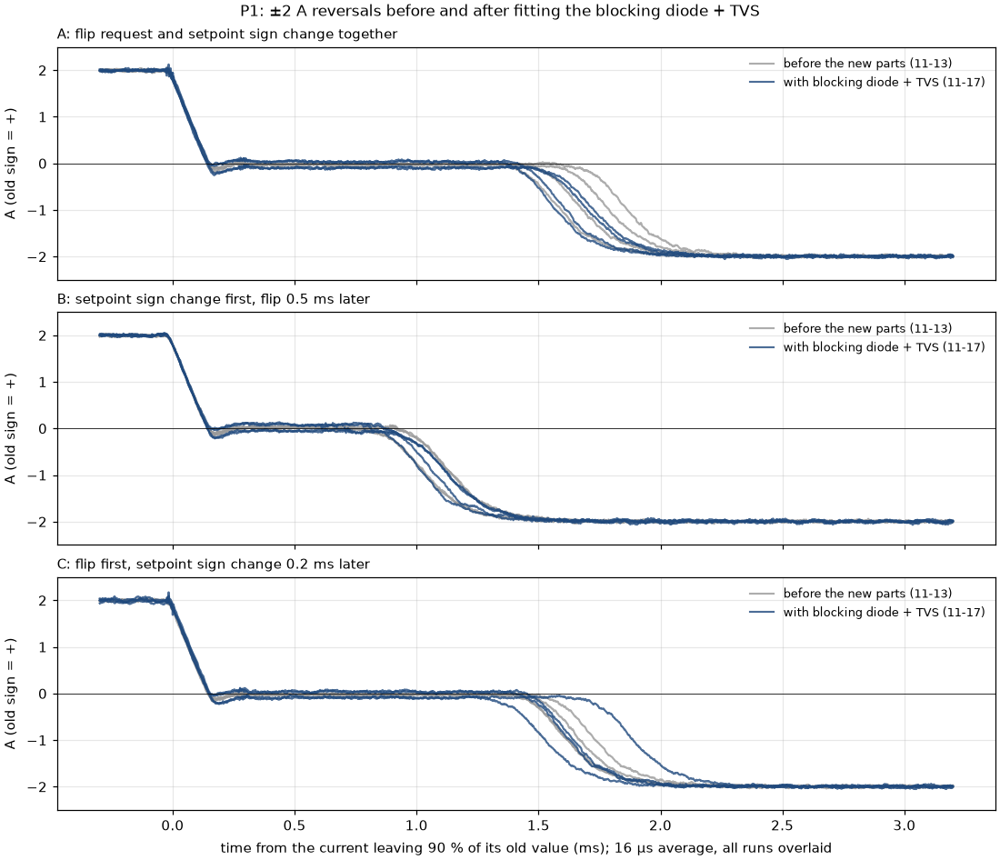

*Log 1 (grey) and 11-17 (blue, new parts, bridge closed): the curves lie on top of each other.*

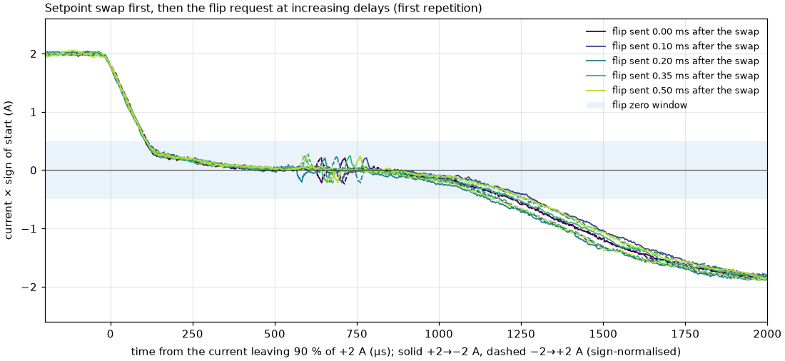

*11-18 new setup: setpoint first, then flip, 20 runs.*

| Order (±2 A, 2 PC commands) | To zero: log 1 → 11-17 → 11-18 | 90 % of the new current: log 1 → 11-17 → 11-18 | Runs OK |
|---|---|---|---|
| A: together | 141 → 143 → **37 µs** | 1.95 → 1.87 → 2.38 ms | 12/12 each day |
| B: setpoint first | 144 → 143 → 411 µs | 1.31 → 1.32 → 1.88 ms |  |
| C: flip first | 143 → 146 → **37 µs** | 1.86 → 1.83 → 2.50 ms |  |
| Setpoint first, then flip (20 runs) | 90 % → 90 %: 0.99 ms (log 1) → 1.28 ms (11-17, slower PC commands) → 1.88 ms (11-18) | 20/20 each day |

**Result:** every reversal ended at the new current with the bridge the right way round, no faults, on all three days. With the bridge opened at the flip (A, C) the current is at zero in 37 µs. The totals here are dominated by the PC's second command arriving ≈ 0.7 ms later, and on 11-18 by the slower rise.

**Changed rule for the control computer:** log 1 said “setpoint first, then flip”, because a reversed setpoint drives the current down fastest with the bridge closed. With the fast flip the bridge opens on the flip itself, and with the 11-18 settings the reversed setpoint alone is slow (B: 411 µs to zero). **Send the flip and the setpoint change together** (DIO3 and IN2 act within microseconds) — or flip first.

## Flip corner cases (log 1: 3g) [passed]

*11-17, new parts, bridge closed.*

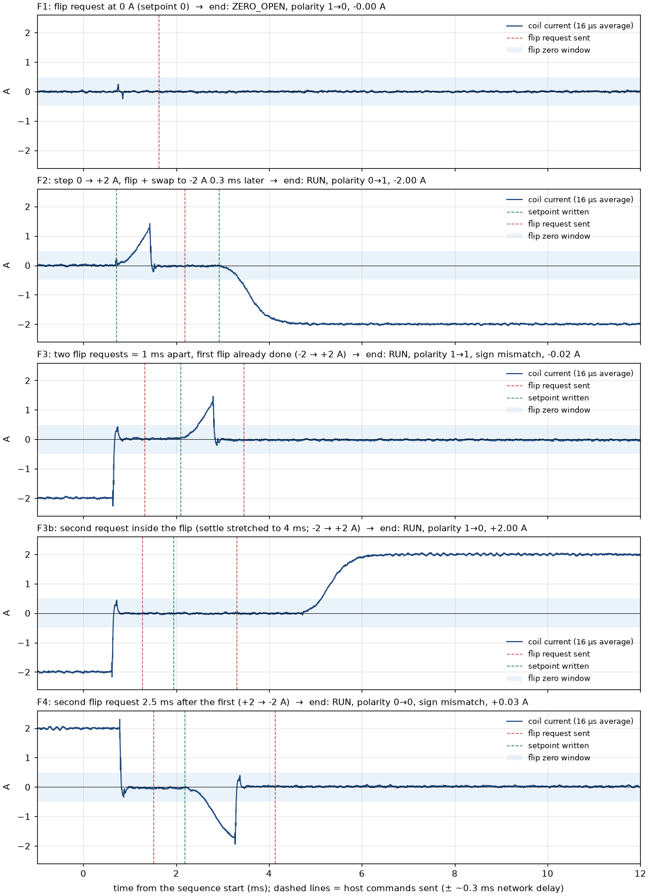

*11-18, new setup.*

**Result:** as in log 1 on both days. A flip at 0 A just changes direction; a flip while the current is still rising works; a second request after a flip has finished flips back (the setpoint sign is then wrong and the board holds zero — safe). A request *during* a flip is ignored: on 11-18 the first try (flip stretched by a 2 ms settle) flipped twice, because the fast flip is over ≈ 0.2 ms sooner and the second request arrived after it; with a 4 ms stretch it was ignored, as designed.

## Stop and trip around a flip (log 1: D1, snap in stops) [passed]

*11-17, bridge closed.*

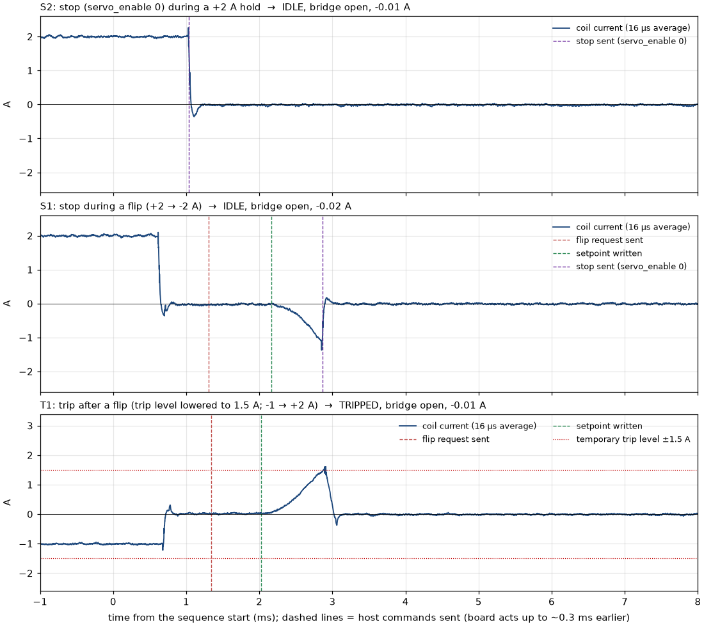

*11-18, bridge opened for the stop.*

**Result:** both stops end stopped with the bridge open and no current; the trip right after a flip (level lowered to 1.5 A for this case) ends TRIPPED with the bridge open in the new direction, and its reset returns to stopped. A stop from 2 A now reaches zero in **34 µs** (log 1 with the snap: 139 µs). Trip level restored afterwards.

## The arm line while running (log 1: D2) [passed]

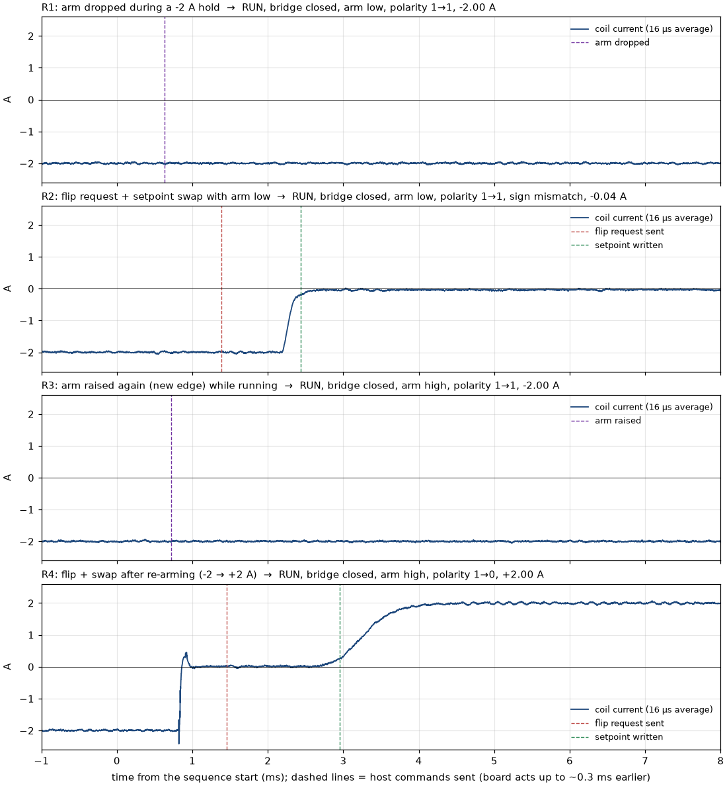

*11-18, new setup. R1: arm dropped during a −2 A hold. R2: flip + sign change with arm low. R3: arm raised again. R4: flip + sign change after re-arming.*

**Result:** as in log 1: dropping arm changes nothing; a flip with arm low is ignored (the sign change alone then holds zero current); raising arm again has no effect; the next flip works normally.

## Setpoint ramp limits (log 1: D3) [identical]

*11-17.*

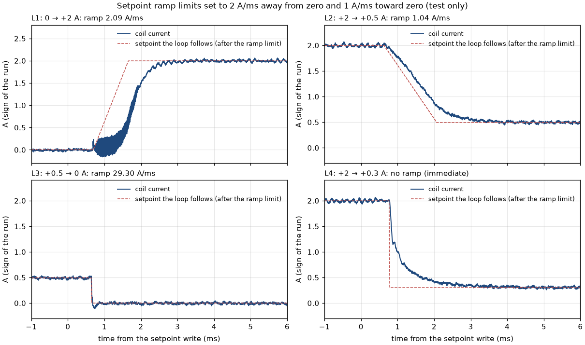

*11-18. The zero target now opens the bridge (ends in ZERO_OPEN).*

**Result:** 2.09 A per ms up and 1.04 A per ms down (set: 2 and 1) in log 1, on 11-17 and on 11-18. A zero setpoint, and one inside the ±0.49 A zero window, are taken at once.

## The shot sequence 50 times (log 1: D4, Q4) [passed]

**How.** +2 A, +1 A, sign change + flip to −2 A, zero, stop; 50 times from a stopped servo. “Back to zero” at 12.5 ms instead of 10.5 ms since 11-17 (slower PC commands).

*11-17, new parts, bridge closed.*

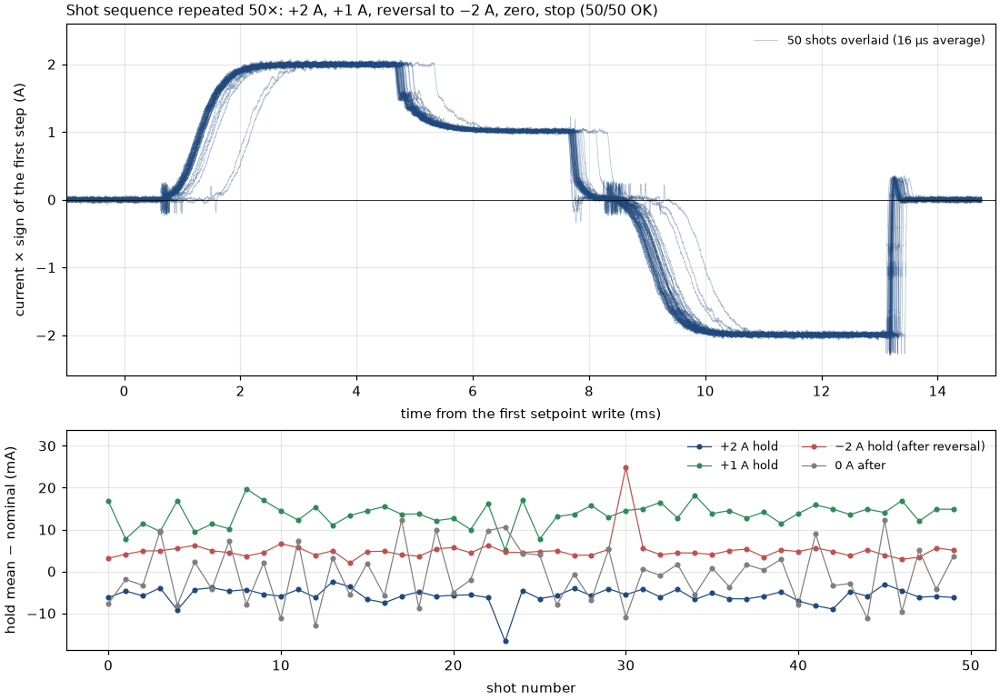

*11-18, new setup: the bridge opens at the final zero and at the flip.*

|  | Log 1 (D4) | 11-17 bridge closed | 11-17 `fastoff_zero` | 11-18 new setup |
|---|---|---|---|---|
| Shots OK | 50/50 (and 1000/1000 in Q4) | 50/50 | 50/50 | 50/50 |
| Final 2 A → 0, to zero | 141 µs | 145 µs | 31 µs | **33 µs** |
| Hold error +2 / +1 / −2 A (mean) | +0.3 / +0.2 / +0.1 mA | +0.3 / +0.1 / +0.1 mA | unchanged | −6 / +14 / +5 mA |
| Shot-to-shot scatter | 1.8 / 1.0 / 1.5 mA | 0.6 / 1.0 / 0.4 mA | unchanged | 2.1 / 2.8 / 3.0 mA |

**Result:** the board did the right thing every time. On 11-18 the holds are 6–14 mA off in the measured windows (0.3–0.7 %): with the lower controller settings the current is not fully settled 1.6–2 ms after each step. A real cost of the 11-18 settings.

## Holds (log 1: 3i, Q2) [passed]

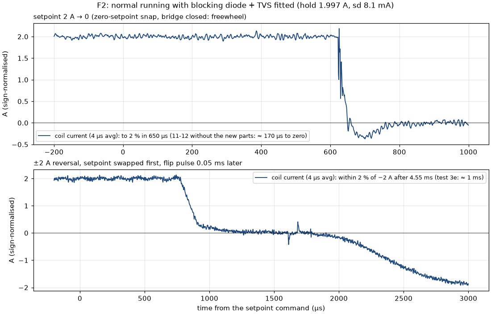

*11-18, new setup: a 45 s hold at 2 A, then 2 A → 0 (bridge opened), then a reversal.*

| 2 A hold | Log 1 | 11-17 | 11-18 new setup |
|---|---|---|---|
| Average | 1.9958 A (10 min), 0.07 mA rms over 45 min | 1.996 A (45 s) | 1.9968 A (45 s), 1.996 A (90 s) |
| Scatter of 0.2 s readings | — | 8.9 mA | 8.1 mA |
| 7 kHz wobble | 4–6 mA | 7–15 mA (82–112 mA at 2.2 A) | 3–5 mA |

## Steps across the bench range (log 1: extra checks) [slower up]

*Log 1 (11-12, before the damper and the snap) and 11-17.*

| Time to 98 % | Log 1 (11-12) | 11-17 | 11-18 new setup |
|---|---|---|---|
| 0 → 0.5 / 1 / 1.5 / 2 / 2.2 A | 1.36 / 0.95 / 0.70 / 0.62 / 0.63 ms | 1.31 / 0.88 / 0.71 / 0.60 / 0.57 ms | 2.99 / 1.59 / 1.31 / 1.41 / 1.34 ms |
| 2.2 → 1 A | 0.34 ms | 0.56 ms | 1.13 ms |
| 1 → 0, 2 → 0 A | 1.22, 1.49 ms (no snap yet) | 0.09, 0.15 ms (snap) | **0.03, 0.03 ms** (bridge opened) |
| Overshoot | 25–41 mA | 4–14 % | 3–18 % |

**Result:** all steps end at the right current, no trips. Up-steps are ≈ 2× slower on 11-18 (the settings); steps to zero are ≈ 3–5× faster than with the snap. During the 0 → 1 A and 0 → 1.5 A steps of this run the reading carried a strong 220 kHz signal (see 11-18 findings); it was not there when repeated.

## Noise on the current reading (log 1: noise reference) [unchanged]

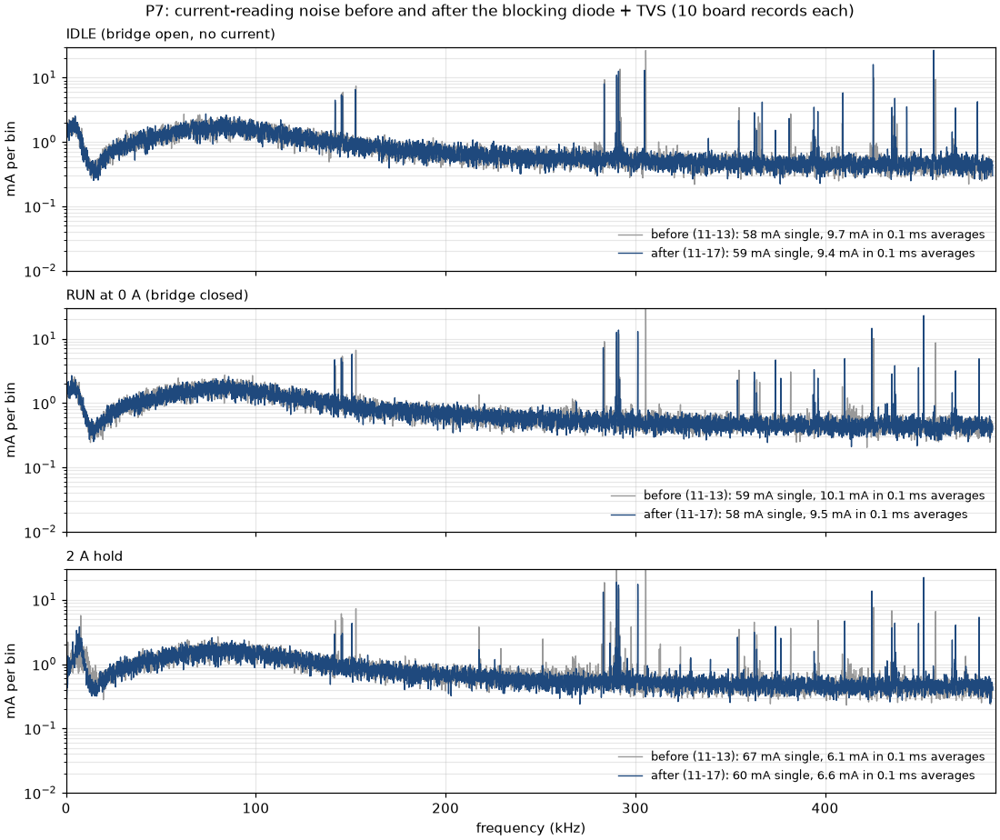

*Log 1 (grey) and 11-17 (blue).*

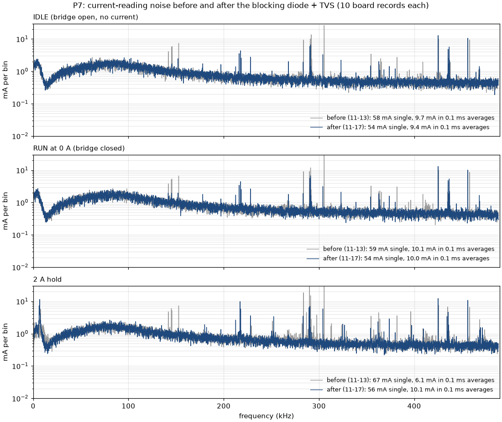

*Log 1 (grey) and 11-18 (blue). “Running at 0 A” now has the bridge open (`fastoff_zero`).*

| Condition | Single samples: log 1 → 11-17 → 11-18 | 0.1 ms averages: log 1 → 11-17 → 11-18 |
|---|---|---|
| Stopped, bridge open | 58 → 59 → 54 mA | 9.7 → 9.4 → 9.4 mA |
| Running at 0 A | 59 → 58 → 54 mA | 10.1 → 9.5 → 10.0 mA |
| 2 A hold | 67 → 60 → 56 mA | 6.1 → 6.6 → 10.1 mA |

**Result:** no new tones. The 0.1 ms scatter at 2 A is a little higher on 11-18: the weaker controller suppresses slow noise less.

## Fastest full reversal (log 1: fastest reversal) [passed]

**Why.** Sign change and flip in one command, as the control computer will send them (DIO3 and IN2 act within microseconds). Six runs per setting; “trimmed” = zero check 8 µs and no settle wait.

*11-17, the old controller settings: grey log 1 (hidden under orange), orange new parts with the bridge closed, blue the bridge opened at once (`fastoff_flip`). The blue trace for 11-18 (new settings) is in the speed figure above.*

| One command, ±2 A | Log 1 | 11-17 bridge closed | 11-17 bridge opened (old settings) | 11-18 new setup |
|---|---|---|---|---|
| At zero | 141 µs | 141 µs | **33 µs** | **34 µs** |
| 90 % of −2 A | 738 µs | 734 µs | **642 µs** | 1289 µs |
| Within ±2 % | 954 µs | 987 µs | **890 µs** | ≈ 2.7 ms |
| Trimmed: 90 % / ±2 % | 582 / 821 µs | 580 / 912 µs | **506 / 771 µs** | 1147 µs / ≈ 2.7 ms |

**Result:** 12 of 12 on every day. With the old settings the open-bridge flip gives the fastest reversal so far (0.89 ms; trimmed 0.77 ms): it saves the ≈ 100 µs of the fall, the rest is the controller's rise. With the 11-18 settings the rise takes ≈ 2× longer.

## 11-18 findings: a drop-then-trip during a hold, and a 220 kHz burst [open finding]

**What happened.** In the first run of the 11-18 repeats, a 2 A hold ran normally for 34 s; then, within one dashboard status sample (0.1 s), the reading dropped to 1.33 A while OUT1 rose by 30 counts, and the over-current trip fired (6 readings above 2.79 A). Eight minutes later, during the 0 → 0.5, 1 and 1.5 A steps, the reading carried a ≈ 220 kHz signal of up to ±1.5 A (single readings up to 3 A, never two in a row, so no trip).

**Not reproduced.** A 90 s hold at 2 A logging every reading (240 000 polls) was clean (OUT1 3925–3940, wobble 3–5 mA); the 45 s F2 hold repeated cleanly; nine 0 → 1.5 A steps with three different settings showed no 220 kHz signal (scatter 52 mA, normal). No PC process touched the board at the time (the tests that ran in parallel use simulated boards).

**Reading.** A 1.5 A swing at 220 kHz in this coil would need ≈ 90 V, so the burst was on the measurement, not the current. The drop-then-trip has the same shape as the unexplained 5 A surge of 11-12 (log 1, Q8): the reading falls, the controller pushes, the trip catches it. Both point to something intermittent in the current-reading chain or its supply (the LEM shares the coil supply; the IN1 cable was reseated several times on 11-17). The trip did its job each time.

**To do:** power the LEM from its own supply; check the IN1 cable, tee and connectors; the firmware stall detection (OUT1 rising while the reading falls) is still on the list.

### Update 11-18 evening: what sets off the 229 kHz burst

**Why.** Looking back, the burst is in *every* 11-18 step from zero with the slow settings (0 → 0.5, 1, 1.5 A, and the rev 7 repeat with feedforward off), lasting 1–2.4 ms from the step; single readings reach 2.8–3.1 A, above the 2.79 A trip level — only the “4 readings in a row” rule (`trip_ticks` = 4) kept it from tripping. It is in no log 1 record and in no hold.

**How.** (1) The full-speed recording (8 ns per point, 131 µs long) shows one clean line at **229 kHz**, ≈ ±12 mV at IN1 (≈ ±2.6 A on the current scale): a real 229 kHz signal, not something faster seen through the 1 µs averaging. (2) It appeared once with **no current at all** (the bridge was held open by the safety board at the time, the board still raised the bridge-enable line). (3) Ten 0 → 2 A pulses each way:

| Start of the pulse | Burst |
|---|---|
| From 0 A with the bridge open at zero (`fastoff_zero` on): the bridge closes at the step | 6 of 10, up to ±2 A, 0.8–1.8 ms |
| From 0 A with the bridge kept closed (`fastoff_zero` off) | 0 of 10 |
| From 0.25 A (bridge already closed) | 0 of 10 |
| Holds 0.25–2 A | only a 10 mA line at 229 kHz (always there) |

**Result:** the burst is set off by the bridge **closing again**, not by the current or the controller. Something on the bridge-driver side (the drivers' isolated supplies or their decoupling are the first suspects) oscillates at 229 kHz for 1–2 ms after the drivers are switched on, and IN1 picks it up. With feedforward on there was **no burst in 83 re-closes** (33 steps from zero and 50 shot sequences, 11-18/19), so the slow start from zero current seems to be needed too; with feedforward the current leaves the low range within ≈ 0.1 ms. **To do:** scope on the driver supplies and on IN1 at the Red Pitaya, triggered on the bridge-enable line (DIO1) rising. Data: `logs/fastoff/burst_cause.json`, `map_229k.json`, `logs/ff/hf_raw_*.npy`.

## The change: blocking diode and TVS (11-17)

**Why.** Turning the current down always kept the bridge closed: the coil's current circulates through the bridge's built-in diodes and dies away slowly (≈ 1.3 ms from 100 A on the MOT coils). Opening the bridge is much faster, but the coil's current would then be pushed back into the supply (log 1, 3h: the supply jumped 2.5–3.2 V at 2 A). The blocking diode stops that; the TVS takes the coil's energy instead. Details: docs/fast_turnoff.md.

### Blocking diode

In the supply's + lead, right at the rail bar. Both halves in parallel: anodes strapped together to the supply lead, cathodes to the rail bar. On the bridge's cooling plate (≈ 60 W at 100 A; negligible on the bench).

### TVS

Straight across the bridge, banded end (cathode) on the rail bar, other end on the return bar, short leads. The surge protector across the pass transistors, the coil varistors and the bench damper all stay.

**F0, meter checks (diode test, supply disconnected).** Rail bar → return bar: open (TVS the right way round). Return bar → rail bar: ≈ 0.6 V. Supply lead → rail bar through the diode: 0.2–0.35 V; reverse: open. **F1, power on, servo stopped.** Supply 4.96 V, rail bar 4.80 V: the diode drops 0.16 V at almost no current.

**F2, normal running (11-17, rev 5).** 2 A hold 1.996 A; switch-off with the bridge closed 158 µs (log 1 ≈ 170 µs); reversal unchanged: the parts change nothing in normal running.

*F2 on 11-17: switch-off with the bridge closed (top) and a reversal (bottom). One single reading of 4.4 A at the switch-off: pickup, not current.*

**Rev 6 loaded (11-17, afternoon).** Built on the lab laptop from `rev6-test` (timing met, +0.084 ns), loaded with the rev-6 PC software; the board reports map rev 6, commit 92d4f15. To go back: `bitstreams/coil_servo.bit.bin` (rev 5) with the software on main.

## F5 · The new fast switch-off, case by case (11-17) [passed]

**Why.** The point of the new parts and rev 6. Each option tested on its own at 2 A, damper connected: `fastoff_zero` (a zero setpoint opens the bridge; it closes again when the setpoint comes back), `fastoff_stop` (a stop opens the bridge at once), `fastoff_flip` (a flip opens the bridge at once instead of waiting for zero).

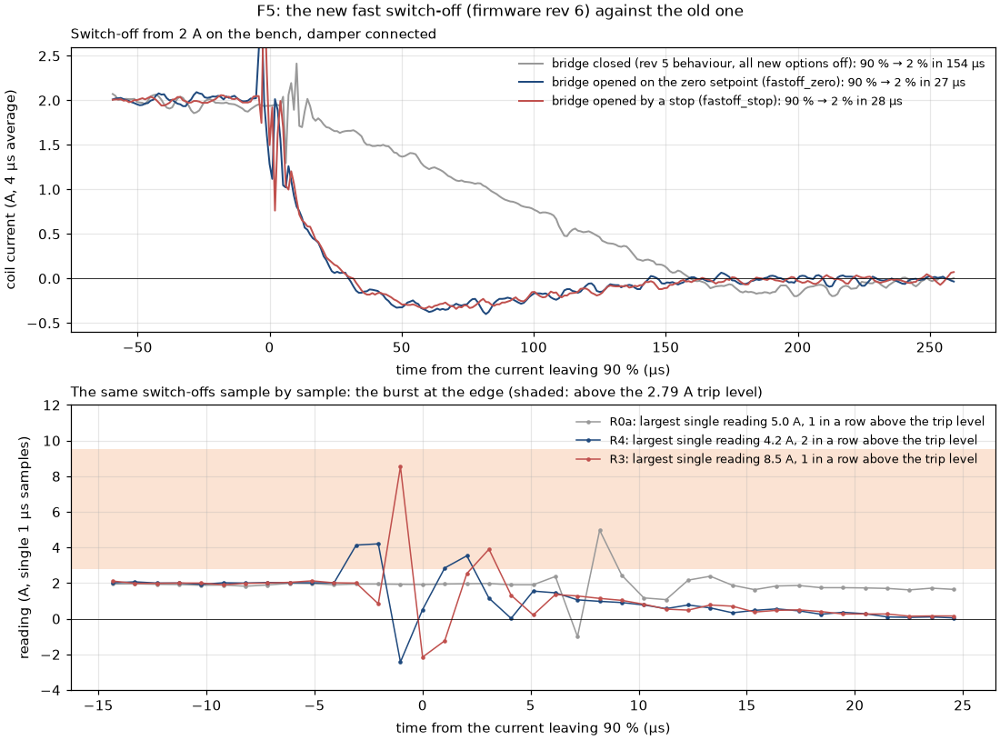

*Top: 2 A → 0 with the bridge closed (grey) and opened (blue: zero setpoint; red: stop). Bottom: sample by sample around the edge; the shaded band is above the trip level.*

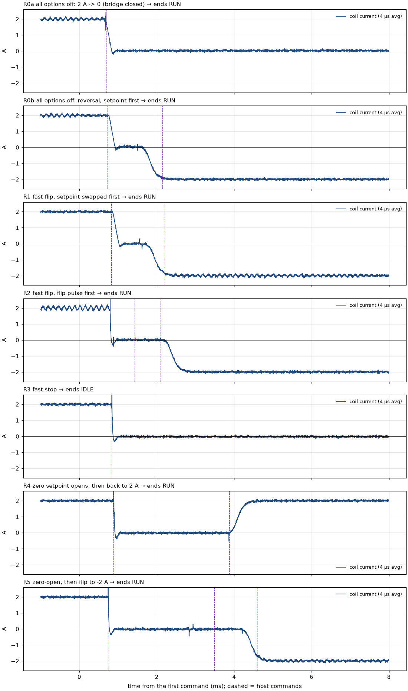

*All seven cases (dashed lines: when the PC's commands came back).*

| Case | 90 % → 2 % | Ends |
|---|---|---|
| R0a all options off: 2 A → 0 (bridge closed) | 154 µs | running at 0 A |
| R0b all options off: reversal, setpoint first | 135 µs (to zero) | −2 A, flipped |
| R1 fast flip, setpoint changed first | 136 µs (the setpoint change had already brought the current to zero) | +2 A, flipped |
| **R2 fast flip, flip first** | **35 µs** | −2 A, flipped |
| **R3 fast stop** | **28 µs** | stopped, bridge open, 0 A |
| **R4 zero setpoint opens the bridge, then back to 2 A** | **27 µs** | 2 A, same direction; bridge re-closed cleanly |
| **R5 zero setpoint, then flip to the other sign** | **27 µs** | flipped, at the new current |

**Result:** every case ended in the right state, direction and current, no trips. On the bench the damper sets the speed (the coil's current goes into the damper's capacitor); on the MOT coils at 100 A the TVS will.

## The current goes briefly negative after a bridge-opened switch-off [open finding]

**What.** After every bridge-opened switch-off the coil current swings to ≈ −0.31 to −0.34 A (−16 %), lowest ≈ 34 µs after zero, gone ≈ 135 µs after it. It is real current: with the bridge open the coil and its damper (3.2 Ω + 10 µF) form a loop of their own; the capacitor charges and rings back once through the coil. This is why the “settled within ±5 %” gain on the bench is only ≈ 1.5×. At 100 A on the MOT coils the same ring-back could reverse the field briefly — see the circuit-model results below.

## F4 · The TVS clamp itself, damper disconnected (11-17) [passed, one finding]

**Why.** With the damper connected the TVS never conducts at bench currents (the damper takes the current at ≈ 6 V). The TVS is what matters at 100 A, so it was checked once at low energy with the damper removed.

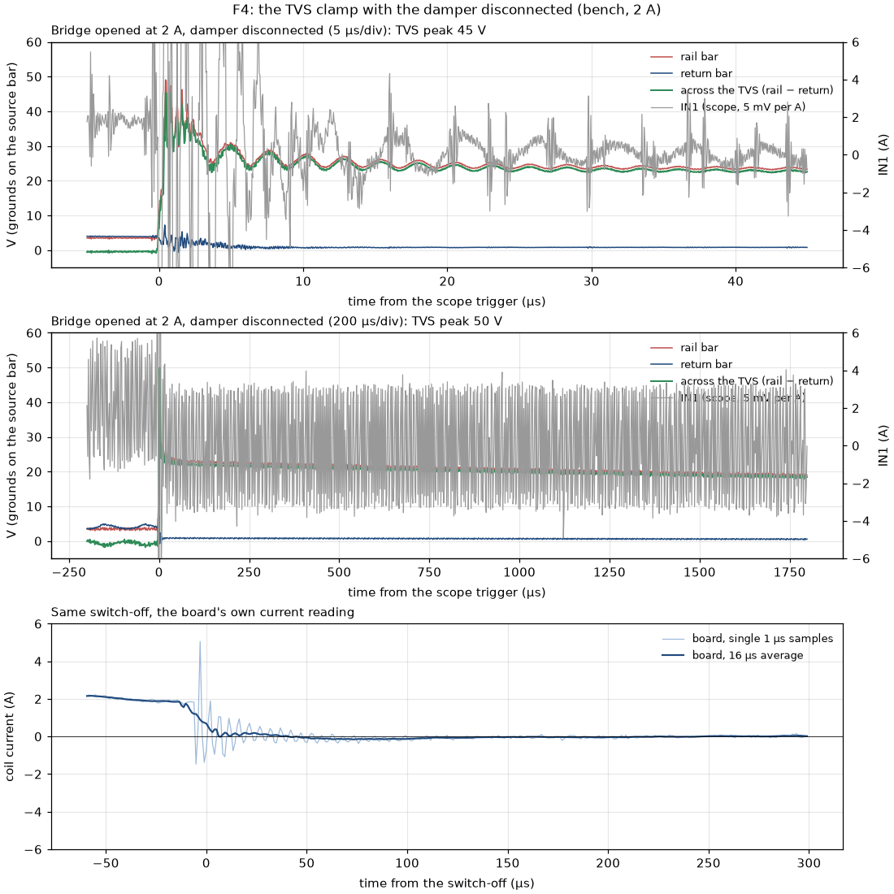

*Top: the first 45 µs. Middle: 200 µs/div. Rail bar (red), return bar (blue), the voltage across the TVS (green), IN1 on the scope (grey, mostly pickup). Bottom: the board's own current reading.*

**The TVS works:** 45–50 V across it for ≈ 1 µs (half the transistors' 100 V rating), then below its 33 V threshold. The current is below 2 % in ≈ 19 µs with no slow negative swing; the reading carries a 400 kHz pickup ring for ≈ 80 µs.

**Finding: the rail bar stays charged** at 20–23 V for at least 1.8 ms (the blocking diode keeps the charge from draining into the supply): a small charge (≈ 1 µC) on the parts' own capacitance. **Re-close check:** closing the bridge again with OUT1 at zero gives a 0.7–1.0 A pulse for ≈ 16 µs — harmless, confirms the small capacitance. A 1 kΩ, ¼ W bleeder across the blocking diode would remove it.

## The switch-off burst on the current reading (11-17) [open finding]

**What.** The first switch-off on rev 6 (with the scope on IN1, DIO1, the return bar and the rail bar) tripped: four readings in a row above 2.79 A (2.55, 3.93, −3.11, 4.00, 4.79 A) at the switch-off edge. Not real current (the 45 µH coil cannot swing −3 → +5 A in microseconds); pickup on IN1 from the sudden voltage jump.

**It has grown** since log 1 (Q6: up to 2.8 A, at most 2 samples): with the scope on IN1 only 3.9–5.3 A for 1–2 samples; with the bridge opened up to 8.5 A. More scope cables made it worse (likely a ground loop through the scope). **Decided 11-17:** the bench trip waits for 6 readings in a row (was 4); a real over-current then rises ≈ 0.2 A further on the bench, ≈ 0.6 A on the MOT. `[mot]` stays at 4 until the burst is measured at 100 A.

## Incidents (11-17) [incident]

**IN1 lost during rewiring.** The IN1 cable came off while scope cables were unplugged at the Red Pitaya. The next run asked for 2 A: the board read 0.02 A, the controller turned the transistors fully on, and only the bench supply's 3 A limit held the current; the run ended TRIPPED. Same mechanism as the leading explanation of the 11-12 surge. Since then every test script checks before each step that the reading follows and OUT1 is not at its limit.

**The current sensor lost its supply.** The bench supply was switched off while rewiring; the LEM is powered from it, so IN1 sat at −5 V (five times the input range) for minutes. The trip caught the bogus reading; no current was driven. IN1 survived (re-zeroed +7 steps, 0.5 A check 0.499 A). Lessons: power the LEM separately; a firmware check for “reading stuck at its limit”; scope readings at a sensitive range clip silently.

## Circuit model: the negative swing and the MOT damper (Ansys session, 11-17) [for Test 4]

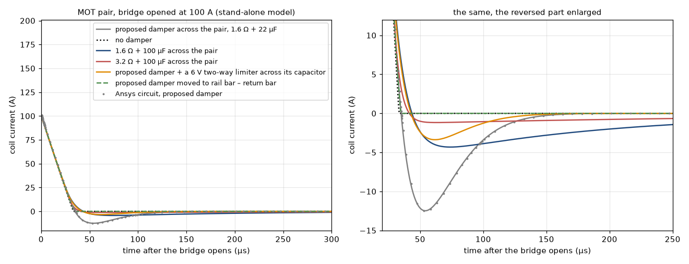

*Circuit model, MOT pair, bridge opened at 100 A: current after the switch-off for the damper options.*

| MOT pair, bridge opened at 100 A (model) | Current below 10 % | Reversed current |
|---|---|---|
| Proposed damper 1.6 Ω + 22 µF | 32 µs | **−12.5 A** for ≈ 90 µs |
| No damper | 30 µs | ≈ 1 A of fast ringing |
| 1.6 Ω + 100 µF | 33 µs | −4.3 A, long tail (≈ 0.4 ms to within 0.5 A) |
| 1.6 Ω + 22 µF, plus a ≈ 6 V two-way TVS across the capacitor | 32 µs | −3.4 A, gone in ≈ 0.12 ms |

- **Bench check:** the model reproduces the −0.3 A depth; its timing matches if the test coil and damper capacitor are about twice their listed values (≈ 57 µH, ≈ 17 µF) — worth an LCR meter on both (and the 11-18 resonance shift adds to this).
- **The resistor sets the reversed current**, not the capacitor. A one-way (diode) damper is not useful.
- **Recommendation for Test 4:** first look for ringing during holds with **no damper** (5–20 A and 100 A); if there is none, fit none. Full report: `ansys/results/damper_study.html`.

## Rev 7 · Setpoint feedforward (11-18/19) [passed, bench settings chosen]

**Why.** With the 11-18 controller settings (kp 18.7, ki 374, needed because of the 7 kHz coil–damper resonance) every rise is ≈ 2× slower than in log 1: the controller has to *find* the right OUT1 by slowly adding up the error. **Feedforward** gives it the answer up front: the board holds a table “OUT1 needed for this current”, measured on the hardware, and sets OUT1 from it the moment the setpoint changes; the controller only corrects the last few percent. The controller settings, and so its stability, stay the same. Background and setup: `docs/feedforward.md`.

**How.** Firmware rev 7 (commit 6bf3e93, timing met), deployed 11-18. The table: `python -m coil_servo_host.ffcal mot_bench --write` holds 11 currents from 0.22 to 2.2 A, up and back down, and stores the OUT1 each one needs (warm transistors, after a few minutes at 2 A). Tests FF0–FF5, all with the bridge-opening switch-off on.

| Test | What | Result |
|---|---|---|
| FF0 (11-18) | Rev 7 with feedforward **off**: one step, six reversals | Same as rev 6: 0 → 2 A 98 % at 1.40 ms (Log 2: 1.41 ms); reversal 90 % at 1293 µs (1289 µs) |
| FF1 (11-18, 11-19) | The table measured warm: 11-18 twice, 11-19 once (after the damper change) | Repeatable to ±1–2 counts (OUT1 3659 at 0.22 A … 3947 at 2.2 A); up and down passes agree within 1 count |
| FF2 (11-18, 11-19) | Steps 0 → 0.5 / 1 / 1.5 / 2 A with feedforward on, several ramp rates and table aims | see below |
| FF3 (11-19) | One-command reversal ±2 A, 12 each, feedforward on and off | 12 / 12 OK; 90 % of −2 A at **555 µs** (off: 1298 µs) |
| FF4 (11-19) | Holds 0.5 / 1 / 2 A on and off; the shot sequence 50 times | Holds identical; **50 / 50** shots |
| FF5 (11-19) | Steps right after a 10 min hold at 2 A (warm transistors) | Overshoot grows from +4–6 % to **+7–12 %** (1–2 A; up to 150 mA); times to 90 % and to within 5 % unchanged (0.38 ms at 2 A). During the 10 min hold OUT1 fell by 17 counts (3934 → 3917): warmer transistors need less, so a table measured after a few minutes aims ≈ 15 counts high once they are hot. Acceptable on the bench; for the MOT measure the table at the operating temperature |

### FF2 · What the transistors do when OUT1 jumps

With the default setpoint ramp (200 A/ms) feedforward reaches 90 % within ≈ 30 µs, but the current **overshoots by 30–80 %**; the 2 A and 2.2 A steps went past 2.79 A and the over-current trip opened the bridge (correctly). The cause is in the power stage, not the controller: with the controller switched off (gains 0, OUT1 from the table alone) the current still overshoots right after the step and then sinks over a few ms to a lower final value. The faster OUT1 rises, the bigger the overshoot:

| Table alone, setpoint ramp | 200 A/ms | 20 A/ms | 10 A/ms | 5 A/ms |
|---|---|---|---|---|
| Overshoot, 0 → 1 A / 0 → 2 A | trip at 2 A | +49 / +38 % | +23 / +18 % | +14 / +7 % |

Likely a short-lived effect inside the transistors right after they turn on (heating of the chip, or the gate charge), not yet understood. The old, slow controller never showed it because it approached the turn-on point gradually. **To check at 100 A** in Test 4. Two ways to live with it: a slower setpoint ramp, and a table aimed a little low (the controller adds the rest).

### FF2 · The two candidate settings (11-19, damper 8.2 Ω)

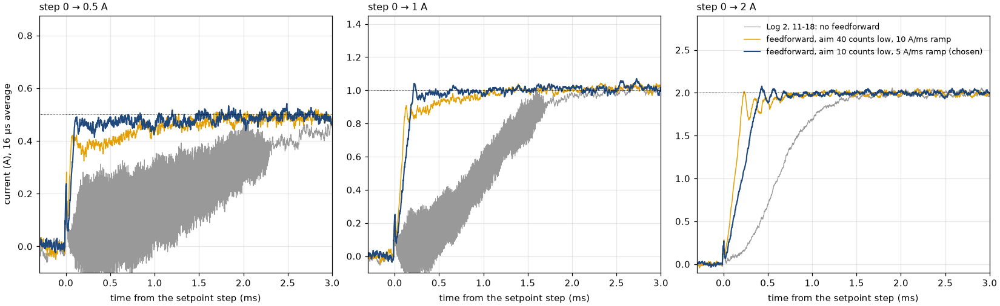

*Grey: Log 2 (11-18, no feedforward; the wide band is the 229 kHz burst on the reading, see 11-18 findings). Orange and blue: feedforward on 11-19. 16 µs averages.*

| 0 → 0.5 / 1 / 1.5 / 2 A | Log 2 (no feedforward) | Aim 40 counts low, 10 A/ms | **Aim 10 counts low, 5 A/ms (chosen)** |
|---|---|---|---|
| 90 % reached | 1.90 / 1.42 / 1.14 / 1.09 ms | 0.72 / 0.41 / 0.16 / 0.20 ms | **0.10 / 0.19 / 0.28 / 0.36 ms** |
| Within 5 % after (1–2 A) | 1.96 / 2.45 / 1.29 ms | 0.97 / 0.67 / 0.56 ms | **0.33 / 0.29 / 0.39 ms** |
| Overshoot | +3 to +12 % | +3 to +11 % | +4 to +14 % (+14 % only at 0.5 A, ≈ 70 mA) |

**Choice:** aim 10 counts low, 5 A/ms. Aiming 40 counts low leaves 0.5–1 A steps 10–20 % short for milliseconds (the slow controller has to make up the difference). With the 5 A/ms ramp the rise time is set by the ramp (0.4 ms for 2 A), and the current follows it closely. Set in `channels.toml` `[mot_bench]`: `ff_enable = 1`, `ff_margin_counts = 10`, `slew_up_amps_per_ms = 5` (was 200). The 0.5 A “within 5 %” time is not given: ±25 mA is about the size of the reading's noise.

### FF3 · One-command reversal

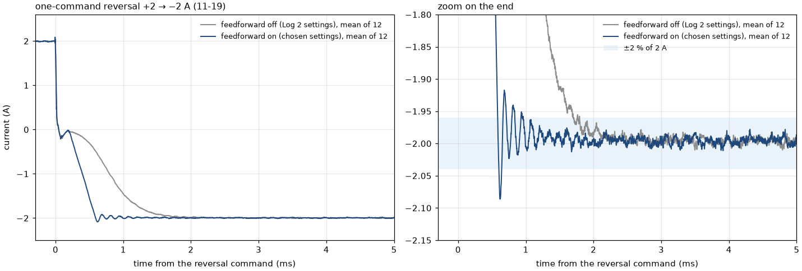

*Mean of 12 reversals each, 11-19, same settings except feedforward (and the up-ramp: 5 A/ms with it, 200 A/ms without).*

| ±2 A, one command, mean of 12 | Log 2 (11-18) | Feedforward off (11-19) | **Feedforward on (11-19)** |
|---|---|---|---|
| At zero | 34 µs | 45 µs | 42 µs |
| 90 % of −2 A | 1289 µs | 1298 µs | **555 µs** |
| Within ±2 % | ≈ 2.7 ms | 1.8 ms | **0.96 ms** |
| Overshoot | — | +0.6 % | +4 % (−2.09 A), then a 7 kHz ring for ≈ 0.4 ms |

**Result:** 12 of 12 OK each way; the reversal is ≈ 2.3× faster to 90 % and ≈ 1.9× faster to ±2 %. With feedforward the current is within 16 mA of −2 A from 0.8 ms on; without, it is still at −1.41 A then. (The 11-19 “feedforward off” run is faster to ±2 % than Log 2's figure: the damper is now 8.2 Ω and the averaged trace is less noisy than the single-run figure of Log 2.)

### FF4 · Holds and the shot sequence

| Hold, 3 recordings of 16.8 ms each | 0.5 A | 1 A | 2 A |
|---|---|---|---|
| Mean, feedforward off → on | 0.4924 → 0.4922 A | 1.0120 → 1.0119 A | 1.9963 → 1.9963 A |
| Scatter, 16 µs averages | 16.0 → 16.0 mA | 16.8 → 14.1 mA | 21.2 → 20.9 mA |
| Strongest line 3–20 kHz | 3–4 → 3–4 mA (4–7 kHz) | 4–5 → 3–4 mA (4–7 kHz) | 9–12 → 9–11 mA (7 kHz) |

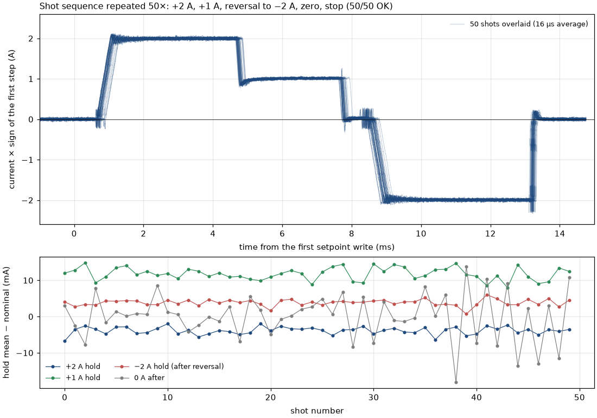

*11-19, feedforward on: +2 A, +1 A, sign change + flip to −2 A, zero, stop; 50 times from a stopped servo.*

| Shot sequence ×50 | Log 2 (11-18) | **Feedforward (11-19)** |
|---|---|---|
| Shots OK | 50 / 50 | **50 / 50** |
| Hold error +2 / +1 / −2 A (mean) | −6 / +14 / +5 mA | −4 / +12 / +4 mA |
| Shot-to-shot scatter | 2.1 / 2.8 / 3.0 mA | 1.0 / 1.7 / 0.9 mA |

**Result:** holds are the same with and without feedforward (it only acts on changes). In the shot sequence the holds are now settled when they are measured: the remaining −4 / +12 / +4 mA are exactly the setpoint register's rounding (one setpoint count = 27 mA: 2 A is sent as 1.9961 A, 1 A as 1.0117 A), and the shot-to-shot scatter halved. No 229 kHz burst in any of the 50 shots.

Data: `logs/ff/` (ff0_*, ff2*_*: 11-18; d82_*, ff3_*, ff4_*, ff5_*, ffcal_1119.txt: 11-19). The bench test scripts are the ones of Log 2 with feedforward settings passed in.

## Next

- ~~Decide the bench controller settings~~ — settled for the bench (11-19): kp 18.7 / ki 374 with feedforward and a 5 A/ms up-ramp; faster than log 1 at every step. (31.2 / 942 now oscillates at 8.4 kHz in a hold even with the 8.2 Ω damper.)
- **229 kHz burst at bridge re-close:** scope on the bridge drivers' supplies and IN1, triggered on DIO1 rising (details).
- **Feedforward at 100 A (Test 4):** measure the table on the MOT with cooling water on; check whether the transistors also overshoot when OUT1 jumps at high current, and set the MOT up-ramp from that.
- **The rule for the control computer** with the fast flip: send the flip and the setpoint sign change together (or flip first), not setpoint first.
- **Intermittent reading faults** (11-12 surge, 11-18 drop-then-trip and 220 kHz burst): power the LEM separately; check the IN1 cable, tee and connectors; firmware stall detection.
- **PC software:** refuse a ki-shift change while the servo runs.
- **Not yet repeated:** current scale against the ammeter (3c); safety-board cut-off at current (3h / F6); dead time on the scope.
- **Test 4 (100 A):** measure the switch-off burst, then set `trip_ticks` for `[mot]` (now 4); MOT damper — look for hold ringing with no damper first; tune the controller there with the final damper fitted, at several currents.
- Fit a 1 kΩ, ¼ W bleeder across the blocking diode. Choose the production options; then merge `rev6-test` into main.

Data: `logs/fastoff/` (11-17), `logs/final/` (11-18 repeats, side_by_side.json, gain_opt.json). The pre-11-18 version of this page is kept as `fastoff_log_before_sbs_20261118.html`.
