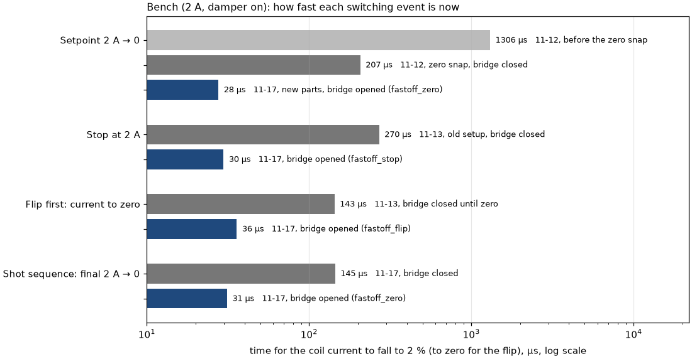
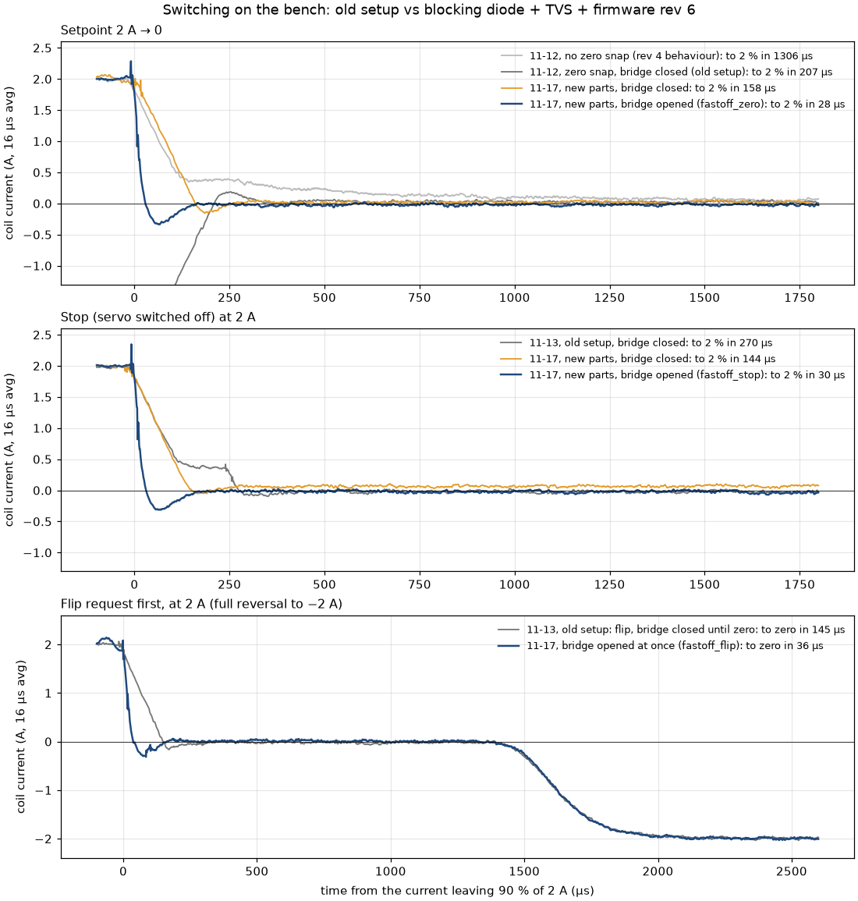
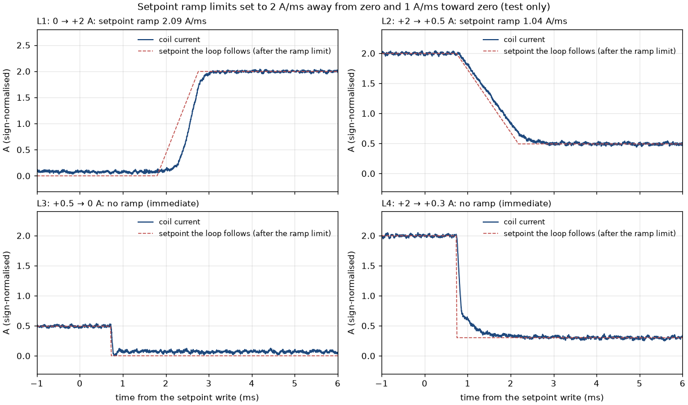
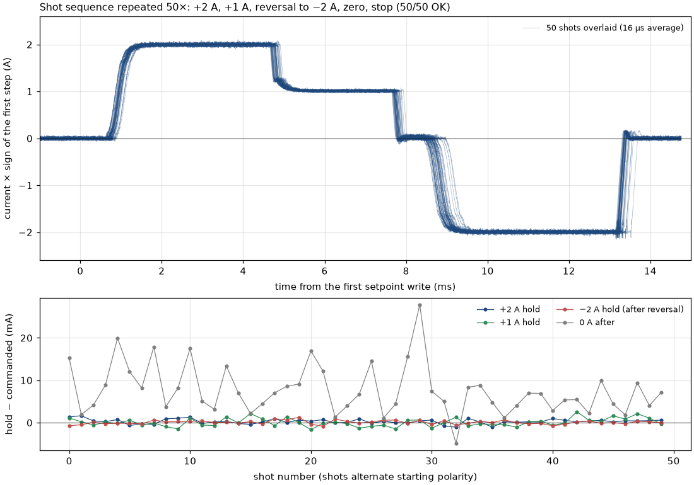
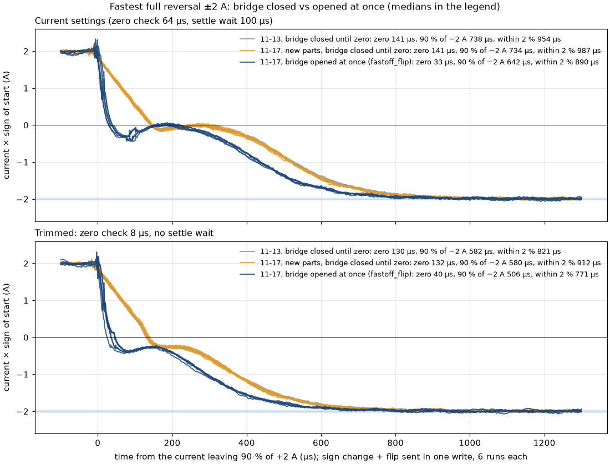

<!-- Generated from the live log page used during the session (logs/testlog/benchtop_log.html on the lab PC; logs/ is not in git). Narrative lab notes: docs/lab_notes_2026-11.md. -->

# Benchtop Test Log 2 — after fitting the fast switch-off parts

2026-11-17 onward · Same bench as Test 3 (log 1: Benchtop Test Log): bench power supply (5 V, at most 3 A), settings profile `mot_bench`, the 12-turn test coil with its damper · New in the circuit: a blocking diode in the supply's + lead and a surge protector (TVS) across the bridge · Firmware rev 5 (build 583e877) until the afternoon of 11-17, then rev 6 (commit 92d4f15, branch rev6-test)

## Words used in this log

- All words from log 1 apply (setpoint, controller, OUT1, IN1, pass transistors, bridge, flip, arm, trip, safety board).
- **Blocking diode:** a one-way valve for current (IXYS DSS2x101-015A, two 100 A diodes in one package, used in parallel), fitted in the supply's + lead. Current can flow from the supply to the coil, but never back into the supply.
- **TVS** ("surge protector", Littelfuse 5KP30A): a diode that does nothing below about 33 V and conducts hard above it. Fitted from the **rail bar** (the bridge's + bar) to the **return bar** (the bridge's bottom bar, which goes to the pass transistors).
- **Fast switch-off:** opening the bridge while current flows. The coil's current then has to push through the TVS (about −35 V) instead of circulating through the bridge's built-in diodes (about −1 V), so it dies away about 30 times faster: on the MOT coils about 40 µs from 100 A instead of 1.3 ms (computer model). The two new parts make this safe; the firmware option to use it (rev 6) is written and simulated but not loaded yet.
- **Before / after:** "before" = the same test in log 1 (11-11 to 11-13); "after" = the repeat in this log with the new parts fitted.

## Status

| Test | What we checked | Status | Result in one line |
|---|---|---|---|
| F0 Meter checks (11-17) | Both new parts the right way round, before power | [passed] | All four diode-test readings as expected |
| F1 Power on (11-17) | Supply and rail voltages, servo stopped | [passed] | Supply 4.96 V, rail bar 4.80 V: the diode drops 0.16 V at almost no current |
| F2 Normal running | A 2 A hold, switch-off with the bridge closed, a reversal | [passed] | Unchanged: hold 1.996 A, 2 A → 2 % in 158 µs (before ≈ 170 µs) |
| P1 Reversals, three orders | Repeat of 3g | [passed] | 12 of 12; fall, rise and total times the same as before |
| P2 Setpoint first, then flip | Repeat of 3g (20 runs) | [passed] | 20 of 20; fall 138 µs and rise 371 µs (before 138 / 358 µs) |
| P3 Flip corner cases | Repeat of the flip edge cases | [passed] | All five end exactly as before |
| P4 Stop and trip around a flip | Repeat of D1 | [passed] | All end safely; trip and reset work |
| P5 Setpoint ramp limits | Repeat of D3 | [passed] | 2.09 / 1.04 A per ms, as before |
| P6 The shot sequence 50 times | Repeat of D4 | [passed] | 50 of 50; holds within 0.3 mA, shot-to-shot scatter 0.4–1.0 mA (before 1.0–1.8 mA) |
| P7 Noise on the current reading | Repeat of the zero-current noise reference | [passed] | Unchanged in all three conditions; no new tones |
| P8 Fastest full reversal | Repeat of the 11-13 test | [passed] | Same curves; within 2 % after 0.99 ms (before 0.95 ms) |
| P9 Steps | Repeat of the step responses | [passed, open finding] | Steps up unchanged; a 7 kHz wobble grows above 2 A (0.1 A at 2.2 A) |
| F3 Bridge opened at current on the old firmware | First fast switch-off | [skipped] | Went straight to the new firmware (decided 11-17) |
| F4 The TVS clamp (damper disconnected) | Does the TVS work? | [passed, one finding] | Clamp 45–50 V for ≈ 1 µs; current below 2 % in ≈ 19 µs; the rail bar stays at ≈ 22 V afterwards (small charge; re-close pulse 0.7–1 A for 16 µs) — fit a bleeder |
| Sensor lost its supply | Supply switched off while rewiring | [incident] | LEM powered from the coil supply: IN1 at −5 V for minutes; trip caught it; repaired, IN1 fine |
| Circuit model: MOT damper | The reversed current after a fast switch-off at 100 A | [for Test 4] | Proposed damper: −12.5 A for 90 µs; none: ≈ 1 A; try no damper first |
| Rev 6 loaded (11-17) | New firmware with the fast switch-off options | [done] | Build met timing (+0.084 ns); board reports map rev 6, commit 92d4f15 |
| Switch-off burst on the current reading | Why the first switch-off on rev 6 tripped | [open finding] | Pickup at the switch-off edge now up to ±5 A for 1–2 samples (once 4 in a row with the scope fully wired → trip); not real current |
| IN1 lost during rewiring | A run with the current reading disconnected | [incident] | The controller drove the transistors fully on; the supply's 3 A limit held the current. Reconnected and checked |
| F5b Fastest reversal, bridge opened | Sign change + flip in one write, `fastoff_flip` | [passed] | 12 of 12; within 2 % of −2 A in 0.89 ms (bridge closed: 0.95–0.99 ms); now limited by the controller's rise |
| Negative swing after a fast switch-off | Is the −0.3 A dip real? | [open finding] | Yes: the coil ringing with the damper's capacitor; at 100 A it could be 10–20 A — being simulated |
| 50 shots with `fastoff_zero` | The shot sequence with the bridge opening at the final zero | [passed] | 50 of 50; final switch-off 31 µs (bridge closed: 145 µs); holds unchanged; the edge burst reached 3 in a row above the trip level in 11 shots (trip now needs 6) |
| F5 New firmware: fast switch-off | Fast flips, fast stops, bridge opened on a zero setpoint | [passed] | 2 A → 0 in 27–35 µs with the bridge opened (154 µs closed); every case ends correctly, no trips |
| F6 Safety-board cut-off at current | Repeat of 3h: energy now into the TVS, not the supply | [planned] | — |

## At a glance: switching times, old setup vs new [faster to zero, not much faster to settle]

**Why.** The point of the blocking diode, the TVS and firmware rev 6 is faster switching. This compares every kind of switch-off measured on the bench, old setup against new, all measured the same way from the board's own recordings: the time from the current leaving 90 % of 2 A until it is first below 2 % (40 mA), using 16 µs averages.

**Correction (11-17, after a remark from the user):** "first below 2 %" overstates the gain. With the bridge opened the current then swings ≈ −0.3 A below zero (the coil ringing with the damper's capacitor) and only comes back ≈ 0.13 ms later. Measured as **"stays within ±5 % of zero"** (64 µs averages): bridge closed 206–215 µs, bridge opened 130–136 µs — **≈ 1.6× faster, not 5–9×**; within ±2 % there is no clear gain on the bench (the damper's slow tail and pickup on the reading). Without the damper (F4 below) there is no slow swing, but the reading carries pickup for ≈ 80 µs. On the MOT coils the picture differs (see the circuit-model results below).

*Median times (log scale). Grey: old setup (bridge closed while the current falls). Blue: new setup, bridge opened at current. For the shot sequence: median of 50 shots each.*

| Event (bench, 2 A, damper on) | Old setup | New: bridge opened | Faster to first reach zero by |
|---|---|---|---|
| Setpoint 2 A → 0 | 1306 µs before the zero snap (11-12); 158–207 µs with it (bridge closed) | **28 µs** (`fastoff_zero`) | 6–7× (47× vs before the snap) |
| Stop | 270 µs (11-13); 144 µs (11-17, bridge closed) | **30 µs** (`fastoff_stop`) | 5–9× |
| Flip request first: current to zero | 143 µs (11-13) | **36 µs** (`fastoff_flip`) | 4× |
| MOT-like shot: final 2 A → 0 (50 shots each) | 145 µs (135–150) | **31 µs** (28–40) | 4.7× |
| Full reversal ±2 A (flip first) | 1.86 ms | 1.82 ms | same: after zero, the time is the wait for the setpoint sign change, the settle wait and the controller's rise, not the switch-off |
| Steps up, holds, noise | unchanged (P1–P9) |
| *MOT coils, 100 A (computer model)* | *≈ 1.3 ms (bridge closed)* | *≈ 40 µs (into the TVS)* | *≈ 30×* |

*The traces behind the table. With the bridge opened the current drops almost straight down and then swings ≈ −0.3 A for ≈ 0.1 ms (the coil ringing with the damper's capacitor). The 11-12 bridge-closed trace (dark grey) swings further below zero. Bottom: in a full reversal the new switch-off reaches zero sooner, but the rest of the reversal is set by the wait for the second command and the settle time.*

**Why the bench gain is 5–9× and the MOT gain ≈ 30×.** On the bench the coil's current goes mostly into the damper's capacitor when the bridge opens, so the damper sets the speed (≈ 25 µs). On the MOT coils at 100 A the TVS takes the current at ≈ 35–48 V and sets the speed: L·I / V ≈ 16 µH × 100 A / 40 V ≈ 40 µs, against ≈ 1.3 ms freewheeling through the bridge.

## The change: blocking diode and TVS (11-17)

**Why.** Turning the current down always keeps the bridge closed: the coil's current circulates through the bridge's built-in diodes and dies away slowly (≈ 1.3 ms from 100 A on the MOT coils). Opening the bridge would be much faster, but the coil's current would then be pushed back into the supply and could trip its overvoltage protection (log 1, 3h: the supply jumped 2.5–3.2 V at 2 A). The blocking diode stops that; the TVS takes the coil's energy instead. Details and reasoning: docs/fast_turnoff.md.

### Blocking diode

In the supply's + lead, right at the rail bar. Both halves in parallel: anodes strapped together to the supply lead, cathodes strapped together to the rail bar. On the bridge's cooling plate (≈ 60 W at 100 A; negligible on the bench).

### TVS

Straight across the bridge, banded end (cathode) on the rail bar, other end on the return bar, short leads. The surge protector across the pass transistors, the coil varistors and the bench damper all stay.

**F0, meter checks (diode test, supply disconnected).** Rail bar → return bar: open (TVS the right way round). Return bar → rail bar: ≈ 0.6 V. Supply lead → rail bar through the diode: 0.2–0.35 V; reverse: open. All as expected.

**F1, power on, servo stopped.** Supply + terminal 4.96 V, rail bar 4.80 V: the diode drops 0.16 V at almost no current. Board stopped, bridge open, current reading −0.02 A.

## F2 · Normal running with the new parts [passed]

**Why.** Before using the new parts for anything, check they change nothing in normal running: a steady hold, the usual switch-off with the bridge closed, and a reversal.

**How.** 2 A hold for 45 s, then setpoint 2 A → 0 (zero snap: the transistors switch off at once, the bridge stays closed), then a ±2 A reversal with the setpoint sign changed first and the flip right after. The board's own recording (one sample every 1.02 µs).

*Top: the switch-off with the bridge closed, 90 % → 2 % in 158 µs (log 1: ≈ 170 µs). One single sample reads 4.4 A at the moment the transistors switch off (circle): pickup on the current reading, not current (the coil cannot change by 2 A in 1 µs). Bottom: the reversal; the dashed lines show when the PC's commands came back.*

**Result:** unchanged. Hold 1.996 A (8.9 mA scatter between readings). Switch-off as fast as before.

**Switch-off spike on the reading:** log 1 (day 4, Q6) found spikes of up to ±0.9 A lasting at most 2 samples. Now one sample reached +2.4 A above the current (the 2 → 0 step in P9 also had 2 samples above the 2.79 A trip level). Still at most 2 samples, so the trip (4 samples in a row) ignores it, but it is larger than before: probably the TVS, which now conducts for a moment at every switch-off, makes the voltage edge sharper. To look at on the scope.

**PC commands are slower than in log 1** (≈ 0.7 ms each instead of ≈ 0.3 ms): since the 11-13 safety fix (D5 in log 1) every settings change first reads the board, then writes. The board's own timing is unaffected; the control computer will send flips on the DIO3 wire, without this delay.

## P1 · Reversals in three orders [passed]

**Why.** Repeat of the main flip test (log 1, 3g), now with the new parts: the blocking diode takes a little off the supply voltage and the TVS conducts at every switch-off.

**How.** ±2 A, three orders of "flip" and "setpoint sign change" sent from the PC (together, setpoint first, flip first), both directions, twice each: 12 reversals.

*All runs overlaid, before (grey, 11-13) and after (blue). The curves lie on top of each other; the waiting time at zero depends on when the PC's second command arrives.*

| Order | Fall to 0, before → after | Rise 12 → 90 %, before → after | Total, before → after |
|---|---|---|---|
| A: together | 141 → 142 µs | 295 → 292 µs | 1.94 → 1.86 ms |
| B: setpoint first | 143 → 143 µs | 299 → 297 µs | 1.31 → 1.31 ms |
| C: flip first | 143 → 146 µs | 293 → 290 µs | 1.88 → 1.88 ms |

**Result:** 12 of 12 ended at the new current with the bridge the right way round, no faults. Every speed the same as before. The small dip just below zero after the fall averages −0.13 A (before −0.14 A).

## P2 · Setpoint first, then flip [passed]

**Why.** The fastest order from log 1 (and the rule for the control computer): change the setpoint sign first, flip as soon as the current is at zero.

**How.** ±2 A, the flip sent 0, 0.1, 0.2, 0.35 and 0.5 ms after the setpoint change, both directions, twice each: 20 reversals.

*20 reversals with the new parts fitted.*

**Result:** 20 of 20. Fall to zero 138 µs (before 138 µs); rise from zero to 90 % of the new current 371 µs (before 358 µs); overshoot 197 mA (same). The total is longer (1.28 ms, before 0.99 ms) only because the PC now sends the flip 1.35 ms after the setpoint change instead of 0.72 ms (slower PC commands, see F2).

## P3 · Flip corner cases [passed]

**Why.** Repeat of the flip edge cases: a flip at zero current, a flip while the current is still rising, and two flip requests close together.

*The five cases with the new parts fitted.*

**Result:** exactly as before. A flip at 0 A is clean; a flip while rising ends at +2 A; two requests 1 ms or 2.5 ms apart both flip and end safely at zero (setpoint sign then disagrees with the bridge); a second request during a flip is ignored.

## P4 · Stopping and tripping around a flip [passed]

**Why.** Repeat of D1: a stop during a hold, a stop in the middle of a flip, and an over-current trip right after a flip (trip level lowered to 1.5 A for that case only).

*The three cases with the new parts fitted.*

**Result:** as before. Both stops end stopped with the bridge open and no current; the trip ends TRIPPED with the bridge open, and its reset returns to stopped. The trip level was restored afterwards (102 steps). With no current the reading had drifted to −0.07 A as the board warmed up; the zero was re-measured before P6 (+9 → +6 steps).

## P5 · Limits on how fast the setpoint may change [passed]

**Why.** Repeat of D3, with the ramp limits set low for the test (2 A per ms up, 1 A per ms down).

*The four cases with the new parts fitted.*

**Result:** identical to before: 2.09 A per ms up, 1.04 A per ms down; a setpoint of zero, or inside the zero window, is taken at once.

## P6 · The shot sequence 50 times [passed]

**Why.** Repeat of D4: a MOT-like sequence (+2 A, +1 A, reversal to −2 A, zero, stop) 50 times from a stopped servo.

**How.** As in log 1, with one change: "back to zero" moved from 10.5 to 12.5 ms in the sequence, because with the slower PC commands the −2 A step was otherwise only ≈ 1 ms long, too short to measure.

*All 50 shots overlaid, and how far each hold was from the requested current.*

| Hold | Mean error, before → after | Shot-to-shot scatter, before → after |
|---|---|---|
| +2 A | +0.3 → +0.3 mA | 1.8 → 0.6 mA |
| +1 A | +0.2 → +0.1 mA | 1.0 → 1.0 mA |
| −2 A after the reversal | +0.1 → +0.1 mA | 1.5 → 0.4 mA |

**Result:** 50 of 50, as steady as or steadier than before.

## P7 · Noise on the current reading [passed]

**Why.** Repeat of the zero-current noise reference (log 1, 11-13): do the new parts add noise or new tones?

**How.** 10 board recordings each with the servo stopped (bridge open), running at 0 A (bridge closed), and holding 2 A; old and new analysed the same way.

*Frequency content of the current reading, before (grey) and after (blue), in the three conditions.*

| Condition | Single samples, before → after | 0.1 ms averages, before → after |
|---|---|---|
| Stopped, bridge open | 58 → 59 mA | 9.7 → 9.4 mA |
| Running at 0 A | 59 → 58 mA | 10.1 → 9.5 mA |
| 2 A hold | 67 → 60 mA | 6.1 → 6.6 mA |

**Result:** unchanged; no new tones.

## P8 · Fastest full reversal [passed]

**Why.** Repeat of the 11-13 speed test: the setpoint sign change and the flip sent in one write, as the control computer will.

*Six reversals each, before (grey) and after (blue), with the normal settings (top) and with the zero check and settle wait trimmed (bottom).*

**Result:** the curves lie on top of each other. Within ±2 % of the new current: 0.99 ms with the normal settings (before 0.95 ms), 0.91 ms trimmed (before 0.82 ms). The differences are in the slow last approach into the narrow ±40 mA band, within run-to-run scatter.

## P9 · Steps [passed, open finding]

**Why.** Repeat of the step responses across the bench range.

*Steps up (top) and down (bottom). "Before" here is from 11-12, before the damper and before the zero snap, so the steps to zero were slow then.*

| Step | Time to 98 %, before → after |
|---|---|
| 0 → 0.5 / 1 / 1.5 / 2 / 2.2 A | 1.36 / 0.95 / 0.70 / 0.62 / 0.63 → 1.31 / 0.88 / 0.71 / 0.60 / 0.57 ms |
| 2.2 → 1 A | 0.34 → 0.56 ms |
| 1 → 0 A, 2 → 0 A | 1.22, 1.49 → 0.09, 0.15 ms (the zero snap, not the new parts) |

**Open finding: a 7 kHz wobble above 2 A.** At the top of the bench range the held current wobbles at ≈ 7.3 kHz, close to the resonance of the test coil with the damper's capacitor (45 µH with 10 µF: 7.5 kHz). It grows steeply with current: 7–15 mA at 2.0 A, 12–30 mA at 2.1 A, 82–112 mA at 2.2 A. OUT1 is well below its limit. At 2 A it is the same as on 11-13 (4–6 mA in the noise reference), but log 1 has no data with the damper at 2.1–2.2 A, so it is not known whether this is new. Likely cause: the controller's response gets stronger as the current rises (the transistors respond more steeply), and the damper's resonance is inside the controller's range. Until understood: hold at most 2.0 A on the bench, or lower the controller settings slightly. It does not carry over directly to the MOT coils (different coil, damper and controller settings).

## Rev 6 loaded (11-17, afternoon) [done]

**What.** The firmware with the fast switch-off options (register map rev 6) was built on the lab laptop from branch `rev6-test` (timing met with +0.084 ns to spare) and loaded from this PC with the rev-6 PC software. The board reports register map rev 6 and commit 92d4f15; the file's fingerprint matched the build. The dashboard was restarted from the same branch. The bench settings now say the new parts are fitted (`fastoff_fitted = true`); the three options are off unless a test switches one on. To go back: load `bitstreams/coil_servo.bit.bin` (rev 5) with the software on main.

## The first switch-off on rev 6 tripped: the burst on the current reading [open finding]

**What happened.** The first test on rev 6 (2 A → 0 with all new options off, i.e. exactly the old behaviour, with the scope connected to IN1, DIO1, the return bar and the rail bar) ended in the over-current trip. The board's own samples at the switch-off edge read 2.55, **3.93, −3.11, 4.00, 4.79**, 0.10 A: four readings in a row above 2.79 A, so the trip (which counts the size of the reading, either sign) fired. The trip did its job safely: transistors off, current gone, bridge opened at zero.

**Why it is not real current.** The coil (45 µH) cannot swing between −3 A and +5 A in a few microseconds; that would need hundreds of volts. It is pickup on the IN1 signal from the sudden voltage jump when the transistors switch off.

**It has grown.** 11-13 (log 1, Q6): up to 2.8 A, at most 2 samples. Today before the scope was connected (F2): one sample at 4.4 A. With the scope on IN1 only (DIO1 cable off), ten 2 A switch-offs: largest reading 3.9–5.3 A, 1–2 samples in a row above the trip level, no trips. With the bridge opened by the new firmware the single largest reading reached 8.5 A (still 1–2 samples). So the margin to a false trip is 2 samples (the trip needs 4), and connecting more scope cables made it worse — most likely a ground loop: the scope joins the Red Pitaya's ground to the power stage's 0 V through its cable shields.

**Decided 11-17:** the bench trip now waits for **6** readings in a row instead of 4 (`trip_ticks = 6` in `[mot_bench]`, loaded on the board). How the trip decides: the current is read every microsecond, and the trip fires only when the reading is above the limit for that many readings in a row, so a short burst of pickup is ignored while a real over-current (which the coil's inductance makes last much longer) is not. The price: a real over-current is caught 2 µs later, so it can rise a little further first — about 0.2 A on the bench (≈ 0.1 A per µs), about 0.6 A on the MOT coils at 100 A (5 V / 16 µH ≈ 0.3 A per µs). The 100 A profile stays at 4 until the burst has been measured there (to-do below). Reducing the pickup itself (IN1 cable routing, a single ground connection, no scope cables on the Red Pitaya's DIO pins during powered tests) is still worth doing.

## Incident: the current reading lost during rewiring [incident]

**What happened.** While unplugging the scope cables at the Red Pitaya to test the ground-loop idea, the IN1 cable came off as well. The next run asked for 2 A: the board read 0.02 A while the return bar sat at 0.63 V, i.e. the controller, seeing no current, turned the pass transistors fully on and only the bench supply's 3 A limit held the current. The run ended in TRIPPED and the servo was stopped. This is the same mechanism as the leading explanation of the 5 A surge of 11-12.

**Since then.** IN1 reconnected; a 0.5 A hold read 0.493 A with OUT1 at 3753 steps (normal). Every test script now checks before each step that the reading follows the setpoint and OUT1 is not at its limit, and stops if not. (Note: the raw ADC noise cannot tell a connected input from an open one: single 125 MS/s samples scatter by 20–25 steps either way.) The firmware still cannot detect a lost sensor by itself — "OUT1 at its limit while no current is read" is the stall detection already on the open-items list.

## F5 · The new fast switch-off (rev 6) [passed]

**Why.** The point of the new parts and the new firmware: switch the current off by opening the bridge, so the coil's current dies away through the TVS (or, on the bench, mostly into the damper) instead of slowly circulating through the bridge.

**How.** Bench, 2 A, damper connected, scope on IN1 only. Each case: hold 2 A, switch on one option (or none, for the reference), send the commands, record with the board. The options: `fastoff_zero` (a zero setpoint opens the bridge; it closes again when the setpoint comes back), `fastoff_stop` (a stop opens the bridge at once), `fastoff_flip` (a flip opens the bridge at once instead of waiting for the current to reach zero).

*Top: 2 A → 0 with the bridge closed (grey, the old way) and with the bridge opened (blue: zero setpoint; red: stop). After zero the current swings ≈ −0.3 A for ≈ 0.1 ms: the coil ringing with the damper's capacitor. Bottom: the same, sample by sample, around the edge; the shaded band is above the trip level.*

*All seven cases (dashed lines: when the PC's commands came back).*

| Case | 90 % → 2 % | Ends |
|---|---|---|
| R0a all options off: 2 A → 0 (bridge closed) | 154 µs | running at 0 A |
| R0b all options off: reversal, setpoint first | 135 µs (to zero) | −2 A, flipped |
| R1 fast flip, setpoint changed first | 136 µs (the setpoint change had already brought the current to zero) | +2 A, flipped |
| **R2 fast flip, flip first** | **35 µs** | −2 A, flipped |
| **R3 fast stop** | **28 µs** | stopped, bridge open, 0 A |
| **R4 zero setpoint opens the bridge, then back to 2 A** | **27 µs** | 2 A, same direction; bridge re-closed cleanly, no surge |
| **R5 zero setpoint, then flip to the other sign** | **27 µs** | flipped, at the new current |

**Result:** with the bridge opened the current falls from 2 A to zero **5–6 times faster** (27–35 µs instead of 154 µs). On the bench the damper sets this speed (the coil's current goes into the damper's capacitor; expected ≈ 25 µs); on the MOT coils at 100 A the TVS sets it (model: ≈ 40 µs instead of ≈ 1.3 ms, about 30 times faster). Every case ended in the right state, the right direction and the right current; no trips. The burst at the edge was 1–2 samples in a row above the trip level in every case.

## F5b · Fastest full reversal with the bridge opened at once [passed]

**Why.** In the earlier reversals the PC sent the setpoint sign change and the flip as two commands ≈ 0.7 ms apart, so the current sat at zero waiting for the second one. The control computer will send both at the same moment (flip on the DIO3 wire, setpoint on IN2). Here both go in one write, as in the 11-13 "fastest reversal" test, now with `fastoff_flip` on.

*±2 A reversals, sign change and flip in one write, six runs each. Grey (11-13) is hidden under orange (11-17, same behaviour). Blue: the bridge opens at once and the current reaches zero in ≈ 35 µs, then swings ≈ −0.35 A (the damper ring, see below) before the controller drives it to −2 A.*

| Settings | Bridge closed until zero (11-13 / 11-17) | Bridge opened (`fastoff_flip`) |
|---|---|---|
| Current (zero check 64 µs, settle wait 100 µs) | zero 141 µs · 90 % of −2 A 738 / 734 µs · within 2 % 954 / 987 µs | zero **33 µs** · 90 % of −2 A **642 µs** · within 2 % **890 µs** |
| Trimmed (zero check 8 µs, no settle wait) | zero 130 µs · 582 / 580 µs · 821 / 912 µs | zero **40 µs** · **506 µs** · **771 µs** |

**Result:** all 12 reversals ended at the new current with the bridge the right way round. Opening the bridge saves the ≈ 100 µs of the fall to zero, so a full reversal is ≈ 10–15 % faster (0.89 instead of 0.95–0.99 ms). The rest is now set by the controller bringing the current up the other way (≈ 450 µs from zero to 90 %) plus the zero check and settle waits. To go faster: higher controller gains (log 1, Q1: margin ×2–3 at 2 A) and shorter waits once the chamber's eddy currents are measured.

## The current goes briefly negative after a bridge-opened switch-off [open finding]

**What.** After every switch-off with the bridge opened, the coil current crosses zero and swings to ≈ −0.31 to −0.34 A (−16 %), lowest ≈ 34 µs after the zero crossing, gone ≈ 135 µs after it.

**Why — it is real current, not a reading error.** With the bridge open, the coil and its damper (3.2 Ω + 10 µF across the coil) form a closed loop of their own. The coil's current charges the damper's capacitor; when the coil current reaches zero, the charged capacitor pushes current back through the coil the other way, and the resistor damps it out after about one swing (a damped ring of the coil with the capacitor). The current sensor sits between the damper and the coil, so it reads this true coil current. A hand calculation (all the current into the damper) gives −19 % at 23 µs after zero, gone by ≈ 90 µs: close to what is measured.

**Why it matters at 100 A.** On the MOT coils the TVS holds the coils at ≈ −40 V while the current falls, so the damper's capacitor charges to that voltage and then rings back through the coils: a rough estimate gives a reversed current of the order of 10–20 A for a few tens of µs — a brief reversed MOT field after every fast switch-off. Requested from the circuit-model session (11-17): simulate this for the bench (check against these measurements) and for the MOT pair with the proposed damper, without a damper, and with other R/C values or damper types that limit the ring-back while still damping the 10–20 kHz hold ringing. If the MOT coils do not ring during a hold (Test 4), the damper may not be needed at all.

## F4 · The TVS clamp itself (damper disconnected) [passed, one finding]

**Why.** With the damper connected the TVS never conducts at bench currents (the damper takes the coil's current at ≈ 6 V; the TVS needs ≈ 35 V). The TVS is what matters at 100 A, so it was checked here once at low energy with the damper removed.

**How.** Damper disconnected; 2 A (and 1 A) hold, then `fastoff_zero` opens the bridge. Scope: rail bar and return bar (grounds on the source bar), trigger on the rail bar rising. (Before this run the sensor chain failed — see the incident below — and was repaired; IN1 re-zeroed, 0.5 A check 0.499 A.)

*Top: the first 45 µs (5 µs/div). Middle: the same at 200 µs/div. Rail bar (red), return bar (blue), the difference = the voltage across the TVS (green), and IN1 on the scope (grey, mostly pickup). Bottom: the board's own current reading.*

**The TVS works.** The voltage across it jumps to **45–50 V for ≈ 1 µs**, rings around 30 V at ≈ 400 kHz for a few µs, then drops below its 33 V threshold. That is above the 34–36 V expected at 2 A (the fast edge plus the wiring's inductance) and half the transistors' 100 V rating; watch it at 100 A (datasheet clamp ≤ 48.4 V at 103 A, plus the overshoot).

**The current** is below 2 % in ≈ 19 µs (board, 1 µs samples; the sensor and sampling are too slow to show the ≈ 3 µs the circuit model predicts), with no slow negative swing (lowest −0.15 A in 16 µs averages). The reading carries a strong ≈ 400 kHz ring for ≈ 80 µs — pickup from the ringing rail bar (a real 1 A swing at 400 kHz in this coil would need > 100 V).

**Finding: the rail bar stays charged.** After the clamp it sits at **20–23 V for at least 1.8 ms**, falling only slowly: the blocking diode keeps the charge from draining back into the supply. The circuit model shows this is a small charge (≈ 1 µC) on the parts' own capacitance (tens of nF: TVS, transistors, diode), not a capacitor storing the coil's energy — the coil's energy (0.1 mJ) goes into the TVS. Why it holds at ≈ 23 V rather than the TVS's ≈ 33 V is not explained yet (best guess: reverse recovery of the bridge transistors' built-in diodes during the 400 kHz ring).

**Re-close check.** With the rail bar charged to 22 V, the bridge was closed again with OUT1 at zero (by switching `fastoff_zero` off while the setpoint stayed zero). The rail bar dropped to the supply voltage within ≈ 2 µs and a current pulse of **0.7–1.0 A for ≈ 16 µs** went through the coil. The circuit model predicted ≈ 0.7–0.9 A for tens of nF and 1.8 A for 136 µs if 0.3 µF were there: the measurement confirms the small capacitance. Harmless, but not the state the controller expects; a **1 kΩ, ¼ W bleeder across the blocking diode** (model: rail bar back at the supply in ≈ 40 µs, pulse 0.2 A on the bench) is cheap and carries nothing in normal running.

## Incident: the current sensor lost its supply [incident]

**What happened.** While the damper was being disconnected the bench supply was switched off. The current sensor (LEM) is powered from that same supply, so its amplifier went to its negative limit: IN1 sat at **−5 V** (five times the Red Pitaya's ±1 V input range) for several minutes and the board read its range limit. The firmware's over-current trip caught the bogus reading at once; no current was driven. The sensor chain needed repair after the supply came back; a Red Pitaya power cycle and firmware reload were done along the way (not needed in the end). The Red Pitaya's IN1 survived: it reads normally again, re-zeroed (+7 steps), 0.5 A check 0.499 A.

**Lessons.** (1) Power the LEM and its amplifier from their own supply, so switching the coil supply off cannot put −5 V on IN1 — and so the switch-off edge on the coil supply cannot reach the sensor (possibly part of the larger switch-off burst). (2) A firmware check for "current reading stuck at its limit" (with the stall-detection item already listed). (3) On the PC side: a scope reading taken at a sensitive scale clips silently — two clipped readings (−22 / −34 mV for a real −5 V) briefly misled us; always check a channel's range before trusting it.

## Circuit model: the negative swing and the MOT damper (Ansys session, 11-17) [for Test 4]

**Why.** The negative swing after a fast switch-off is a ring of the coil with the damper's capacitor. On the bench it is −0.3 A; at 100 A on the MOT coils it could be large. The circuit-model session simulated the bench (to check against these measurements) and the MOT pair with and without dampers. Full report: `ansys/results/damper_study.html`.

*Circuit model, MOT pair, bridge opened at 100 A: current after the switch-off for the damper options.*

| MOT pair, bridge opened at 100 A (model) | Current below 10 % | Reversed current |
|---|---|---|
| Proposed damper 1.6 Ω + 22 µF | 32 µs | **−12.5 A** for ≈ 90 µs |
| No damper | 30 µs | ≈ 1 A of fast ringing |
| 1.6 Ω + 100 µF | 33 µs | −4.3 A, long tail (≈ 0.4 ms to within 0.5 A) |
| 1.6 Ω + 22 µF, plus a ≈ 6 V two-way TVS across the capacitor | 32 µs | −3.4 A, gone in ≈ 0.12 ms |

- **Bench check:** the model reproduces the −0.3 A depth; its timing matches if the test coil and damper capacitor are about twice their listed values (≈ 57 µH, ≈ 17 µF) — worth an LCR meter on both.
- **The resistor sets the reversed current** (not the capacitor); a bigger resistor damps the hold ringing less. A one-way (diode) damper is not useful.
- **TVS current at 100 A** peaks at 160–190 A for ≈ 2 µs (the supply cable's current must stop too) — scope it in Test 4.
- **Recommendation:** in Test 4, first look for ringing during holds with **no damper** (at 5–20 A as well as 100 A); if there is none, fit none — cleanest switch-off, no reversed field. If one is needed: 1.6 Ω + 22 µF with a ≈ 6 V two-way TVS across the capacitor, or 1.6 Ω + 100 µF. Parts: pulse-rated resistor (20–40 mJ, ≈ 1.6 kW for ≈ 30 µs), film capacitor ≥ 63 V.

## Next

- **To-do for the 100 A version (Test 4):** measure the switch-off burst on the current reading at 100 A (with and without the bridge opened), then set `trip_ticks` for `[mot]` (now 4; the bench uses 6). Each extra reading lets a real over-current rise ≈ 0.3 A further on the MOT coils.
- **F6:** safety-board cut-off at 2 A (pull the heartbeat): energy into the TVS / damper, no supply jump.
- Repeat the 50-shot sequence with `fastoff_zero` on (the way a MOT sequence would use it).
- Choose which options to use in production; then merge `rev6-test` into main (until then the PC software on main cannot write to this board).
- The 7 kHz wobble above 2 A on the bench.
- MOT damper (Test 4): look for hold ringing with no damper at 5–20 A and 100 A first; fit none if there is none, otherwise 1.6 Ω + 22 µF with a ≈ 6 V two-way TVS across the capacitor (circuit model).
- Fit a 1 kΩ, ¼ W bleeder across the blocking diode (the rail bar otherwise stays at ≈ 20–30 V after a fast switch-off).
- Power the LEM and its amplifier from their own supply (not the coil supply).
- LCR-meter the test coil and the damper's 10 µF capacitor (the model fits ≈ 57 µH and ≈ 17 µF).
