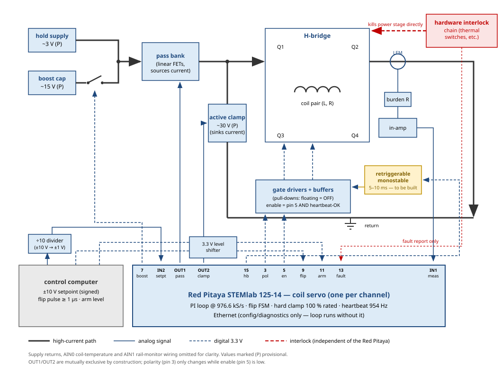
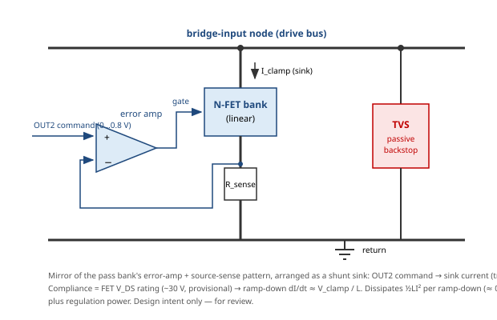

# Coil current servo — interface brief for the power electronics

**Purpose:** what the digital servo (Red Pitaya STEMlab 125-14, one per coil
channel, custom FPGA firmware — commissioned 2026-08-27) does as a black
box, and the requirements it places on the circuits connected to it.
Channels: MOT anti-Helmholtz (100 A rated), X/Y/Z shims (60 A rated).

*Revised 2026-09-08 following circuit-design review (Ben Brown, Harvard):
command-signal convention clarified, coil-parameter table and power
arithmetic added, pass-bank dissipation corrected upward, clamp intent
documented, section 6 questions rewritten.*

## 1. Black-box function

The box measures the coil current as a voltage on one analog input, runs a
PI feedback loop in hardware (FPGA — deterministic, updated every 1.02 µs),
and drives two analog command outputs: one telling the linear pass bank how
hard to *source* current, one telling the active clamp how hard to *pull it
down*. **These outputs are small analog command signals (the board's fixed
±1 V range), not gate drives** — each power stage is expected to close its
own local loop (error amplifier + source-sense) that translates command
volts into gate voltage (section 2). The box also sequences the H-bridge
polarity flips (ramp to zero → open bridge → dead time → toggle polarity →
dead time → close → resume) and enforces the safety rules below in silicon.
A computer connects only over Ethernet for configuration and diagnostics;
if the network dies, the loop keeps running.

*System schematic. Thick dark lines: high-current path; solid blue:
analog signals; dashed blue: 3.3 V digital; red: the interlock chain,
which acts on the power stage directly and only reports to the board.*

## 1b. Capabilities at a glance

Numbers marked (P) are PROVISIONAL — they derive from the coil-parameter
table in section 1c (inductances from coil geometry, resistances pending
Kelvin measurement) with the ~15 V boost rail and the illustrative ~30 V
clamp. Ramp times are t ≈ L·I_rated / V with the stated L and V per row;
the I·R back-off makes ramps *up* slightly slower and ramps *down*
slightly faster than this.

| Channel | Rated current | Resolution (1 ADC count) | Boost ramp 0 → rated (P) | Clamp ramp rated → 0 (P) | Full reversal, electrical (P) |
|---|---|---|---|---|---|
| MOT anti-Helmholtz | 100 A (bipolar) | 15 mA | ~120 µs (16 µH × 100 A / 15 V) | ~55 µs (16 µH × 100 A / 30 V) | ~0.25 ms |
| Z shim | 60 A (bipolar) | 9 mA | ~120 µs (29 µH × 60 A / 15 V) | ~60 µs (29 µH × 60 A / 30 V) | ~0.25 ms |
| X / Y shim | 60 A (bipolar) | 9 mA | ~230 µs (57 µH × 60 A / 15 V) | ~115 µs (57 µH × 60 A / 30 V) | ~0.4 ms |

- **Command clamp at 100 % of rated** (unexceedable in software);
  measurement range extends to 125 % of rated, so overshoot is still seen.
  DC resolution is finer than one count — the loop dithers/averages
  through the quantization (bench: held setpoint to 0.04 %).
- **Loop:** PI at 976.6 kS/s (1.02 µs per correction), ~3.6 µs digital
  latency; target crossover 2–5 kHz; commissioned closed-loop bandwidth
  ≈ 3.5 kHz (loopback), 10–90 % rise 102 µs, ±1 % in 259 µs, no
  overshoot. Spec: settle to 0.1 % in < 1 ms.
- **Ramp shapes:** the loop tracks an arbitrary analog setpoint up to its
  bandwidth — shaped (adiabatic) ramps are programmed at the control
  computer; a setpoint step slews at the physical maximum (boost up,
  clamp down). Snap-off to zero does not open the bridge.
- **Stability:** spec < 0.1 % of rated; bench 17 mA rms / on-target to
  0.04 % (worst-case unfiltered plant). Estimated real-system floor
  ~0.01 %, set by the sensor/burden/setpoint chain, not the servo.
- **Reversal:** explicit-trigger only (≥ 1 µs pulse); ramp to zero →
  ±0.5 A window held ~66 µs → 2 µs bridge-open with 1 µs dead time each
  side of the polarity edge → resume. Chamber eddy settling (unmeasured)
  adds on top of the electrical time.
- **Continuous duty:** indefinite hold at rated current from the servo's
  side; the limits are thermal, outside the board (section 1c power
  budget, section 6 thermal question). Loop runs autonomously in the
  FPGA — network loss changes nothing.

## 1c. Coil parameters, the two rails, and the power budget

**Scope of every number in this document:** all derived figures (ramp
times, dissipations) come from the per-channel table below and name their
channel; the power worked example is the 100 A MOT channel, the worst
case. The commissioning numbers in section 5 are from the bench loopback
with no power stage attached.

### Per-channel coil parameters (PROVISIONAL — Kelvin measurement pending)

| Channel | L (pair) | R (pair) | Rated current |
|---|---|---|---|
| MOT anti-Helmholtz | 16 µH | 6.4 mΩ | 100 A |
| Z shim (Helmholtz) | 29 µH | 11.6 mΩ | 60 A |
| X shim (racetrack) | 57 µH | 14.2 mΩ | 60 A |
| Y shim (racetrack) | 57 µH | 14.2 mΩ | 60 A |

Total loop resistance ≈ coil + 10–15 mΩ of pass bank ballast, bridge, and
cabling. **These values are the blocking unknown** — the PI gains, every
dissipation figure, and the rail sizing check all depend on them; a
four-wire (Kelvin) resistance measurement and an LCR inductance check per
coil are the highest-priority measurements outstanding.

**One clarification from the 2026-09-08 review:** a follow-up email had
quoted "largest coils are 60 µH, 15 mΩ" alongside the 100 A figure. Those
values describe the **X/Y shims (60 A)**, not the MOT channel — the MOT
pair is ~16 µH / 6.4 mΩ. The pairing matters: at 16 µH the 15 V boost
reaches 100 A in ~120 µs, comfortably inside the < 1 ms settling spec.
(An earlier estimate that 30–60 V of boost was needed had paired the shim
inductance with the MOT current — with the correct pairing, ~15 V works
for every channel.)

### Why two rails

- **~3 V hold rail** for continuous operation: sized just above the
  coil's steady-state need at rated current (MOT: 0.64 V coil drop +
  bridge, cable, and pass-element headroom), so the *linear* pass bank
  burns as little as possible on long holds. A higher hold rail would go
  watt-for-watt into the pass bank.
- **~15 V boost rail**, capacitor-fed and switched in by E1 pin 7 only
  during fast ramps: pure L·dI/dt headroom. It exists because on 3 V the
  MOT coil could never ramp fast (dI/dt ≈ V/L caps at ~0.2 A/µs vs
  ~0.9 A/µs boosted).
- **Warning — boost engaged at current:** if the boost is ever held in at
  rated current (stuck switch, manual-mode mistake), the pass bank
  absorbs on the order of (15 V − drops) × 100 A ≈ **1.4 kW** instead of
  ~0.2 kW. The firmware's automatic boost windows last ~100 µs (~0.1 J,
  harmless); the *fault case* is what thermal protection must consider.

### Power dissipation at 100 A CW (MOT channel, worked)

Everything the rail supplies that the coil doesn't dissipate lands on the
power stage — dominantly the pass bank, which as a linear element absorbs
whatever voltage is left over:

| Term | Expression | Assumed value | Power |
|---|---|---|---|
| Total from hold rail | V_rail × I | 3.0 V × 100 A | 300 W |
| Coil pair | I² × R_coil | 100² × 6.4 mΩ (P) | 64 W |
| Bridge (2 conducting FETs) | I² × 2·R_ds(on) | 2 × 0.5 mΩ (P, paralleled) | 10 W |
| Cabling + connections | I² × R_cable | 3 mΩ (P) | 30 W |
| Current sensor | — | LEM is non-contact; no series drop | 0 W |
| **Pass bank (FETs + ballast + sense)** | remainder: (V_rail − ΣI·R) × I | 1.96 V × 100 A | **≈ 200 W** |

With rail tolerance (+5 % → +15 W) and the assumption spread on bridge
and cable resistances, budget the pass-bank assembly for **~200–240 W
continuous** on the MOT channel. *This supersedes the ~120 W in earlier
drafts, which wrongly excluded the ballast/loop resistance that
physically sits inside the pass assembly — review comment confirmed.*
Shim channels, same arithmetic at 60 A on 3 V: 180 W total, 42–51 W in
the coil, roughly 110–130 W on the pass bank.

## 2. Analog interfaces (SMA)

**Convention (important):** the ±1 V range on all four ports is the
STEMlab 125-14's fixed hardware range, not a design choice. OUT1/OUT2
are **low-level command signals, not gate drives** — 0.8 V would not
reach any power FET's threshold, and is not meant to. Each power stage is
expected to contain its own error amplifier and source-sense loop that
servos its output current onto the command.

| Port | Function | Electrical | Requirements on the connecting circuit |
|---|---|---|---|
| IN1 | Measured coil current (the feedback signal) | ±1 V range, 1 MΩ, DC-coupled, 14 bit @ 125 MS/s | LEM secondary → burden resistor → **buffer (instrumentation amp — the burden must not drive the cable or anything else directly; adopted from 2026-09-08 review)** → IN1. **Signed (coil-side)**, scaled so full scale (+1 V) ≈ 1.25 × rated current (rated sits at 80 % of range, leaving headroom to *measure* overshoot; the drive itself is clamped at 100 % of rated). Absolute scale is calibrated in software afterwards — the burden choice only needs to land in the right ballpark. |
| IN2 | Current setpoint from the control computer | same as IN1 | ±10 V analog out through a ÷10 divider. **Must use the same volts-per-amp scaling as IN1** (the loop subtracts them directly), and its sign must track the bridge polarity. |
| OUT1 | Pass bank command ("source this much current") | 0 … +0.8 V full command (into 50 Ω; ×2 if unterminated), 50 Ω source, updated at 976.6 kS/s. Fixed ±1 V hardware range. | **Command input to the pass bank's own error amplifier** — not a gate voltage. 0 V (or below) = fully off; rising voltage = conduct more, with ~0.8 V ≈ rated current at the intended transconductance. **The reference input must treat ≤ 0 V as zero drive and tolerate a small negative resting offset** (measured ≈ −35 mV at DAC code zero on the bench board — raw converters are uncalibrated). |
| OUT2 | Active clamp command ("absorb this much") | same as OUT1 | Same conventions (an inverted-polarity convention is available in configuration if the conditioning chain prefers it). Guaranteed **never active simultaneously with OUT1**, with a small dead-band gap at the handoff. Intended clamp circuit: section 2b. |

*Loop dynamics for context: target crossover 2–5 kHz; commissioned
closed-loop bandwidth ≈ 3.5 kHz on a loopback plant; the digital path
contributes ~3.6 µs of loop latency — the analog chain (gate charge,
source-sense op-amp bandwidth, coil) is expected to set the achievable
bandwidth, not the digital side.*

## 2b. Active clamp — intended circuit (for review, not yet designed)

The clamp has so far appeared only as a box on the schematic; this is the
topology we intend, written down so it can be reviewed rather than
guessed at.

*Intended clamp: mirror image of the pass bank, as a shunt.*

- **Position:** shunt leg from the bridge-input node to return, in
  parallel with a TVS (the passive backstop that needs no working
  electronics).
- **Topology:** N-FET bank with a source-sense resistor and a local error
  amplifier — the same error-amp + source-sense pattern as the pass bank,
  but arranged to *sink* current from the bridge-input node. OUT2 command
  → sink current, i.e. a **transconductance**, which is what the loop
  model and all simulations assume (`clamp_is_voltage_mode = false`).
- **What it does:** during ramp-downs and flips the coil's current
  recirculates through it and it dissipates the stored ½LI² (0.08 J per
  event at 100 A on the MOT pair) plus regulation power; its compliance
  voltage (FET V_DS rating, ~30 V illustrative) sets the ramp-down speed
  dI/dt ≈ V_clamp/L and couples to the bridge FET voltage rating.
- **Status:** design intent only. Section 6 asks for review of exactly
  this.

## 3. Digital interface (E1 header — 3.3 V logic, unbuffered, NOT 5 V tolerant)

| Signal (E1 pin) | Dir | Behavior | Requirements on the connecting circuit |
|---|---|---|---|
| Bridge polarity (3) | out | Static level selecting the H-bridge diagonal; changes only mid-flip, while enable is low | Weak drive (4 mA, slow slew) — buffer locally at the gate-driver board. |
| Bridge enable (5) | out | High = bridge may conduct; low = all four FETs off | **Low, floating, or high-Z must all mean OFF** — the pin is undefined for ~1 s during the board's Linux boot, so the gate driver needs its own pull-down. "Enable low with either polarity = safe non-conducting state" is assumed by the flip logic. |
| Boost enable (7) | out | Switches in the ~15 V boost rail during fast ramps (automatic or manual per config) | Same class as bridge enable (default-off wiring). See section 1c for the boost-at-current fault case. |
| Flip request (9) | in | Rising edge triggers the flip sequence (honored only while armed) | 3.3 V level via level shifter; pulse ≥ 1 µs. Internal pull-down: disconnected = no request. |
| Arm (11) | in | High = servo may enable the bridge and accept flips; losing arm mid-run does *not* drop the bridge | 3.3 V level; internal pull-down: disconnected = disarmed. |
| Interlock fault (13) | in | Report-only: shown to operators/tools. The servo has no path to clear or act on it — enforcement stays in the interlock hardware | 3.3 V level from the interlock chain; either polarity is fine (configurable in software) — please tell us which, and prefer the convention where a broken cable reads as "fault". |
| Heartbeat (15) | out | ~954 Hz square wave, running unconditionally from power-on; **stops only if the FPGA is dead** (verified on the bench, including deliberate kill/recovery) | **Requirement: a retriggerable monostable** (suggest 5–10 ms timeout) that gates bridge enable off when the heartbeat stops, and does not re-enable on its own when it returns. This is the protection against a dead/hung/mid-reprogram controller — it must live outside the Red Pitaya. Needs building; we can discuss ownership. |
| 3V3 (1, 2) / GND (25, 26) | — | Available on the header | All logic referenced to board ground. |

### Field-reversal choreography (contract for the control computer)

IN2 carries the **full signed setpoint** (magnitude and direction), but the
sign does not command a flip — it must *agree with* the bridge polarity that
the flip line has established. To reverse the field from +I to −I, the
control computer does two things:

1. **Pulse the flip request line** (E1 pin 9, ≥ 1 µs). The servo ramps the
   current to zero, verifies it, reverses the bridge with dead time, and
   resumes — ignoring the setpoint throughout (internally forced to zero).
2. **Swap the analog setpoint sign** (+I → −I) any time while the flip is
   in progress.

If the setpoint sign and bridge polarity ever disagree, the hardware cannot
produce that current direction; the servo sits safely at zero and raises
the `sp_sign_mismatch` status flag until they agree — a sequencing mistake
costs field, never hardware. Flips are deliberately *never* triggered by
the setpoint changing sign: a reversal is a disruptive, milliseconds-long
event the experiment must schedule explicitly, not a side effect of a
setpoint ramp passing through zero.

## 4. What the box guarantees (enforced in the FPGA, verified in test + on the bench)

- **Power-on/reset state is fully off:** both analog outputs at code zero,
  all digital outputs low, bridge disabled — before and independent of any
  software.
- **Hard command clamp at 100 % of the channel's rated current** — no
  software state, setpoint, or integrator wind-up can command beyond it.
- **OUT1 and OUT2 are mutually exclusive by construction** (single
  multiplexer; both-active is unrepresentable).
- **The bridge polarity never changes with the bridge enabled:** flips only
  proceed once the measured current has sat inside a zero window (default
  ±0.5 A) for ~66 µs, with 1 µs dead time (configurable) on each side of
  the polarity edge. A flip that cannot reach zero parks safely (bridge
  closed, servoing to zero) and waits for operator acknowledgment. Scope
  capture of the sequence available.
- **Software "off" is a graceful ramp-to-zero**, never an instantaneous
  bridge drop at current.
- Network/computer loss changes nothing: the loop holds its last
  configuration; protection is the heartbeat/monostable plus the interlock
  chain.

## 5. Commissioned performance (bench, loopback plant, 2026-08-27)

- Closed loop: 10–90 % rise 102 µs (≈ 3.5 kHz), settled to ±1 % in 259 µs,
  no overshoot, on-target to 0.04 %.
- Built-in swept-sine transfer-function measurement validated: magnitude
  flat to 0.3 % over 100 Hz – 100 kHz, instrument phase error equivalent to
  139 ns — plant measurements will be limited by the plant, not the
  instrument.
- Raw converter calibration measured (gain ≈ +2 % class per converter path,
  DAC zero ≈ −35 mV); absolute amps-per-volt is calibrated per channel in
  software.

## 6. Questions for review

Rewritten 2026-09-08: each item now states what we intend and why, then
asks a specific question. Items marked ✓ were addressed in the 2026-09-08
review.

1. **Burden resistor (✓ arithmetic confirmed; buffer recommendation
   adopted into the IN1 spec).** Intent: LEM LF 310-S at 2000:1 puts
   50 mA on the secondary at 100 A; a 10 Ω burden gives 0.5 V, 16 Ω gives
   0.8 V (the preferred ~80 % of the ±1 V input range). Remaining
   question: *given the LEM's compliance against its ±15 V supplies, is
   16 Ω safe across the full range, or does it cost linearity near full
   scale — which value would you pick?*
2. **Pass bank.** Intent: a linear MOSFET bank with ballast and a local
   error amplifier + source-sense loop, so that OUT1's 0…0.8 V command
   maps to 0…rated current (a transconductance of ~125 A/V for the MOT
   channel). Questions: *does the internal-loop architecture hold up at
   ~200–240 W continuous (section 1c)? What transconductance and
   small-signal bandwidth will the design provide? How will the input
   behave for commands ≤ 0 V and in the −50…0 mV region (our resting
   offset)?*
3. **Active clamp.** Intent: section 2b — shunt transconductance sink,
   error-amp + source-sense like the pass bank, TVS in parallel,
   compliance ~30 V. This is our design decision to make; what we ask
   for is review. Questions: *does the topology hold up? What compliance
   voltage would you rate it for (it sets ramp-down speed and couples to
   the bridge FET V_DS rating)? Is the intended stage safe for repeated
   ½LI² dumps (~0.08 J/event) plus regulation duty?*
4. **Gate-driver logic.** Questions: *what logic thresholds do the
   enable/polarity inputs need, do floating inputs default to off (our
   boot-time requirement), and will you buffer our weak 3.3 V / 4 mA
   outputs locally?*
5. **Interlock fault line.** Question: *what polarity and level will the
   interlock chain output on the fault-report line (we prefer broken
   cable = "fault")?*
6. **Thermal protection.** Context (updated numbers, section 1c): 64 W
   in the MOT coil pair and **~200–240 W in the pass bank** at 100 A CW;
   the boost-stuck-at-current fault case is ~1.4 kW. The interlock chain
   currently has no thermal input. Questions: *can thermal switches go on
   the coil and the pass-bank heatsink in the interlock chain — what
   type, thresholds, and mounting? Is the pass bank heatsink design sized
   for the corrected continuous figure?*
7. **Heartbeat monostable.** Questions: *who builds it, and what timeout
   (we suggest 5–10 ms)?*
8. **Rails.** Intent: ~3 V hold / ~15 V boost per section 1c. Questions:
   *do these values hold given the corrected drop budget? What does the
   boost switch expect from our pin 7 output? How is the boost cap sized
   and how fast does it recharge (limits ramps per shot)?*

*Full technical record: [docs/design.md](design.md) (loop design, every
number) and [docs/lab_notes_2026-08-27.md](lab_notes_2026-08-27.md)
(commissioning data and scope captures).*
