<!-- Generated from the live log page used during the session (logs/testlog/test3_log.html on the lab PC; logs/ is not in git). Narrative lab notes: docs/lab_notes_2026-11.md. -->

# Test 3 Bench Log — MOT coil servo on the bench supply

Day 2 · 2026-11-12 · profile `mot_bench` · 3 A current-limited bench supply at 5 V · one temporary test coil (12 turns, ≈ 45 µH) · firmware register map rev 4, commit 103a127 · updated live during the session

## Status

| Test | Why | Status | Result in one line |
|---|---|---|---|
| Bring-up | Load firmware and bench settings, re-zero | [done] | Clean; deploying trips the safety latch (reset after every deploy) |
| 3c IN1 current scale | Board must read amps correctly | [done] | `in1_fs_volts` = 1.12 V → 224 A full scale |
| 3d PI gain tuning | Fast, stable closed loop | [done] | kp 31.2 counts/A, ki 942 counts/(A·ms); ×2 more oscillates at 21 kHz; 2.5 A step +2.8 %; bench limit lowered to 2.2 A because of the ringing |
| 3e Over-current trip | The current limit of the MVP | [passed] | Fires at ≈ 2.85 A (set 2.79 A), before the 3 A supply limit |
| 3f Turn-off path | Freewheel vs TVS, turn-off time | [done] | Freewheel through the bridge body diode; slope set by the coil's L |
| 3g Flips + dead time | Polarity change at zero current, no shoot-through | [passed] | Flips only inside the zero window; enable low 1 µs each side |
| 3h Heartbeat-latch trip | Hardware safety path at current | [passed] | Bridge opens at 2 A, current gone in ≈ 10 µs; rail spikes +2.5–3.2 V for ≈ 10 µs |
| 3i Hold noise, dither on/off | Steady-hold stability vs 0.1 % spec | [done, open finding] | Average stable to 0.01 %; dither makes no difference on the bench; hold noise dominated by a 10–20 kHz ringing of the pass bank with the coil (±0.15 A), not from the loop |
| Extra: range, long hold, flips | Gains over 0.5–2.2 A, drift, flip reliability | [passed] | No trips; 10 min hold stable within 0.5 mA after warm-up; 20/20 flips |
| 3j Uncooled duty test | Heating limit without water | [moved] | Moved to the 100 A build (≤ 15 W on the bench) |
| Damper test | Does 3.2 Ω + 10 µF across the coil stop the ringing? | [passed] | Yes: ringing 43–124 mA → 2.5–5 mA with the coil lifted; 2 A hold 100 µs noise 6.5 mA rms |

## Setup

### Power and wiring

- Bench supply 5 V, 3 A limit, **floating** (no earth links; system earthed only through the scope).
- One test coil, 12 turns of 4 × 2 mm hollow Cu, racetrack 70 × 210 mm, lifted 13–15 cm off the optical table (from 3f on).
- OUT1 → 50 Ω terminator → OPA994 gate stage (gain 7.93) → 6-FET pass bank.
- Arm and flip requests from software (pulses of the `dio_invert` setting); arm jumper out.

### Scope (Rigol DHO914 "test", all ×1 BNC)

- CH1: IN1 tee (5 mV per amp: LEM 2000:1 into 10 Ω).
- CH2: drain bar (3f) → DIO1 bridge enable (3g dead time).
- CH3: bridge node A.
- CH4: DIO1 → pass-bank gate (3f) → DIO0 polarity (3g).

## Bring-up [done]

**How.** `deploy mot_bench` loads the bitstream (the FPGA configuration) and the bench settings, `check mot_bench` verifies them (LED 7 lit), `zero mot_bench --write --apply` measures the input offsets with no current flowing.

Offsets: IN1 +0.256 A, IN2 +0.157 A, within one ADC count of day 1.

**Finding:** the first closed-loop step gave no current and no amber light. Loading the FPGA pauses the heartbeat, so the logic-board latch trips. **Reset the latch after every deploy** (servo stopped, heartbeat green).

## 3c · IN1 current scale [done]

**Why.** The firmware works in raw ADC counts; the Red Pitaya's own input calibration is not applied, so each board reads slightly off. Day 1 found IN1 reading ≈ 10 % low (provisional, ±3 %).

**How.** Closed-loop hold at 2 A for 60 s; compare the board's reading with the bench supply's ammeter (reference) and with the scope on the IN1 tee.

| Board (FPGA) | Bench supply ammeter | Scope, IN1 tee | OUT1 command |
|---|---|---|---|
| 1.988 A | 2.02–2.03 A | 2.086 A (reads ≈ 3 % high) | 3942 counts, steady |

**Result:** `in1_fs_volts` 1.10 → **1.12 V** (IN1 volts at the full-scale ADC code; nominal 1.0). Full scale IFS = 224 A, 27.3 mA per count. Agrees with day 1's first ammeter estimate (1.118). Committed d70a45d6.

## 3d · PI gain tuning [done]

**Why.** The loopback gains do not fit the real plant. Near threshold the pass bank gives only ≈ 0.008 A per OUT1 count (day 1 scan), versus 0.136 A/count in the 100 A model.

**How.** Closed-loop 1 A steps (`step mot_bench --amps 1`, 16.8 ms capture at 1 µs per sample), starting at ¼ of the gains computed from the measured slope and doubling kp and ki together while the step stays clean.

| kp (counts/A) | ki (counts/(A·ms)) | 90 % rise | 98 % settle | Hold noise (rms) | Verdict |
|---|---|---|---|---|---|
| 15.6 | 471 | 1.41 ms | 1.85 ms | 40 mA | clean, slow |
| **31.2** | **942** | 0.73 ms | 1.04 ms | 40 mA | **chosen** |
| 62.4 | 1884 | 0.38 ms | 0.53 ms | 86 mA | oscillates at 21 kHz |
| 31.2 (2 A step) | 942 | 0.45 ms | 0.65 ms | 54 mA | clean, +1 % overshoot |

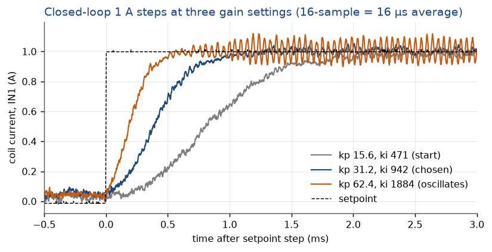

*Rise speeds up with each doubling; the highest setting rings during the hold.*

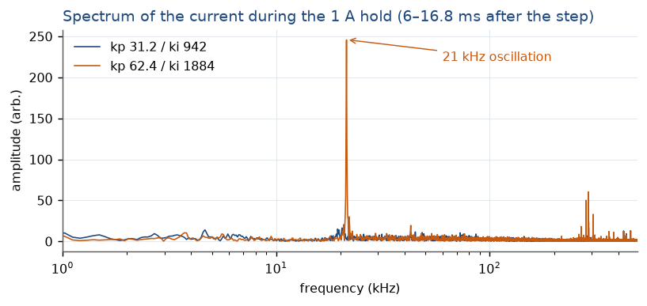

*At ×4 a sharp 21 kHz line appears: the loop is at its stability limit. The ≈ 290 kHz floor is ADC noise.*

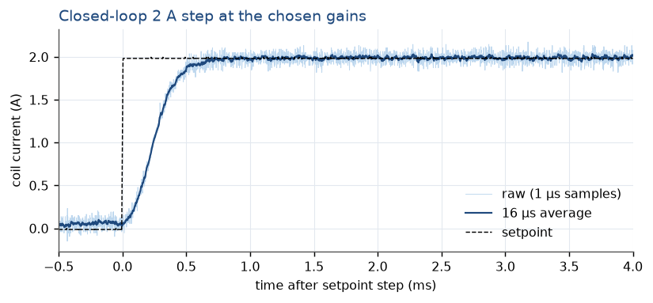

*The bank's gain rises with current, so the margin is smallest at the top of the range: still clean at 2 A. Re-check at 2.5 A.*

**Result:** gains set at half the oscillation limit (gain margin ≈ 2). These are bench values; the 100 A plant has ~17× more gain per count and needs its own tuning.

**Open point (found in 3h):** a single jump from 0 to 2.5 A overshoots past the 2.79 A trip level, and the trip ends the run. The tuning was done at 1 A and checked at 2 A, where it was clean. Two effects can push 2.5 A over the edge, and the second was found only later (3i):

1. The pass bank's gain (amps per OUT1 count) grows with current, so the same PI gains act harder at 2.5 A and damp less; 2.5 A leaves only 0.29 A of margin to the trip.
2. The 2.5 A step was taken with the coil lifted off the table, where the coil rings at ≈ 12 kHz by itself with ≈ ±0.12 A (3i). That ripple alone uses up much of the 0.29 A margin.

**Closed:** repeated with the coil on the table, the 2.5 A step did not trip: overshoot +2.8 %, 98 % in 0.59 ms. The ringing was there too (11.5 kHz, 128 mA rms), and 28 single samples exceeded 2.79 A (a trip needs 4 in a row). So the gains are fine; the near-trips come from the ringing on top of a 0.29 A margin. **Bench `I_rated` lowered 2.5 → 2.2 A** (peaks then ≈ 0.45 A below the trip).

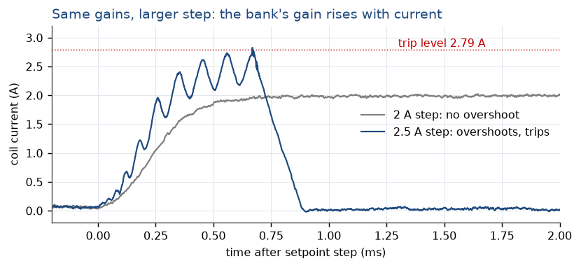

*At 2 A the current approaches the setpoint from below; at 2.5 A it keeps rising toward the trip level, and the trip ends the run at ≈ 0.6 ms.*

## 3e · Over-current trip [passed]

**Why.** In the MVP the firmware trip is the current limit: |IN1| above `trip_level` for 4 samples sets both DACs to zero, lets the coil freewheel, opens the bridge and latches TRIPPED.

**How.** Temporarily `I_rated` = 2.9 A (the step tool refuses targets above it), closed-loop step to 2.9 A. Trip set to 2.79 A, 0.21 A below the supply's 3 A limit so it fires first. Then `trip_ack`, stop, restore 2.5 A.

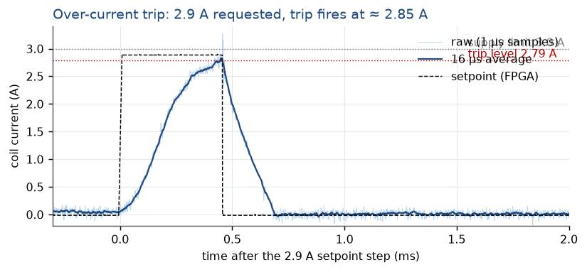

*The current rises toward 2.9 A, trips at ≈ 2.85 A (1 µs samples), and freewheels to zero in ≈ 225 µs. The spikes at the trip are switching pickup, not current.*

**Result:** state TRIPPED, bridge open, supply CC lamp stayed off. Acknowledged and back to IDLE without a power cycle.

## 3f · Turn-off path [done]

**Why.** With the bridge kept closed, the coil current should freewheel through the bridge body diodes (drain bar ≈ rail + one diode drop). The alternative is the bank's TVS (drain ≈ 13 V). The trip's 225 µs decay was ≈ 7× slower than the model's 30 µs.

**How.** Hold ≈ 1.5 A in open loop (OUT1 = 3900 counts), then OUT1 → 0 at once. Scope triggered on the falling current; the gate on CH4 shows whether the bank itself switches off slowly.

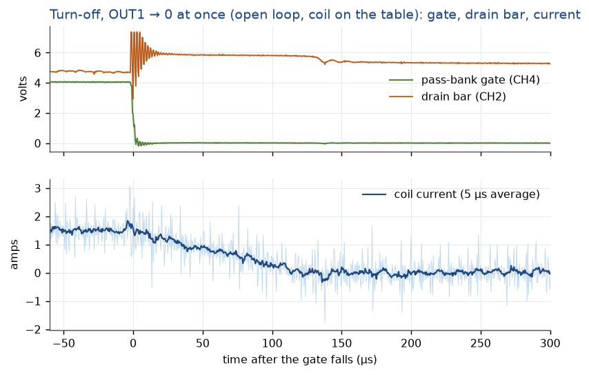

*The gate falls in ≈ 4 µs. The drain bar jumps to ≈ 5.9 V (with brief ringing to 7.4 V) and stays there exactly as long as current flows, then drops. The current ramps down linearly.*

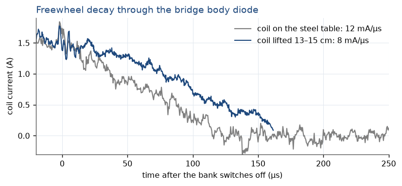

*Lifting the coil off the steel table made the decay slower, not faster: the table's eddy currents had been absorbing part of the energy.*

**Result:** freewheel through the bridge body diode, confirmed; the TVS is never reached. The gate stage is not the cause of the slow turn-off.

**Why it is slow:** the test coil has 12 turns. From its geometry (Neumann integral, scaled N2) L ≈ 45 µH, not the 9 µH in the bench model. Slope = Vcoil/L: 8.1 mA/µs × 45 µH ≈ 0.37 V, a plausible diode drop at ≈ 1 A. Bench model to be updated. The MOT pair's 16 µH (Radia) is unaffected.

**Side finding:** leakage of the warm bank at the RUN floor is small: 45–60 mA at 3450 counts, 66–76 mA at 3500, 98–117 mA at 3550.

**Not measured:** the voltage across the coil (node B is not probed), so 45 µH is calculated, not yet measured.

## 3g · Flips and dead time [passed]

**Why.** A flip must ramp the current into the zero window, drop bridge enable, change polarity, and re-enable. The enable-low window is the only shoot-through protection; the logic board adds no dead time.

**How.** Closed loop at ±2 A; flip request from software. Arm must stay *high* for flips to be accepted, so the arm input was held inverted during the test. After each flip the host re-signs the setpoint.

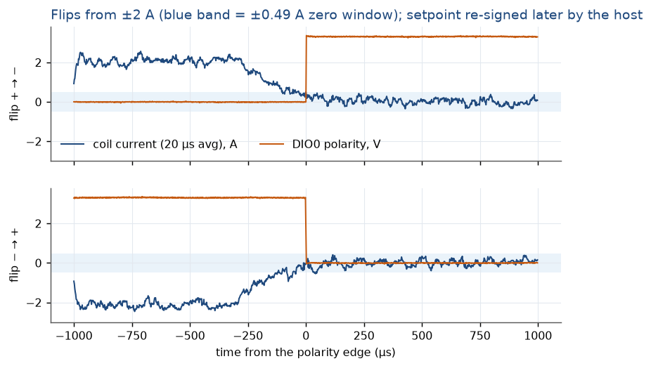

*The current ramps from ±2 A into the ±0.49 A window in ≈ 300 µs, then the polarity changes. Afterwards the board sits at zero until the setpoint sign matches.*

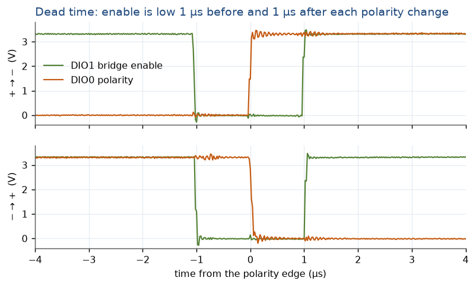

*Enable drops 1.02–1.04 µs before the polarity edge and returns 0.98–1.02 µs after it: the 125 × 8 ns setting.*

**Result:** +2 → −2 → +2 A with no timeout and no trip; current at the polarity edge +0.13 A and −0.29 A.

**Side finding:** the dashboard's software-arm button gives only an edge, so flips after it are ignored. It needs a "hold arm" mode for bench flip tests (passed to the dashboard session).

**Still open:** the bridge FETs' gate voltages during a flip (needs a floating probe), to see the dead time at the FETs rather than at the Red Pitaya pins.

## 3h · Heartbeat-latch trip at current [passed]

**Why.** The logic board's heartbeat latch is the only automatic hardware trip. Opening the bridge at current pushes the coil's energy back into the supply (here ½LI2 ≈ 90 µJ at 2 A); on the SE-600-5 the same event (≈ 0.08 J) is the open over-voltage question.

**How.** Hold 2 A in closed loop (2.5 A tripped the firmware first, see 3d), scope armed on the drain bar falling, pull the DIO6 heartbeat wire (E1 pin 15). The script stops the servo as soon as it sees the current collapse. Recovery: servo stopped (IDLE), re-plug DIO6, wait for green, press the latch reset.

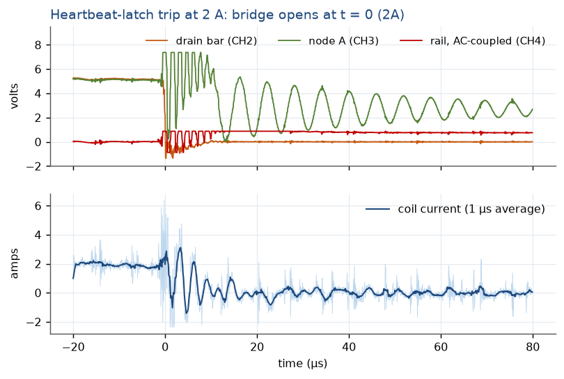

*With all four bridge FETs off, the coil current returns to the supply through three diodes: up from ground through the pass-bank body diodes (drain bar ≈ −0.5 V), through Q4 and Q1's body diodes into the rail. Afterwards node A rings at ≈ 170 kHz. The rail trace (AC-coupled, 0.2 V/div) clips at +0.87 V.*

**Result:** bridge opened the moment DIO6 was pulled; 2 A → 0 in ≈ 10–13 µs, as expected for ≈ 6.7 V across 45 µH.

**As predicted:** with the bridge open the PI saw zero current and drove OUT1 to the clamp (4100 counts) until the script stopped it. This is why the servo must be stopped before pressing the latch reset.

**Rail, first capture:** clipped at +0.87 V (0.2 V/div), so repeated at 0.5 V/div over 200 µs:

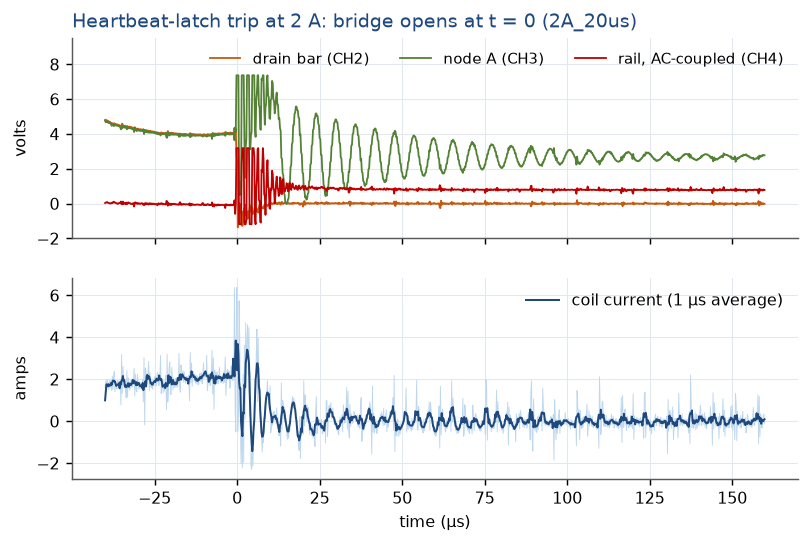

*Repeat at 2 A. The rail spikes by +2.5 V (1 µs average; +3.2 V peak samples) for ≈ 10 µs while the coil current is pushed back into the supply, then sits ≈ 0.85 V higher.*

**Spike, +2.5 to +3.2 V for ≈ 10 µs:** the returned current through the bench supply leads' inductance. This is the bench preview of the SE-600-5 question; the real numbers need the 100 A setup with 4/0 cable.

**Plateau, ≈ +0.85 V, slow:** most likely not stored energy (that would need an output capacitor of only ≈ 20 µF) but the lead resistance. At 2 A the rail bar sits ≈ 0.85 V below the supply's setting (≈ 0.4 Ω of leads and contacts) and returns when the load vanishes. To confirm: DC rail reading at 2 A and at 0 A.

## 3i · Hold noise, dither on/off [done, open finding]

**Why.** The spec is a steady hold within 0.1 %. One OUT1 count moves the bench current by ≈ 0.008–0.14 A, so the firmware dithers OUT1 (switches it ±1 count very fast so the average falls between counts). This test compares the hold with dither on and off.

**How.** Closed-loop 2 A hold; four 16.8 ms current records (1 µs per sample) plus 4 s of slow readings, dither on, then off. DC readings of the rail at the hold and at zero current.

| Run (coil lifted) | Current noise, 1 µs samples | 100 µs averages | Spectrum |
|---|---|---|---|
| Dither on, chosen gains | 165 mA rms | 15 mA rms | strong line at 11 kHz |
| Dither off, chosen gains | 164 mA rms | 15 mA rms | same line |
| Dither on, half gains | 162 mA rms | 11 mA rms | same line, same height |

The noise was 4× this morning's (40–54 mA rms), so the source was tracked down instead:

| Open loop, OUT1 fixed at 3935 (≈ 1.93 A) | Current at 10–12 kHz | Drain bar at 12 kHz | Gate at 12 kHz |
|---|---|---|---|
| Coil lifted | ±116 mA | ±467 mV | ±0.1 mV |
| Coil on the table | ±31 mA | ±67 mV | ±0.1 mV |
| Coil lifted, varistor removed | ±165 mA | ±494 mV | — |

**Finding:** the ringing is not the control loop (it stays with half the gains and in open loop) and not the gate stage (the gate does not move at 12 kHz). With the bank's gate fixed, its current is fixed, so the 12 kHz current must circulate in a loop that bypasses the bank: the coil with a capacitance of ≈ 4 µF across it (45 µH and 12 kHz). In free air the coil loses little energy per cycle (Q ≈ 100) and noise keeps it ringing; on the table the eddy currents absorb the energy.

**Checked and ruled out:** there is no capacitor on the H-bridge; the only part across the coil was a varistor (Digi-Key 495-6502-ND). With it removed and the coil still lifted, the 12 kHz ringing is unchanged (current ±0.17 A, drain ±0.49 V). So it is not a passive resonance with a capacitor: the bank's current must be responding to its own drain voltage, which makes the stage an oscillator together with the coil's inductance.

**Also ruled out:** the drain swing coupling back onto the gates (Miller effect). CH4 was on a pass-FET gate pin, and that gate is steady to ±0.1 mV during the ringing.

**Nothing bypasses the bank:** the ballast resistors could not be probed, but the rail ripple measures the supply current. Rail ±0.059 V vs current ±0.207 A, lagging by 233°, is exactly the supply leads (0.17 Ω, matching the 0.2 Ω measured at DC, plus ≈ 3.6 µH). So supply, bank and coil carry the same oscillating current, while the bank's gate stays fixed: the bank changes its current by itself, through its drain voltage and/or die temperature.

| Open loop, coil lifted | Current | Frequency | Current swing | Drain swing (p-p) |
|---|---|---|---|---|
| OUT1 3800 | 0.71 A | 20 kHz | ±0.08 A | 1.64 V |
| OUT1 3870 | 1.23 A | 15 kHz | ±0.11 A | 1.64 V |
| OUT1 3935 | 1.93 A | 11.5 kHz | ±0.15 A | ≈ 1.6 V |

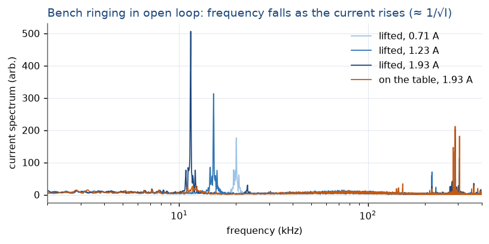

*Lifted: one sharp line that moves down as the current rises. On the table at 1.93 A: no line in open loop.*

**Pattern:** frequency ∝ 1/√I (f·√I ≈ 16–17), and the drain swing is always ≈ 1.6 V p-p: the oscillation grows until the drain reaches rail + one diode drop, where the bridge freewheel diode clamps it.

**Coil on the table, closed loop at 2 A (later):** the line is back at 13.6 kHz, 110 mA rms, so the table only damps it marginally (position, current and temperature decide).

**Dither:** on vs off makes no difference (110 / 110 mA rms; 100 µs averages 20.6 / 19.9 mA). Expected on the bench: near 2 A one OUT1 count is only ≈ 8 mA. The dither test belongs to the 100 A plant (≈ 0.14 A per count).

**Average current:** the means of four 16.8 ms records agree to ±0.2 mA (0.01 %), well inside the 0.1 % spec.

**Why it matters:** a similar ringing on the MOT would put a few-percent field ripple at 10–20 kHz, far above the loop's bandwidth. Needs understanding before the 100 A build (FET data near threshold; try an RC damper across the coil or a drain-bar snubber).

**DC rail:** 5.06 V at zero current, 4.65 V at 2 A: the supply leads and contacts drop 0.41 V (≈ 0.2 Ω), about half of the 0.85 V plateau seen in 3h.

## Extra bench tests (second session) [done]

**Why.** While the damper was being soldered: check the chosen gains over the whole bench range, the long-term stability of a hold, and flip reliability. Coil flat on the table, kp 31.2 / ki 942, limit 2.2 A. Run by a second Claude session that held the board meanwhile.

| Step | 10 / 90 / 98 % | Overshoot (64 µs avg) | Hold noise (1 µs) |
|---|---|---|---|
| 0 → 0.5 A | 0.18 / 1.08 / 1.36 ms | +37 mA | 69 mA rms |
| 0 → 1.0 A | 0.08 / 0.72 / 0.95 ms | +25 mA | 64 mA rms |
| 0 → 1.5 A | 0.12 / 0.55 / 0.70 ms | +30 mA | 74 mA rms |
| 0 → 2.0 A | 0.10 / 0.46 / 0.62 ms | +28 mA | 85 mA rms, faint 13.8 kHz line |
| 0 → 2.2 A | 0.08 / 0.44 / 0.63 ms | +41 mA | 83 mA rms, no sample above the trip |
| 2.2 → 1.0 A | 0.01 / 0.24 / 0.34 ms | 27 mA past | 63 mA rms |
| 1.0 → 0 A | 0.01 / 0.68 / 1.22 ms | 32 mA past | ends at 18 mA (floor leakage) |
| 2.0 → 0 A | 0.02 / 0.47 / 1.49 ms | 40 mA past | ends at 14 mA |

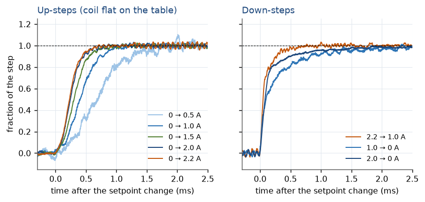

*Up-steps get faster with current (the bank's gain rises with current); the 0.5 A step is the slowest. Down-steps drop fast at first, then approach the target as the integrator unwinds.*

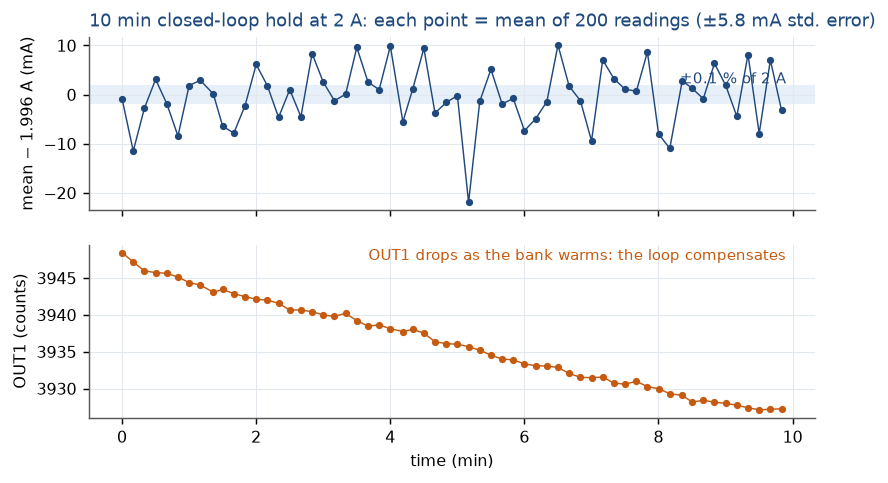

*The point-to-point scatter (6.1 mA) equals the statistical error of each point, so no drift is visible above it; window means after the first minute agree within 0.5 mA. Over the same 10 min OUT1 fell by 21 counts: at fixed gate the warming bank would have drifted by ≈ 0.2 A, and the loop removed it.*

**Steps:** overshoot is at the noise level everywhere (25–41 mA, against 56–77 mA p-p hold noise in 64 µs averages); no trips. The gains hold across 0.5–2.2 A.

**Long hold, 2.0 A for 10 min:** mean 1.9958 A; fitted drift +0.19 mA/min; window means 1.9925 (first minute, warming up), 1.9959, 1.9964, 1.9962 A, i.e. stable within ≈ 0.5 mA (0.025 %) after the first minute. Each point resolves only ±5.8 mA, so a per-point 0.1 % check needs longer averages.

**Flips, 20 at ±1 A:** 20 of 20 good, no TIMEOUT_HOLD, no trip; current after re-signing ±1.003–1.025 A; request → RUN in the new polarity ≈ 1.1 ms (host-timed, includes polling).

## Damper test [passed]

**Why.** If the 10–20 kHz ringing (3i) is a weakly damped oscillation of the bank together with the coil, a resistor across the coil at those frequencies should remove its energy each cycle. A capacitor in series keeps the resistor out of the DC path.

**How.** 1 Ω + 2.2 Ω (1/4 W metal film) in series with 10 µF (non-polarized) across the coil terminals, next to the varistor; sized so the damper's ≈ 3.2 Ω matches the coil's impedance at 12 kHz (≈ 3.4 Ω). Coil lifted onto the box (the condition where it rang reliably). The same open-loop captures at three currents, then a closed-loop 2 A hold.

| Open loop, coil lifted | Strongest line 5–30 kHz, no damper | With damper | Drain ripple, no damper → damper |
|---|---|---|---|
| OUT1 3800 (≈ 0.7 A) | 43 mA at 20 kHz | 2.5 mA (noise) | 328 → 107 mV rms |
| OUT1 3870 (≈ 1.2 A) | 76 mA at 15 kHz | 2.8 mA (noise) | 326 → 71 mV rms |
| OUT1 3935 (≈ 1.9 A) | 124 mA at 11.5 kHz | 4.9 mA (noise) | 366 → 63 mV rms |

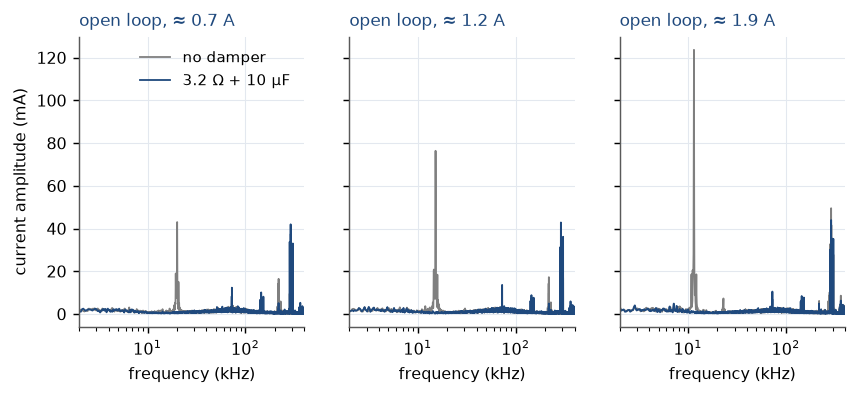

*The sharp ringing line disappears at every current. What remains is the ADC noise near 290 kHz and a small new line at ≈ 72 kHz (≈ 10–14 mA), probably the damper's capacitor with its wiring.*

**Result:** the damper removes the ringing completely in free air. Closed-loop 2 A hold, coil lifted: 75 mA rms in 1 µs samples (ADC noise), **6.5 mA rms in 100 µs averages** (15–21 mA before), record means identical to 0.1 mA.

**For the MOT build:** plan an RC damper across the coil pair, sized for the pair (16 µH): R ≈ ωL at the expected ringing frequency, C large enough to pass it, and the resistor rated for the pulses at 100 A (heartbeat trip, flips). Confirm on the real coils.

## Open items

- ~~Bench model: coil L 9 → ≈ 45 µH; lab notes for day 2; bench doc recovery fix.~~ Done, commit 8edac7cc.
- Design the RC damper for the MOT pair (16 µH, pulse rating at 100 A); check the 72 kHz line it introduces.
- Optional: node B probe or LCR meter to measure the test coil's L.
- **Bench ringing at 10–20 kHz (3i):** understand the mechanism (FET behaviour near threshold) and test a damper across the coil before the 100 A build.
- 3j uncooled duty test.
- Gate-voltage check of the bridge FETs during a flip (floating probe).
